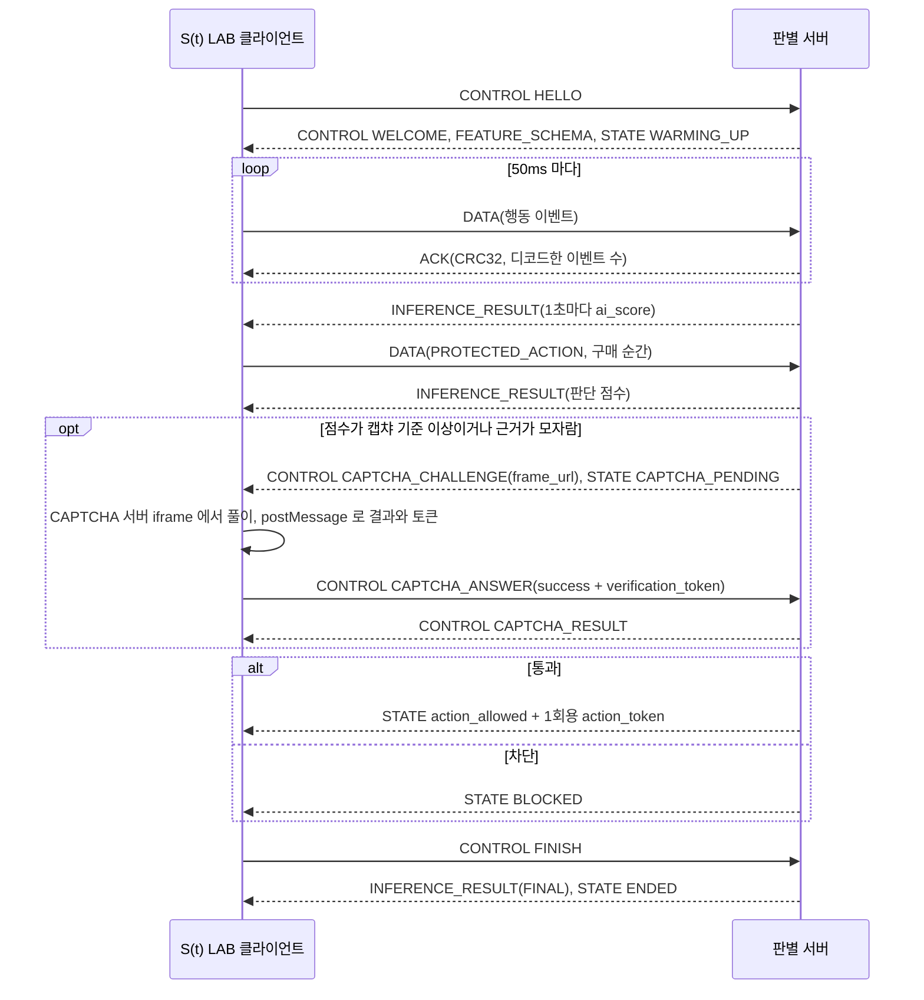

# actveri-protocol

ACTVERI 의 행동 검증 프로토콜 AVP/1 규격과, 그 규격을 바이트 단위로 지키는 TypeScript, Python 코덱이 있는 레포입니다. 두 코덱은 같은 골든 벡터를 통과하고, 서로 만든 프레임을 읽어 같은 결과를 냅니다.

AVP/1(Action Verification Protocol)은 S(t) LAB 클라이언트와 판별 서버가 WebSocket 바이너리 프레임으로 행동 이벤트, 판별 점수, 상태와 제어 메시지를 주고받는 규격입니다. 현재 판은 v0.3.2 입니다.

## 이 레포가 하는 일

- 규격서: `docs/avp1-protocol.md` 가 AVP/1 의 정본입니다. 프레임, 이벤트, 세션 규칙, 오류 코드, 골든 벡터가 모두 여기에 있습니다.
- TypeScript 패키지(`ts/`): 코덱, Protocol Client 상태 기계(`Session`), 브라우저 수집기, WebSocket 연결, `createActveri()` SDK 입니다. `pnpm build` 가 의존성 없는 ESM 번들 하나(`ts/dist/actveri.js`)를 만듭니다.
- Python 참조 코덱(`py/`): 표준 라이브러리만 씁니다. 시험용 가짜 서버(`actveri-server/mock`)가 이 코덱을 그대로 가져다 씁니다.
- 골든 벡터(`test-vectors/`): 두 코덱이 함께 읽는 계약입니다. hex 와 디코드 JSON 이 짝으로 들어 있습니다.
- 차등 퍼저(`tools/fuzz/`): 이상한 입력을 두 디코더에 함께 넣어 결과가 갈리는 곳을 찾습니다.

## 왜 바이너리인지

판별 서버는 1초마다 점수 메시지를 보내고, 클라이언트는 50ms 마다 행동 이벤트를 묶어 보냅니다. 같은 내용을 JSON 텍스트로 보내면 키 이름과 숫자 글자가 매번 선로에 실립니다. AVP/1 은 고정 헤더, 정수 코드, varint, 시각 차이로 같은 정보를 더 적은 바이트에 싣습니다.

| 점수 메시지 1개 | 크기 |
|---|---|
| AVP/1 바이너리(헤더 24B + 본문) | 36~40B |
| 같은 내용을 JSON 본문(`{"w":12,"s":2000,"e":12000,"n":400,"p":0.4321}`)으로 실은 경우 | 64~72B |

위 숫자는 실제 선로에서 잰 값이 아니라 계산값입니다. 90초 세션에서 1초마다 최근 10초 윈도우 점수를 낸다고 두고, 윈도우 이벤트 수 20, 400, 1,800 과 점수 소수 넷째 자리로 `py/avp1` 인코더가 만든 바이트 수를 셌습니다. 대시보드 연결을 위해 이벤트 번호 범위까지 싣는 MVP 점수 메시지는 골든 벡터 TV9 처럼 38B 입니다.

전송량, 지연, CPU 를 같은 조건에서 JSON 과 비교한 측정은 아직 없습니다. 측정 방법은 규격서 'JSON 기준선 벤치마크' 절에 있습니다. 바이너리 형식은 판별 정확도를 높이지 않고, 프레임 무결성이 사람임을 증명하지도 않습니다.

## 24바이트 헤더

모든 프레임은 아래 헤더로 시작합니다. 다중 바이트 정수는 리틀 엔디언이고, WebSocket 메시지 하나에 프레임 하나를 담습니다.

| 오프셋 | 크기 | 필드 | 값 |
|---:|---:|---|---|
| 0 | 2B | Magic | `0x41 0x56` (ASCII "AV") |
| 2 | 1B | Version | 메이저 버전 `0x01` |
| 3 | 1B | Message Type | DATA, ACK, CONTROL, INFERENCE_RESULT, MODEL_INPUT, STATE, ASSET_CHUNK |
| 4 | 2B | Flags | 비트0 `RETRANSMIT`, 1 `FINAL`, 2 `HAS_CHECKPOINT`, 3 `ACK_REQUESTED`, 4 `TRUNCATED` |
| 6 | 2B | Event Count | DATA 는 이벤트 수, 나머지는 0 |
| 8 | 4B | Sequence | 보내는 쪽 프레임 번호. ACK 는 누적 확인 번호 |
| 12 | 8B | Timestamp | 보내는 쪽 시계의 세션 기준 µs |
| 20 | 4B | Payload Length | 헤더 뒤 바이트 수 |

## 메시지 흐름

한 세션은 아래 순서로 흐릅니다. 구매 같은 보호 행동의 판단과 집행은 서버가 하고, 클라이언트가 만든 값은 대조용으로만 씁니다.



1. HELLO 와 WELCOME 으로 세션을 엽니다. WELCOME 이 묶음 간격, 윈도우, 캡챠 기준, 차단 기준을 알립니다.
2. 클라이언트는 행동 이벤트를 DATA 로 묶어 보내고, 서버는 버퍼에 넣은 뒤 받은 프레임의 CRC32 를 담은 ACK 를 돌려줍니다.
3. 서버는 1초마다 최근 10초 윈도우로 `INFERENCE_RESULT` 를 보냅니다. 이 점수는 화면에만 쓰입니다.
4. 구매 버튼을 누르면 `PROTECTED_ACTION` 이벤트가 바로 나가고, 서버는 그때까지 받은 근거 전체로 한 번 판단합니다. 결과 `STATE` 에는 그 행동의 `action_event_seq` 가 실립니다.
5. 점수가 캡챠 기준 이상이거나 근거가 모자라면 서버가 CAPTCHA 서버에 챌린지를 만들고 iframe 주소를 `CAPTCHA_CHALLENGE` 로 보냅니다. 클라이언트는 그 주소를 그대로 iframe 으로 열고, iframe 이 준 결과와 1회용 토큰을 `CAPTCHA_ANSWER` 로 전합니다. 궤적 판정은 CAPTCHA 서버가 하고, 판별 서버는 토큰을 CAPTCHA 서버에 1번 확인(consume)한 뒤 `CAPTCHA_RESULT` 를 보냅니다.
6. 통과면 `STATE` 에 1회용 `action_token` 이 실리고, 행동 완료는 이 토큰을 서버에 확인한 쪽만 인정합니다. 캡챠 실패나 차단 기준 이상이면 `STATE` `BLOCKED` 입니다.
7. 클라이언트가 `FINISH` 를 보내면 서버는 세션 전체 점수(`FINAL`)와 `STATE` `ENDED` 를 보내고 닫습니다.

## 빠른 실행

Node 22, pnpm, Python 3.11 이상, pytest 가 필요합니다. 명령은 레포 최상위에서 시작합니다.

```bash
cd ts && pnpm install && pnpm test && pnpm typecheck && pnpm build
cd py && python -m pytest -q
python tools/fuzz/fuzz.py --total 2000
```

`pnpm build` 는 `ts/dist/actveri.js` 와 타입 `ts/dist/actveri.d.ts` 를 만듭니다. 데모 페이지는 이 파일 하나를 가져다 `createActveri()` 를 부릅니다.

## 시험 방법과 결과

| 명령 | 보는 내용 | 결과 |
|---|---|---|
| `pnpm test`(ts) | 골든 벡터와 경계 사례, Session 단위 시험, 수집기와 화면 변화, ws 시험 서버 연결, 층 규칙, TS 와 Python 왕복, 차등 퍼징 1,000건 | 14개 파일, 329개 통과 |
| `pnpm typecheck`, `pnpm build`(ts) | 타입 검사, ESM 번들 | 오류 없음 |
| `python -m pytest -q`(py) | 골든 벡터, 코덱, 판정 토큰 | 232개 통과 |
| `python tools/fuzz/fuzz.py --total 2000` | TS 와 Python 디코더 차등 퍼징 2,000건 | 버그와 불일치 0묶음 |

TS 와 Python 왕복 시험은 `python` 명령으로 Python 을 부릅니다. 이름이 다르면 `PYTHON` 환경 변수로 경로를 줍니다. 왕복 시험만 따로 돌릴 때는 `cd ts && pnpm exec vitest run test/cross-lang.test.ts` 이고, `AVP_CROSS_SEED=7` 처럼 시드를 바꿀 수 있습니다.

퍼저의 TS 쪽은 `ts/node_modules` 의 esbuild 로 `src/codec.ts` 를 묶어 쓰므로 `pnpm install` 뒤에 돌립니다. 더 길게 돌릴 때는 `python tools/fuzz/fuzz.py --total 22000 --reduce 40 --report fuzz-report.json` 입니다. 찾은 불일치와 판단은 `test-vectors/avp1-fuzz-findings.json` 에 있고, 그 가운데 고친 항목은 두 코덱의 벡터 시험이 함께 읽습니다.

## 폴더 구조

```text
docs/avp1-protocol.md                 AVP/1 v0.3.1 규격서(정본)
docs/avp1-protocol-v0.1.md            v0.1 규격. 바이너리 골격의 근거로만 남김
docs/architecture.md                  TS 패키지의 층과 import 규칙
test-vectors/avp1-v0.2.json           골든 벡터 TV1~TV22
test-vectors/avp1-v0.3.json           골든 벡터 TV23~TV35(차단, 보호 행동, WELCOME 새 필드, 궤적 요약)
test-vectors/avp1-v0.3.1.json         골든 벡터 TV36~TV73(판단 결과 STATE 묶음, 캡챠 시드, 한도, 세션 규칙)
test-vectors/avp1-v0.2-extra.json     규격 밖 경계 사례(오류 코드, 선택 필드, 확장 블록)
test-vectors/avp1-fuzz-findings.json  차등 퍼징에서 찾은 불일치와 판단
tools/fuzz/                           TS 와 Python 디코더 차등 퍼저
ts/                                   TypeScript 패키지(pnpm, vitest)
py/                                   Python 참조 코덱(pytest)
CHANGELOG.md                          버전별 변경 기록
```

`actveri-server` 와 `actveri-web` 은 이 레포를 형제 폴더로 두고 코덱과 골든 벡터를 사본 없이 읽습니다. 세 레포를 같은 폴더 아래에 나란히 받습니다.
