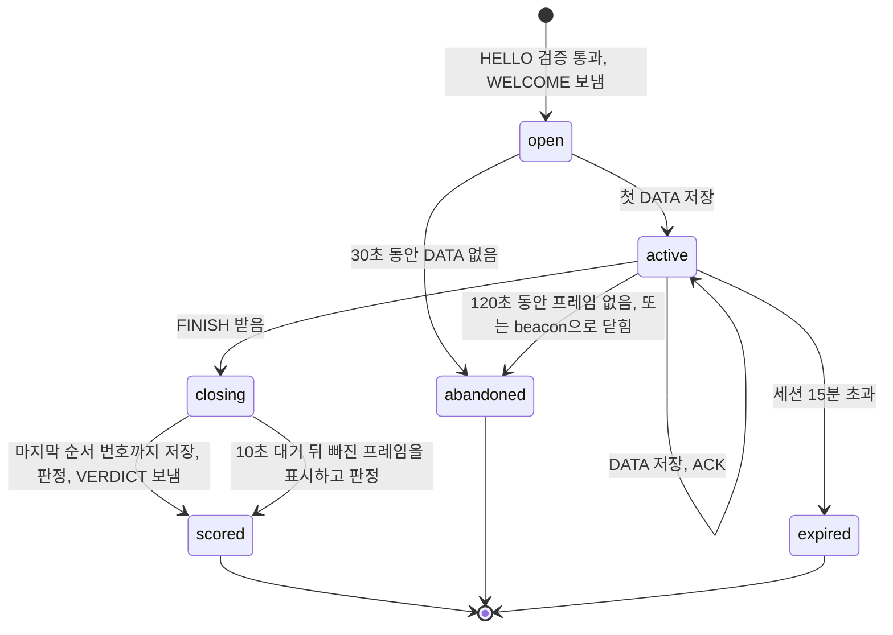
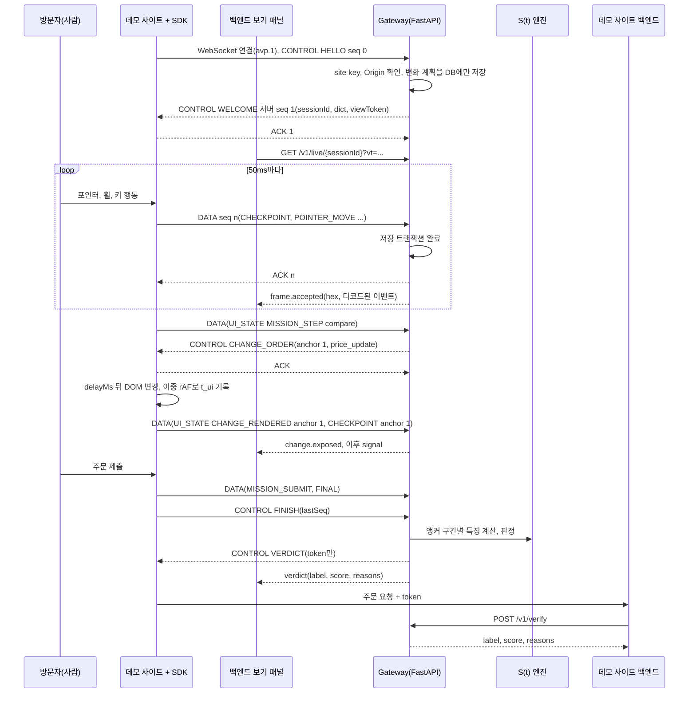
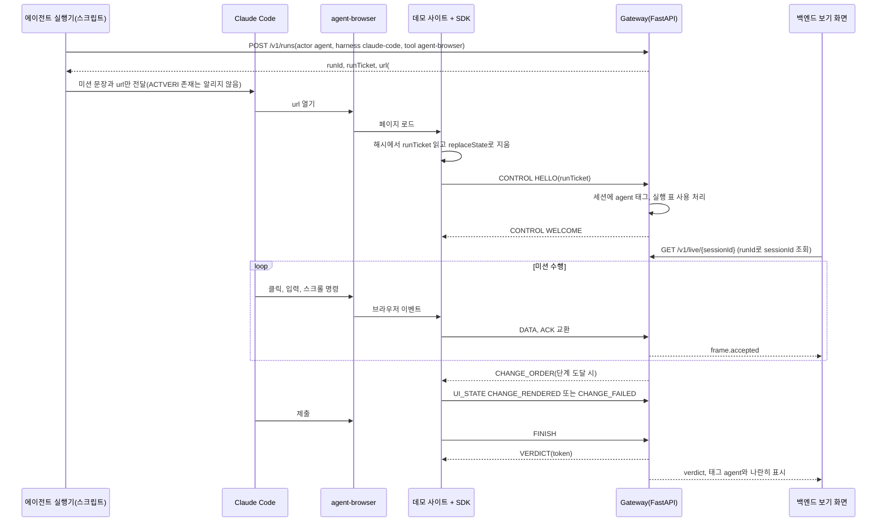
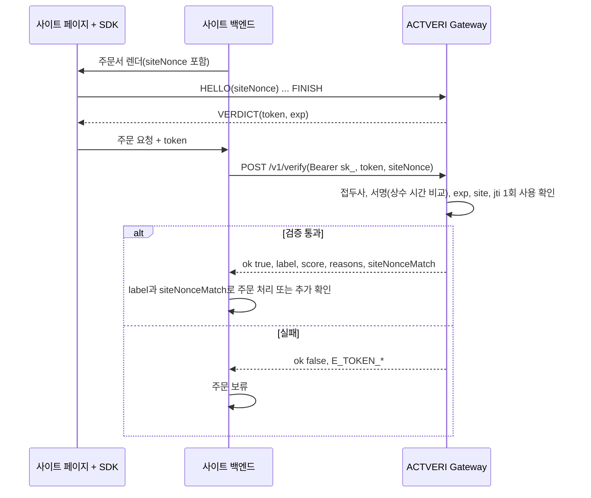

# AVP/1 프로토콜 명세 (ACTVERI)

AVP/1(Action Verification Protocol)은 ACTVERI SDK와 수집 서버가 WebSocket 바이너리 프레임으로 행동 이벤트, 화면 변화 지시, 판정 토큰을 주고받는 애플리케이션 규격입니다. 이 문서는 2026-11-08 기준 v0.1 초안이고, 해커톤 당일(2026-11-09) 2명이 5시간 안에 만들 범위를 따로 표시합니다. 프로토콜 방향(AVP/1, WebSocket 바이너리, 24바이트 헤더)은 팀 논의 결론 문서를 따르고, 이 문서는 그 초안의 빈 곳을 채웁니다.

연구 근거는 S(t) 연구 브리핑(2026-11-08)입니다. 브리핑에서 겪은 문제 4가지(ACK 경합에 따른 이벤트 유실, trial마다 재사용된 세션 ID, `isTrusted`와 포인터 부재를 사람 근거로 읽는 오류, 지시 시각과 실제 그려진 시각의 혼동)는 규격 단계에서 막습니다.

## 개념

사이트에 붙은 SDK가 방문자의 행동을 기록하고, 서버가 세션마다 정한 시점에 화면을 조금 바꿉니다(결과 재정렬, 가격 갱신, 입력 오류 안내, 비동기 새로고침). 서버는 그 변화 앞뒤의 행동 구조 S(t) = [U(t), A(t), ΔU(t), ΔA(t), C(t)]를 분석하고, 사이트 백엔드가 자기 서버에서 검증하는 판정 토큰을 발급합니다. 퍼즐을 내지 않고, 판정은 클라이언트가 아니라 서버에서만 나옵니다.

| 입력 | 서버가 판단하는 근거 | 출력 |
|---|---|---|
| SDK가 보낸 행동 이벤트(포인터, 휠과 스크롤, 키 종류, 포커스), 사이트가 알린 화면 상태와 미션 단계, 화면 변화가 실제로 그려진 시각 | 서버가 지시한 화면 변화(상태 앵커) 이후 첫 유효 행동까지 지연, 재방문, 경로 수정, 오류 복구 단계 같은 S1 특징. 기준선으로 B0(자동화 흔적), B1(입력 지문)을 함께 계산 | 판정 토큰(사이트 백엔드가 검증), 검증 응답의 판정(`human`, `agent`, `uncertain`), 점수, 근거 코드 |

### 주장하지 않는 내용

팀 결론 문서의 "아직 주장하면 안 되는 것" 목록을 이 규격에도 그대로 적용합니다.

- AVP/1 바이너리 형식은 전송 형식일 뿐이고, 판별 정확도를 높인다고 주장하지 않습니다. JSON 대비 전송량, CPU, 지연은 측정 전입니다.
- 바이너리 프레임의 무결성은 사람임을 증명하지 않습니다. 클라이언트가 보낸 이벤트는 위조될 수 있습니다.
- 판정은 행동만으로 사람임을 확정하지 않습니다. 브리핑 기준 검증된 사람 세션은 0건이고, 사람 오탐률과 AI 재현율은 측정하지 못했습니다.
- 특정 데모 사이트와 특정 에이전트 도구에서 나온 결과를 다른 브라우저나 AI로 일반화하지 않습니다.

## 배포 구조와 저장소

팀 결론 문서의 서비스 구조를 따릅니다. 해커톤에서는 SDK 경로를 먼저 만들고, iframe 위젯은 나중으로 미룹니다.

```text
고객사 웹 (데모 사이트)
  ├─ ACTVERI SDK      고객사 페이지에서 허용된 행동만 계측 (해커톤 MVP)
  └─ ACTVERI iframe   독립 인증 UI와 추가 챌린지 (나중)
          │ AVP/1 바이너리 (WebSocket)
          ▼
  Ingestion Gateway (FastAPI)   디코드, 검증, 순서와 시간 정렬, 저장, ACK
          ▼
  S(t) 엔진                      특징 계산, 판정
          ▼
  서버 발급 판정 토큰  ──▶  고객사 백엔드가 /v1/verify 로 검증
```

iframe은 다른 출처의 부모 페이지에서 일어나는 클릭, DOM 변화, 휠 이벤트를 볼 수 없습니다. 부모 페이지 행동을 관측하려면 SDK를 부모 페이지에 직접 넣어야 합니다. iframe이 `postMessage` 로 보내는 "통과" 알림은 신뢰하지 않고, 판정은 항상 서버 토큰 검증으로만 확인합니다.

저장소는 3개로 나눕니다. 데모 사이트는 SDK를 가져다 쓰기만 하고 규격을 고치지 않습니다.

| 저장소 | 담는 내용 | 언어 |
|---|---|---|
| protocol | 이 명세, TypeScript SDK와 인코더(`@actveri/sdk` 후보), 공용 시험 벡터 파일 | TypeScript |
| server | Ingestion Gateway, AVP/1 디코더, S(t) 엔진, 토큰 발급과 검증, 실시간 보기 스트림 | Python, FastAPI |
| front | 분야별 데모 사이트(쇼핑 등). SDK를 붙이고, 백엔드가 도는 모습(AVP/1 프레임, S(t) 신호, 판정)을 화면에 보여 줌 | TypeScript |

시험 벡터는 protocol 저장소의 `test-vectors/avp1.json` 하나가 원본이고, server 저장소는 같은 파일을 복사해 디코더 시험에 씁니다(가안).

## 바이너리와 JSON의 경계

브라우저와 Gateway 사이 WebSocket은 전부 AVP/1 바이너리 프레임입니다. 서버끼리 통신, 사람이나 화면이 읽는 통로는 JSON으로 둡니다.

| 통로 | 형식 | 이유 |
|---|---|---|
| SDK와 Gateway 사이 WebSocket | AVP/1 바이너리. 24바이트 헤더 + 페이로드 | 규격의 본체 |
| DATA 프레임의 이벤트 | 바이너리(type, varint 길이, 페이로드) | 이벤트 수가 가장 많은 부분 |
| CONTROL 프레임 본문 | 5시간 범위에서는 UTF-8 JSON, 나중에 고정 바이너리 레이아웃 | HELLO, WELCOME 같은 저빈도 메시지라 구현 시간을 아낌. 헤더와 프레이밍은 바이너리 그대로 |
| 탭 닫힘 때 `sendBeacon` | AVP/1 프레임을 이어 붙인 바이너리 Blob | `sendBeacon` 은 바이너리 본문을 보낼 수 있어 같은 디코더를 씀 |
| 사이트 백엔드의 토큰 검증 `/v1/verify` | JSON over HTTPS | 고객사 서버가 붙이기 쉬워야 함 |
| 에이전트 실행 태그 `/v1/runs` | JSON over HTTPS | 실행기 스크립트가 curl로 호출 |
| 실시간 보기 스트림 | JSON over SSE | 데모 화면이 디코드된 결과를 바로 그림 |

## 5시간 범위

팀 결론 문서는 WebSocket + AVP/1 MVP를 숙련 개발자 1명 기준 5~10작업일로 추정했습니다(실측 견적 아님). 당일 개발 시간은 2명이 5시간이라, 아래 범위만 첫날 만들고 나머지는 이 문서에 규격만 남깁니다.

| 구분 | 첫날 만드는 범위 | 뒤로 미루는 범위 |
|---|---|---|
| 프레이밍 | 24바이트 헤더, Magic과 Version 검사, 길이 검사, 프레임 1개 = WebSocket 메시지 1개 | 압축, 여러 프레임 묶음 |
| DATA 이벤트 | `CHECKPOINT`, `POINTER_MOVE`(델타, ZigZag, varint), `POINTER_DOWN`, `POINTER_UP`, `WHEEL`, `KEY`, `FOCUS`, `UI_STATE` | `ERROR` 세부 코드(첫날은 버퍼 초과 1가지만), `CLICK`(추가 제안) |
| ACK | 누적 ACK만. 서버는 저장이 끝난 뒤 ACK | SACK 범위 |
| CONTROL | 본문 JSON으로 HELLO, WELCOME, CHANGE_ORDER, FINISH, VERDICT, STOP, ERROR | RESUME, 본문 바이너리화 |
| 재전송 | 연결이 끊기면 다시 연결하지 않고, 아직 ACK 못 받은 프레임을 `sendBeacon` 으로 보낸 뒤 세션을 닫음(beacon 안의 RESUME 프레임은 인증용으로만 해석) | 다시 연결해 RESUME으로 같은 세션 이어 가기, 오프라인 보관 |
| 화면 변화 | 세션마다 서버가 무작위로 정한 변화 1~2건, 단계 도달 시 즉시 지시, 이중 rAF로 그려진 시각 보고 | 미끼 변화, 계획 해시 공개 |
| 보안 | site key와 허용 출처 검사, 판정 토큰 HMAC-SHA256, `/v1/verify` 1회 사용 처리 | secret key 별 서명 키, 오프라인 검증, 속도 제한 |
| 실시간 보기 | 세션 하나를 보는 SSE(디코드된 이벤트, 프레임 hex, 변화, 판정) | 사이트 전체 세션 목록 스트림, 끊긴 뒤 이어 받기 |
| 실행 태그 | 에이전트 실행기가 `runTicket` 으로 세션에 `agent` 태그를 붙임 | 사람 세션 태그, 태그 수정 이력 |
| 시험 | 공용 시험 벡터 7개를 TS 인코더와 Python 디코더가 모두 통과 | 대량 무작위 왕복 시험 |

뺀 범위 때문에 생기는 한계는 2가지입니다. 연결이 끊긴 세션은 이어지지 않아 판정이 `uncertain` 이 되기 쉽고, 오프라인 상태에서 쌓인 이벤트는 페이지를 닫으면 사라집니다.

## 참여자와 통로

| 참여자 | 하는 일 | 쥐는 키 | 통로 |
|---|---|---|---|
| SDK | 행동 수집, 화면 변화 실행, 프레임 인코딩과 재전송 | site key(공개) | WebSocket `wss://<gateway>/avp/1/ws`, beacon |
| Ingestion Gateway | 디코드, 검증, 정렬, 저장, ACK, 변화 계획과 지시 | 서명 키 | WebSocket, HTTP |
| S(t) 엔진 | 특징 계산과 판정. 실행 태그를 입력으로 받지 않음 | 없음 | Gateway 안의 함수 호출 |
| 사이트 백엔드 | 판정 토큰을 받아 검증하고 다음 동작을 정함 | secret key | `POST /v1/verify` |
| 데모 사이트의 백엔드 보기 패널 | 세션 하나의 프레임, 신호, 판정을 실시간으로 보여 줌 | WELCOME이 준 `viewToken` | SSE `GET /v1/live/{sessionId}` |
| 에이전트 실행기 | Claude Code를 실행하기 전에 실행 표를 받아 세션에 `agent` 태그를 붙임 | runner key | `POST /v1/runs` |

WebSocket은 서브프로토콜 `avp.1` 로 엽니다(`Sec-WebSocket-Protocol: avp.1`). Gateway는 업그레이드 요청의 `Origin` 이 site key에 등록된 출처인지 먼저 확인합니다.

## 세션 상태

TCP 방식은 실제로 필요한 곳에만 씁니다. WebSocket은 TCP 위에서 돌아 연결이 살아 있는 동안 프레임이 빠지거나 순서가 바뀌지 않으므로, 연결 안에서 재전송 타이머는 두지 않습니다. 순서 번호와 ACK가 필요한 이유는 네트워크가 아니라 서버 저장과 연결 끊김입니다.

브리핑의 유실은 클라이언트가 서버 저장 전에 버퍼를 비운 ACK 경합에서 생겼고, AVP/1의 ACK는 "저장 완료"를 뜻합니다.

| TCP 개념 | AVP/1에서 맡는 부분 |
|---|---|
| 핸드셰이크 | HELLO와 WELCOME. 서버가 세션 ID를 새로 발급하고, 클라이언트가 정한 ID는 받지 않음 |
| 순서 번호 | 방향마다 따로. SDK가 보내는 DATA와 CONTROL이 한 번호 공간, 서버가 보내는 CONTROL이 다른 번호 공간 |
| ACK | 누적 ACK. 서버는 DB 저장 뒤에만 보냄 |
| 재전송 | 연결이 끊긴 뒤에만. 같은 순서 번호로 다시 보내고 서버는 중복을 버림 |
| 종료 | FINISH에 마지막 순서 번호를 적고, 서버는 그 번호까지 모두 저장된 뒤 VERDICT를 보냄 |

### 서버 세션 상태



`abandoned` 와 `expired` 세션에는 판정 토큰을 발급하지 않습니다. 실시간 보기에는 상태와 빠진 프레임 수를 그대로 보여 줍니다.

### SDK 상태

| 상태 | 들어가는 조건 | 하는 일 |
|---|---|---|
| `connecting` | SDK 초기화 | WebSocket을 열고 HELLO를 보냄. 이벤트는 메모리 버퍼에 쌓음 |
| `open` | WELCOME 받음 | 50ms마다 DATA 프레임을 보냄. 서버가 보낸 CONTROL마다 ACK를 보냄 |
| `reconnecting` (나중) | 비정상 연결 종료 | 신뢰성 절의 간격으로 다시 연결하고 RESUME. 실패하면 `degraded`. 5시간 범위에서는 이 상태 없이 바로 `degraded` |
| `degraded` | 다시 연결 실패, 5시간 범위에서는 비정상 연결 종료 | 새 이벤트는 버리고 ACK 못 받은 프레임을 beacon으로 보냄. 판정 토큰 없음 |
| `finishing` | 사이트가 `finish()` 호출, 또는 서버 STOP | 남은 이벤트를 보내고, 모든 프레임이 ACK 된 뒤 FINISH |
| `closed` | VERDICT 받음 | 토큰을 사이트 코드에 넘김 |

### 시간 제한

| 항목 | 값(가안) | 넘으면 |
|---|---|---|
| WebSocket 연결 뒤 첫 프레임(HELLO) | 5초 | 닫기 코드 4401 |
| WELCOME 뒤 첫 DATA | 30초 | `abandoned` |
| 프레임 사이 간격 | 120초. SDK는 보낼 이벤트가 없어도 15초마다 빈 DATA를 보냄 | `abandoned` |
| 세션 최대 길이 | 15분 | `expired`, STOP 보냄 |
| FINISH 뒤 빠진 프레임 대기 | 10초 | 빠진 프레임을 근거에 표시하고 판정 |
| 판정 토큰 유효 시간 | 120초 | `/v1/verify` 가 `E_TOKEN_EXPIRED` |
| 실행 표(`runTicket`) 유효 시간 | 10분, 1회 사용 | HELLO 거절 없이 태그만 붙지 않음 |

## 프레임 헤더

모든 프레임은 24바이트 헤더로 시작하고, 다중 바이트 정수는 리틀 엔디언입니다. WebSocket 바이너리 메시지 하나에 AVP/1 프레임 하나만 담고, 메시지 길이는 `24 + Payload Length` 와 같아야 합니다.

| 오프셋 | 크기 | 필드 | 값 |
|---:|---:|---|---|
| 0 | 2B | Magic | 바이트 `0x41 0x56` (ASCII "AV") |
| 2 | 1B | Version | `0x01` |
| 3 | 1B | Message Type | `0x01` DATA, `0x02` ACK, `0x03` CONTROL |
| 4 | 2B | Flags | 아래 표 |
| 6 | 2B | Event Count | DATA는 이벤트 수, ACK와 CONTROL은 0 |
| 8 | 4B | Sequence | DATA와 CONTROL은 보내는 쪽 순서 번호, ACK는 누적 확인 번호 |
| 12 | 8B | Timestamp | 세션 기준 시간(µs). DATA는 첫 이벤트의 기준 시각, ACK와 CONTROL은 보낸 시각 |
| 20 | 4B | Payload Length | 헤더 뒤 페이로드 바이트 수 |

Python에서는 `struct.unpack_from('<2sBBHHIQI', buf, 0)` 한 줄로 헤더를 읽습니다.

### Flags

| 비트 | 이름 | 뜻 |
|---:|---|---|
| 0 | `RETRANSMIT` | 다시 보낸 프레임. 서버는 중복 판단에 쓰지 않고 통계에만 씀 |
| 1 | `FINAL` | FINISH 전 마지막 DATA |
| 2 | `HAS_CHECKPOINT` | 페이로드에 `CHECKPOINT` 가 있음 |
| 3 | `ACK_REQUESTED` | `POINTER_DOWN`, `POINTER_UP`, `KEY`, `UI_STATE` 가 들어 있어 서버가 모아 보내지 않고 바로 ACK |
| 4 | `TRUNCATED` | SDK가 버퍼 초과로 이벤트를 버림. 같은 프레임에 `ERROR` 이벤트로 버린 수를 적음 |
| 5~15 | 예약 | 0이어야 함. 1이면 `E_FLAGS` |

### Sequence 규칙

- SDK가 보내는 DATA와 CONTROL은 같은 번호 공간을 쓰고 1부터 1씩 늘립니다. FINISH도 번호를 받아 DATA 뒤에 순서가 고정됩니다.
- HELLO와 RESUME처럼 연결을 여는 프레임은 Sequence 0이고 ACK 대상이 아닙니다. 응답(WELCOME, ACK)이 확인 역할을 합니다.
- 서버가 보내는 CONTROL(WELCOME, CHANGE_ORDER, STOP, VERDICT)은 서버 번호 공간에서 1부터 셉니다. SDK는 이 번호에 ACK를 보냅니다.
- 새 trial은 항상 새 HELLO와 새 세션 ID로 시작합니다. 세션 ID 재사용 문제를 이 규칙으로 막습니다.

### 길이 제한

| 항목 | 최대 | 넘으면 |
|---|---|---|
| Payload Length | 65,536B | `E_FRAME_TOO_LARGE`, 연결 닫기 4413 |
| 프레임당 이벤트 수 | 1,024개 | `E_FRAME_TOO_LARGE` |
| 이벤트 페이로드 | 1,024B | `E_EVENT_TOO_LARGE` |
| varint 길이 | 5바이트(u32 범위) | `E_VARINT_TOO_LONG` |
| CONTROL JSON 본문 | 8,192B | `E_CONTROL_TOO_LARGE` |
| ACK 못 받은 프레임 | 64개 또는 1MiB | SDK가 새 `POINTER_MOVE` 부터 버리고 `TRUNCATED` 표시 |
| 세션당 이벤트 | 200,000개 또는 16MiB | STOP(`limit`) |
| 사전(dict) 항목 | 종류마다 256개, 항목당 64B | WELCOME 생성 시 서버가 자름 |

## 기본 인코딩

| 형식 | 규칙 |
|---|---|
| `u8` | 1바이트 부호 없는 정수 |
| `uvar` | LEB128 부호 없는 varint. 하위 7비트부터, 최상위 비트가 1이면 다음 바이트가 이어짐 |
| `svar` | ZigZag 후 `uvar`. `zz(n) = (n << 1) ^ (n >> 31)`, 복원은 `(z >>> 1) ^ -(z & 1)` |
| 이벤트 | `type(u8) + length(uvar) + payload`. 모르는 type은 length만큼 건너뜀 |

### 시간 델타

모든 이벤트 페이로드는 `dt(svar, µs)` 로 시작합니다. 프레임의 첫 이벤트는 헤더 Timestamp에서, 나머지는 바로 앞 이벤트 시각에서 잰 차이입니다. 대개 0 이상이지만, 그려진 시각을 나중에 확정하는 `UI_STATE` 때문에 음수도 허용합니다.

### 좌표 델타와 체크포인트

포인터 좌표는 뷰포트 기준 CSS 픽셀 정수(`clientX`, `clientY` 반올림)입니다. `POINTER_MOVE` 의 `dx`, `dy` 는 같은 프레임 안 직전 포인터 위치에서 잰 차이이고, 직전 위치는 `CHECKPOINT`, `POINTER_DOWN`, `POINTER_UP` 의 절대 좌표나 앞선 `POINTER_MOVE` 로 정해집니다.

델타 연결은 프레임 경계를 넘지 않습니다. `POINTER_MOVE` 가 있는 프레임은 첫 move 앞에 반드시 `CHECKPOINT` 를 넣고, 프레임이 없어도 1초마다 하나를 보냅니다. 프레임 하나를 잃어도 다음 프레임은 혼자 디코드됩니다.

### 대상(target) 인코딩

대상은 `uvar` 하나로 적고, 사이트의 `data-av` 속성 값은 WELCOME이 준 사전의 번호로 바꿉니다. 문자열을 프레임에 싣지 않아 클래스 이름이나 페이지 글자가 섞여 들어가지 않습니다.

| 값 | 뜻 |
|---|---|
| 0 | 대상 없음(window, document) |
| 짝수 `idx << 1` | `dict.targets[idx]` (`idx` 는 1부터) |
| 홀수 `(tag << 1) \| 1` | 사전에 없는 요소의 태그 코드. 1 button, 2 a, 3 input, 4 select, 5 textarea, 6 img, 7 div, 8 span, 9 li, 10 label, 15 기타 |

## 시간 3가지

AVP/1은 관측 시각, UI 상태 시각, 서버 수신 시각을 섞지 않고 따로 저장합니다. 지연 특징은 같은 시계에서 잰 값끼리만 뺍니다.

| 시각 | 시계 | 어디에 실리는지 | 무엇을 기준으로 |
|---|---|---|---|
| 관측 시각 `t_obs` | 클라이언트 `performance.now()` 계열, HELLO를 보낸 순간이 0 | 이벤트의 `dt` 누적 | 행동 이벤트는 핸들러 실행 시각이 아니라 `event.timeStamp` |
| UI 상태 시각 `t_ui` | 클라이언트, 같은 시계 | `UI_STATE` 의 `dt` 누적(그려진 시각), `applyLag` 로 DOM 적용 시각 | 변화를 DOM에 반영한 뒤 이중 `requestAnimationFrame` 콜백 시각 |
| 서버 수신 시각 `t_recv` | 서버 벽시계(유닉스 µs) | 프레임에 싣지 않음. Gateway가 프레임마다 저장 | WebSocket 메시지를 받은 순간 |
| 지시 시각 `t_order` | 서버 벽시계 | CHANGE_ORDER 헤더 Timestamp(세션 기준 µs)와 서버 저장값 | CHANGE_ORDER를 보낸 순간 |

변화 노출 기준은 `t_order` 가 아니라 `t_ui` 입니다. `t_ui` 도 브라우저가 화면을 그린 시각의 근사이고, 사람이 그 변화를 보았다는 증거는 아닙니다. 클라이언트 시계와 서버 시계의 차이 추정은 5시간 범위에서 하지 않고, `t_recv` 는 유실과 지연 확인에만 씁니다.

## DATA 이벤트

모든 페이로드는 `dt(svar)` 로 시작하고, 아래 표는 그 뒤에 오는 필드입니다.

| type | 이름 | dt 뒤 필드 | 수집 빈도 | 5시간 범위 |
|---:|---|---|---|---|
| `0x01` | `POINTER_MOVE` | `dx svar`, `dy svar` | `pointermove` 를 화면 프레임마다 최대 1개(약 60Hz)로 합침 | MVP |
| `0x02` | `POINTER_DOWN` | `x uvar`, `y uvar`, `button u8`, `pointerType u8`(0 mouse, 1 touch, 2 pen), `flags u8`(비트0 trusted), `target uvar` | 발생할 때마다 | MVP |
| `0x03` | `POINTER_UP` | `POINTER_DOWN` 과 같음 | 발생할 때마다 | MVP |
| `0x04` | `WHEEL` | `source u8`(0 wheel, 1 scroll), `dx svar`, `dy svar`, `mode u8`(wheel의 deltaMode, scroll은 0) | wheel은 발생마다, scroll 위치 변화는 100ms마다 1개 | MVP |
| `0x05` | `KEY` | `category u8`(1 char, 2 nav, 3 edit, 4 enter, 5 mod, 6 other), `phase u8`(0 down, 1 up), `flags u8`(비트0 trusted, 비트1 repeat), `target uvar` | 발생할 때마다 | MVP |
| `0x06` | `UI_STATE` | `kind u8`, `anchor uvar`, `value uvar`, kind별 꼬리 | 발생할 때마다 | MVP |
| `0x07` | `FOCUS` | `phase u8`(0 focus, 1 blur), `target uvar`(0이면 창) | 발생할 때마다 | MVP |
| `0x08` | `ERROR` | `code u8`(1 버퍼 초과로 버림, 2 인코딩 실패, 3 변화 적용 예외, 4 시계 역행), `count uvar` | 발생할 때마다 | 코드 1만 MVP |
| `0x09` | `CHECKPOINT` | `flags u8`(비트0 포인터 위치 앎, 비트1 문서 보임, 비트2 창 포커스), `x uvar`, `y uvar`, `scrollY uvar`, `anchor uvar` | 1초마다, 그리고 move가 있는 프레임의 첫 move 앞 | MVP |
| `0x0A` | `CLICK` (추가 제안) | `x uvar`, `y uvar`, `flags u8`(비트0 trusted), `detail u8`, `target uvar` | 발생할 때마다 | 나중 |

`CLICK` 은 팀 결론 문서의 목록에 없던 추가 제안입니다. `element.click()` 처럼 포인터 down과 up 없이 생기는 클릭을 B0 기준선으로 보려면 필요합니다.

### UI_STATE kind

| kind | 이름 | value | 꼬리 |
|---:|---|---|---|
| 1 | `SITE_STATE` | `dict.states` 번호(예: `results_loading`) | 없음 |
| 2 | `CHANGE_RENDERED` | 0 | `applyLag uvar`(µs, DOM 적용부터 그려진 시각까지), `visiblePct u8`(0~100) |
| 3 | `CHANGE_FAILED` | 실패 사유 코드(화면 변화 지시 절의 표) | 없음 |
| 4 | `MISSION_STEP` | `dict.steps` 번호 | 없음 |
| 5 | `MISSION_SUBMIT` | `dict.answers` 번호(상품 ID 같은 사이트 내부 ID) | 없음 |
| 6 | `ROUTE` | `dict.routes` 번호(쿼리 문자열 없는 경로) | 없음 |
| 7 | `VISIBILITY` | 0 hidden, 1 visible | 없음 |
| 8 | `VIEWPORT` | 0 | `w uvar`, `h uvar` |

`UI_STATE` 의 `anchor` 는 그 시점의 현재 상태 앵커입니다. kind 2와 3에서는 결과를 보고하는 변화의 앵커입니다.

### S(t) 대응

| S(t) 요소 | 관측 근거 | 계산하는 곳 |
|---|---|---|
| U(t) UI 상태 | `UI_STATE` kind 1, 6, 7, 8, `CHECKPOINT` 의 scrollY와 앵커 | SDK가 보내고 서버가 상태 타임라인으로 정렬 |
| A(t) 외부 행동 | `POINTER_*`, `WHEEL`, `KEY`, `FOCUS` | SDK |
| ΔU(t) UI 변화 | `UI_STATE` kind 2(그려진 시각), kind 3(노출 실패), 서버의 CHANGE_ORDER 기록 | SDK가 보고, 서버가 지시 기록과 맞춤 |
| ΔA(t) 행동 변화 | 앵커 전후 행동 비교. 첫 유효 행동 지연, 이전 대상 재방문, 경로 수정, 오류 복구 단계 수, 비동기 갱신 뒤 재탐색 | 서버(S(t) 엔진)만 |
| C(t) 맥락 | `UI_STATE` kind 4, 5와 서버의 미션 정의(정답 조건, 단계 순서, 이번 세션에 적용된 변화) | 서버가 미션 정의와 합침 |

B0(자동화 흔적)와 B1(입력 지문)은 같은 이벤트에서 기준선으로 계산합니다. `trusted` 비트와 `navigator.webdriver` 는 B0 입력일 뿐이고, 판정 근거에 단독으로 쓰지 않습니다. Playwright도 trusted 이벤트를 만들 수 있고, 키보드만 쓰는 사람은 포인터 이동이 없는 편이 자연스럽습니다.

### 수집하지 않는 정보

| 수집하지 않는 정보 | 대신 보내는 값 |
|---|---|
| 키 값(`key`, `code`, `keyCode`) | 키 종류 6가지와 down, up |
| 입력 필드의 글자와 길이 | 포커스 대상 번호만 |
| 페이지 글자, 상품명, 검색어 원문 | 사이트가 정한 `data-av` 사전 번호 |
| URL 쿼리 문자열과 해시 | 경로 사전 번호 |
| 쿠키, `localStorage`, 비밀번호, 인증 정보 | 없음 |
| 클립보드, 캔버스와 폰트 지문 | 없음 |
| 전체 User-Agent 문자열 | Gateway가 헤더에서 브라우저 종류와 주 버전만 남김 |
| IP 주소의 장기 저장 | 연결 제한에만 쓰고 이벤트와 함께 저장하지 않음 |

## 상태 앵커

상태 앵커는 서버가 지시한 화면 변화 하나와 그 뒤의 행동을 바이트 수준에서 묶는 번호입니다. S(t) 엔진은 시각 비교만으로 변화와 행동을 짝짓지 않고, 각 프레임이 스스로 밝힌 앵커를 기준으로 삼습니다.

- 서버는 CHANGE_ORDER마다 세션 안에서 1부터 늘어나는 `anchor` 를 붙입니다. 0은 첫 화면 상태입니다.
- SDK는 변화를 그린 뒤 `UI_STATE`(kind 2, 해당 anchor)를 보내고, 바로 다음에 새 앵커를 담은 `CHECKPOINT` 를 넣습니다.
- 그 뒤 모든 `CHECKPOINT` 와 `UI_STATE` 는 새 앵커를 적습니다. 서버는 앵커 n의 그려진 시각부터 앵커 n+1의 그려진 시각 전까지 들어온 행동을 앵커 n의 반응 구간으로 묶습니다.
- 변화를 적용하지 못하면 `UI_STATE`(kind 3)를 보내고 현재 앵커를 바꾸지 않습니다. 서버는 그 변화를 "노출 안 됨"으로 기록하고 S1 특징 계산에서 뺍니다.

## ACK

ACK 프레임의 Sequence는 상대가 보낸 프레임 가운데 빠짐없이 받은 마지막 번호입니다. 5시간 범위의 ACK는 페이로드가 비어 있습니다(Payload Length 0).

- 서버는 DATA와 CONTROL을 DB에 저장하는 트랜잭션이 끝난 뒤 ACK를 보냅니다. 저장 전 ACK는 금지입니다.
- 서버는 ACK를 200ms까지 모아 보낼 수 있고, `ACK_REQUESTED` 프레임에는 저장 직후 바로 보냅니다.
- SDK는 ACK를 받은 번호까지의 프레임만 버퍼에서 지웁니다.
- SDK는 서버 CONTROL을 처리한 뒤 ACK를 보냅니다. CHANGE_ORDER는 적용을 예약한 순간이 처리 완료입니다.

SACK(나중): 페이로드를 `n u8` 과 `n` 개의 `(start u32, end u32)` 범위로 채워, 누적 번호보다 큰데 이미 받은 범위를 알립니다. 최대 8개 범위까지 싣습니다.

## CONTROL

CONTROL 페이로드는 `subtype(u8) + body` 입니다. 5시간 범위의 body는 UTF-8 JSON이고, 모든 body에 `v: 1` 을 넣지 않아도 헤더 Version이 버전을 정합니다.

| subtype | 이름 | 방향 | Sequence | 5시간 범위 |
|---:|---|---|---|---|
| `0x01` | HELLO | SDK에서 Gateway로 | 0 | MVP |
| `0x02` | WELCOME | Gateway에서 SDK로 | 서버 1 | MVP |
| `0x03` | CHANGE_ORDER | Gateway에서 SDK로 | 서버 번호 | MVP |
| `0x04` | FINISH | SDK에서 Gateway로 | 클라이언트 번호 | MVP |
| `0x05` | VERDICT | Gateway에서 SDK로 | 서버 번호 | MVP |
| `0x06` | STOP | Gateway에서 SDK로 | 서버 번호 | MVP |
| `0x07` | RESUME | SDK에서 Gateway로 | 0 | 나중(beacon에서는 MVP) |
| `0x08` | ERROR | 양쪽 | 보내는 쪽 번호, 연결 전이면 0 | MVP |

```ts
// 0x01 HELLO
type Hello = {
  siteKey: string;            // "pk_demo_shop"
  missionId: string;          // "shop_compare_v1"
  path: string;               // 쿼리 문자열 제외
  siteNonce?: string;         // 사이트 서버가 페이지에 심은 값. 토큰에 묶임
  runTicket?: string;         // 에이전트 실행기가 받은 1회용 실행 표
  sdk: string;                // "actveri-sdk/0.1.0"
  viewport: [number, number];
  dpr: number;
  pointer: "fine" | "coarse" | "none";
  hover: boolean;
  env: { webdriver: boolean | null; visible: boolean };  // B0 기준선 전용
};

// 0x02 WELCOME
type Welcome = {
  sessionId: string;          // 서버가 새로 만든 ULID
  resumeToken: string;        // 32바이트 무작위 값. beacon과 RESUME 인증
  viewToken?: string;         // 실시간 보기 SSE용. 데모 모드 site key에만 발급
  serverOpenUs: number;       // 세션을 연 서버 시각(유닉스 µs)
  dict: {                     // 0번은 항상 빈 문자열
    targets: string[]; states: string[]; steps: string[];
    answers: string[]; routes: string[];
  };
  config: {
    flushMs: number;          // 50
    checkpointMs: number;     // 1000
    keepaliveMs: number;      // 15000
    maxPayloadBytes: number;  // 65536
    maxEventsPerFrame: number;// 1024
    maxUnackedFrames: number; // 64
  };
};

// 0x03 CHANGE_ORDER
type ChangeOrder = {
  anchor: number;             // 1부터
  kind: "reorder" | "price_update" | "inline_error" | "async_reload";
  target: string;             // dict.targets 에 있는 data-av 값
  params:
    | { order: string[] }                   // reorder: 새 순서의 상품 ID
    | { item: string; price: number }       // price_update
    | { field: string; code: string }       // inline_error: 문구는 사이트가 code로 찾음
    | { region: string; spinnerMs: number };// async_reload
  delayMs: number;            // 받은 뒤 적용까지 기다릴 시간
  deadlineMs: number;         // 받은 뒤 이 시간 안에 못 그리면 실패 보고
  requireStep?: string;       // 이 단계일 때만 적용
};

// 0x04 FINISH
type Finish = {
  lastSeq: number;            // 이 FINISH 바로 앞 DATA의 번호
  reason: "submit" | "stop" | "pagehide" | "client_timeout";
};

// 0x05 VERDICT : 판정 라벨은 싣지 않음
type VerdictReceipt = { token: string; exp: number };  // exp: 유닉스 초

// 0x06 STOP
type Stop = { reason: "runner_stop" | "max_duration" | "limit" };

// 0x07 RESUME
type Resume = { sessionId: string; resumeToken: string; serverAck: number };

// 0x08 ERROR
type AvpError = { code: string; message: string; fatal: boolean };
```

WELCOME 예시입니다(데모 쇼핑 사이트).

```json
{
  "sessionId": "01JCB7Q4K9T6M2X8N0R5V3W1ZA",
  "resumeToken": "Zk3vQe2b9xY1pR7tLw0sHn4mUa6cJd8f",
  "viewToken": "vt_5d1c9a",
  "serverOpenUs": 1794276723120000,
  "dict": {
    "targets": ["", "search_box", "result_list", "cart_button"],
    "states": ["", "results_loading", "results_shown", "cart_open"],
    "steps": ["", "browse", "filter", "compare", "cart"],
    "answers": ["", "p1", "p2", "p3", "p4"],
    "routes": ["", "/sites/shop", "/sites/shop/cart"]
  },
  "config": {
    "flushMs": 50, "checkpointMs": 1000, "keepaliveMs": 15000,
    "maxPayloadBytes": 65536, "maxEventsPerFrame": 1024, "maxUnackedFrames": 64
  }
}
```

CHANGE_ORDER 예시입니다.

```json
{
  "anchor": 1,
  "kind": "price_update",
  "target": "result_list",
  "params": { "item": "p2", "price": 31900 },
  "delayMs": 2300,
  "deadlineMs": 8000,
  "requireStep": "compare"
}
```

VERDICT에는 토큰만 담고 판정 라벨은 넣지 않습니다. 브라우저를 조작하는 에이전트가 응답을 읽고 행동을 바꾸지 못하게 하기 위해서입니다. 판정은 사이트 백엔드가 `/v1/verify` 응답으로 받습니다.

## 화면 변화 지시

변화 계획은 서버에만 있고, 미션 단계에 들어선 순간 하나씩 보냅니다. 페이지 소스, SDK 번들, WELCOME 어디에도 앞으로의 변화가 없어서 에이전트가 미리 읽을 수 없습니다.

### 계획 (MVP)

1. 미션 정의에 변화 슬롯을 적습니다. 예: `{ step: "compare", kinds: ["reorder", "price_update", "async_reload"] }`, `{ step: "cart", kinds: ["inline_error"] }`.
2. HELLO를 받으면 서버가 암호학적 난수로 이번 세션의 변화 수(1~2건), 슬롯, 종류, 대상, 파라미터(옮길 상품, 새 가격), `delayMs`(800~4,000ms 균등)를 정해 DB에만 저장합니다.
3. `UI_STATE` kind 4로 슬롯의 단계에 들어섰다는 보고가 저장되면 그때 CHANGE_ORDER를 보냅니다.
4. 가격 갱신처럼 정답을 바꾸는 변화가 있으므로, 서버는 미션 제출을 이번 세션에 실제로 그려진 변화를 반영한 정답과 비교합니다. 미션 정답 데이터는 서버에만 둡니다(브리핑의 정적 fixture 정답 노출 문제).

나중: 변화가 없는 대조 세션, 화면에 영향이 없는 미끼 변화, WELCOME에 계획 해시(`sha256(plan + salt)`)를 실어 사후 감사하기.

### 그려진 시각 보고 (MVP)

SDK는 `delayMs` 뒤 DOM을 바꾸고 그 시각을 `tApplied` 로 적습니다. 이어서 `requestAnimationFrame` 안에서 다시 `requestAnimationFrame` 을 걸고, 두 번째 콜백 시각을 그려진 시각 `t_ui` 로 씁니다. 대상 요소가 뷰포트에 보이는 비율은 IntersectionObserver로 재서 `visiblePct` 에 넣습니다.

문서가 숨겨진 상태(`visibilityState` hidden)면 적용은 하되 보고를 미루고, 다시 보이는 순간의 rAF 시각을 `t_ui` 로 씁니다. 그 사이 `deadlineMs` 를 넘기면 실패로 보고합니다.

### 적용하지 못한 경우 (MVP)

| 사유 코드 | 이름 | 서버 처리 |
|---:|---|---|
| 1 | `target_missing` | 노출 안 됨. 다른 슬롯이 남아 있으면 1회 다시 지시 |
| 2 | `step_passed` | 노출 안 됨. 다음 슬롯에서 1회 다시 지시 |
| 3 | `deadline` | 노출 안 됨 |
| 4 | `hidden` | 노출 안 됨 |
| 5 | `apply_exception` | 노출 안 됨. `ERROR` 코드 3도 함께 옴 |

노출된 변화가 0건인 세션의 판정은 `uncertain` 입니다. 변화 없이 B0, B1만으로 `agent` 를 내리면 S(t)를 검증하는 데모가 아니게 됩니다.

## 신뢰성

| 항목 | 규칙 | 5시간 범위 |
|---|---|---|
| 묶음 전송 | 50ms마다, 또는 이벤트 1,024개나 64KiB에 닿으면 프레임 하나로 보냄. `ACK_REQUESTED` 대상 이벤트는 다음 50ms를 기다리지 않음 | MVP |
| 저장 뒤 ACK | 프레임 원본 바이트와 디코드된 이벤트 행을 한 트랜잭션에 저장한 뒤 ACK | MVP |
| 중복 | `(sessionId, seq)` 유일 키. 같은 번호에 `RETRANSMIT` 비트만 다르고 페이로드 SHA-256이 같으면 버리고 ACK. 페이로드가 다르면 `E_SEQ_CONFLICT` 로 닫기 4409 | MVP |
| 순서 어긋남 | 연결 안에서는 생기지 않음. 재전송 뒤 어긋나면 받아 저장하고 누적 ACK는 빈 번호 앞에서 멈춤. 엔진은 도착 순서가 아니라 `t_obs` 순서로 정렬 | MVP |
| 유실 측정 | 서버는 빠진 번호와 `TRUNCATED` 로 버린 이벤트 수를 세션마다 기록하고 실시간 보기에 보여 줌 | MVP |
| 다시 연결 | 비정상 종료 시 0.5초, 1초, 2초, 4초, 8초 간격으로 시도. 새 연결의 첫 프레임은 RESUME. 서버가 ACK로 누적 번호를 알려 주면 SDK는 그 뒤 프레임을 `RETRANSMIT` 비트로 다시 보내고, 서버는 SDK가 ACK하지 않은 CONTROL을 다시 보냄. 이어 갈 수 있는 시간은 마지막 프레임부터 120초 | 나중(첫날은 다시 연결 없이 beacon) |
| 탭 닫힘 | `pagehide` 에서 `navigator.sendBeacon('/avp/1/beacon', blob)`. Blob은 RESUME 프레임, ACK 못 받은 DATA 프레임들, `FINISH(reason: pagehide)` 를 이어 붙인 바이너리. 64KiB를 넘으면 `POINTER_MOVE` 부터 덜어 냄. `visibilitychange` 의 hidden은 닫힘으로 보지 않음 | MVP |
| beacon 처리 | Gateway는 프레임을 차례로 디코드해 WebSocket과 같은 저장 경로에 넣고, 세션을 `abandoned` 로 닫음. 판정 토큰은 받을 화면이 없어 발급하지 않음 | MVP |
| 오프라인 | `offline` 이벤트에서 다시 연결 시도를 멈추고, ACK 못 받은 프레임을 `sessionStorage` 에 보관했다가 `online` 에서 RESUME | 나중 |

## 보안

### 키

| 키 | 형태 | 둘 곳 | 쓰는 곳 |
|---|---|---|---|
| site key | `pk_` 로 시작, 공개 | 사이트 페이지의 SDK 설정 | HELLO. 허용 출처 목록과 묶여 있음 |
| secret key | `sk_` 로 시작, 비밀 | 사이트 백엔드 환경 변수 | `/v1/verify` 의 `Authorization: Bearer` |
| runner key | `rk_` 로 시작, 비밀 | 에이전트 실행기 환경 변수 | `/v1/runs` |
| 서명 키 | 32바이트 이상 무작위 값 | Gateway 환경 변수만 | 판정 토큰 HMAC |
| resumeToken | 세션마다 32바이트 | SDK 메모리 | beacon, RESUME 인증 |
| viewToken | 세션마다 | 데모 페이지 메모리 | 실시간 보기 SSE |

### nonce와 재사용 방지

- 세션 ID와 resumeToken은 서버가 만들고, 클라이언트가 고른 값은 받지 않습니다.
- `siteNonce` 는 사이트 서버가 페이지(예: 주문서)를 렌더할 때 만든 1회용 값입니다. HELLO에 실려 토큰에 해시로 묶이고, 사이트 백엔드는 검증 응답의 `siteNonceMatch` 로 같은 주문서에서 나온 토큰인지 확인합니다.
- 판정 토큰은 `jti` 로 1회만 검증됩니다. 두 번째 검증은 `E_TOKEN_REPLAYED` 입니다.
- 실행 표 `runTicket` 은 1회용이고 10분 뒤 만료됩니다.

### 판정 토큰 형식

JWT와 비슷하지만 헤더를 두지 않고 접두사로 형식을 고정합니다. `alg: none` 같은 알고리즘 바꿔치기를 원천에서 막기 위해서입니다.

```text
av1.<payload: base64url(JSON)>.<sig: base64url(HMAC-SHA256(signingKey, "av1." + payload))>
```

```json
{ "sid": "01JCB7Q4K9T6M2X8N0R5V3W1ZA", "site": "pk_demo_shop", "jti": "t_8c2f61d0",
  "iat": 1794276801, "exp": 1794276921, "sn": "u3Lx0Qm4b1Zr8Kd2" }
```

`sn` 은 `siteNonce` 의 SHA-256 앞 12바이트를 base64url로 쓴 값이고, `siteNonce` 가 없으면 빠집니다. 페이로드에 판정 라벨을 넣지 않아 토큰을 열어 봐도 판정을 알 수 없습니다. 서명 비교는 상수 시간 비교 함수(`hmac.compare_digest`)로 합니다.

### 클라이언트를 믿지 않는 항목

- 판정, 점수, 근거. 클라이언트가 "사람"이라고 주장할 방법이 프로토콜에 없습니다.
- 앞으로의 변화 계획. 지시 시점 전에는 클라이언트에 없습니다.
- 미션 정답과 정답 여부. 서버가 세션의 실제 변화 기록으로 판단합니다.
- 실행 태그. HELLO의 `runTicket` 이 없거나 틀려도 판정은 그대로이고, 태그만 붙지 않습니다.
- 클라이언트 시각의 절대값. 지연은 같은 클라이언트 시계 안에서만 빼고, `t_recv` 와 크게 어긋나면 `clock_suspect` 근거로 표시합니다.
- `trusted` 비트, `navigator.webdriver`. 위조할 수 있는 값이라 B0 기준선 입력으로만 씁니다.

## 판정 토큰 검증

사이트 백엔드가 호출하는 JSON API입니다. 브라우저에서 호출하면 secret key가 노출되므로 금지합니다.

```http
POST /v1/verify
Authorization: Bearer sk_demo_shop_xxx
Content-Type: application/json
```

```ts
type VerifyRequest = { v: 1; token: string; siteNonce?: string };

type VerifyResponse =
  | {
      v: 1; ok: true;
      sessionId: string;
      label: "human" | "agent" | "uncertain";
      score: number;                 // 0~1, 에이전트일 가능성 추정
      reasons: { code: string; group: "B0" | "B1" | "S1"; value?: number }[];
      exposedChanges: number;        // 실제로 그려진 변화 수
      dataGaps: number;              // 빠진 프레임 수
      siteNonceMatch: boolean | null;
      engine: string;                // "rules-0.1"
      issuedAt: number;
    }
  | { v: 1; ok: false; error: string };
```

```json
{
  "v": 1, "ok": true,
  "sessionId": "01JCB7Q4K9T6M2X8N0R5V3W1ZA",
  "label": "agent", "score": 0.81,
  "reasons": [
    { "code": "post_change_first_action_ms", "group": "S1", "value": 4200 },
    { "code": "no_revisit_after_reorder", "group": "S1" },
    { "code": "pointer_path_straight", "group": "B1", "value": 0.97 }
  ],
  "exposedChanges": 1, "dataGaps": 0, "siteNonceMatch": true,
  "engine": "rules-0.1", "issuedAt": 1794276801
}
```

사이트는 `ok`, `siteNonceMatch`, `label` 을 함께 보고 다음 동작을 정합니다. `uncertain` 일 때 차단하지 않고 다른 확인 수단을 주는 정책은 사이트가 정합니다. `score` 는 규칙 엔진의 추정치이고, 사람 데이터로 보정한 확률이 아닙니다.

## 실행 태그

데모 사이트는 데이터 라벨링 도구가 아니므로 태그는 최소로 둡니다. 에이전트 실행기만 자기 세션에 `agent` 태그를 붙이고, 태그가 없는 세션은 "태그 없음"입니다. 태그는 S(t) 엔진 입력이 아니고, 데모 화면에서 판정과 나란히 보여 주는 용도입니다.

```http
POST /v1/runs
Authorization: Bearer rk_xxx
```

```ts
type CreateRun = {
  v: 1;
  missionId: string;
  actor: {
    kind: "agent";                // 5시간 범위는 agent만
    harness: string;              // "claude-code"
    tool: string;                 // "agent-browser" | "playwright"
    model?: string;               // "claude-opus-5-5"
  };
};
type CreateRunResponse = { v: 1; runId: string; runTicket: string; url: string; exp: number };
```

```json
{ "v": 1, "runId": "run_0007", "runTicket": "rt_Q2x9Lm",
  "url": "https://demo.example/sites/shop#avr=rt_Q2x9Lm", "exp": 1794277401 }
```

- 실행 표는 URL 해시(`#avr=`)로 넘깁니다. 해시는 서버 로그에 남지 않고, SDK는 읽은 즉시 `history.replaceState` 로 지웁니다.
- 실행기가 적는 `model`, `tool` 은 자기 신고 메타데이터이고 서버가 검증하지 않습니다.
- 사람이 직접 연 세션을 사람이라고 적는 태그(`human_claimed`)는 나중입니다. 붙이더라도 신원 확인이 아니라 라벨 입력이고, 판정과 섞지 않습니다.
- S(t) 엔진 코드는 runs 테이블을 읽지 않습니다. 태그와 판정은 데모 화면과 사후 비교에서만 만납니다.

## 실시간 보기 스트림

데모 사이트 옆 "백엔드 보기" 패널이 세션 하나를 실시간으로 그리는 통로입니다. 서버가 디코드한 결과를 JSON으로 보내고, 원본 프레임 hex도 함께 실어 바이너리가 실제로 오가는 모습을 보여 줍니다.

```http
GET /v1/live/{sessionId}?vt=<viewToken>
Accept: text/event-stream
```

EventSource는 헤더를 붙일 수 없어 `viewToken` 을 쿼리로 받습니다. `viewToken` 은 그 세션 하나만 볼 수 있고, 데모 모드로 등록된 site key에만 발급합니다.

```ts
type LiveMessage =
  | { type: "session.opened"; sessionId: string; missionId: string; tag: "agent" | null; at: number }
  | { type: "frame.accepted"; seq: number; msgType: "DATA" | "CONTROL";
      bytes: number; hex: string; events: DecodedEvent[]; recvUs: number; retransmit: boolean }
  | { type: "change.exposed"; anchor: number; kind: string; tUi: number; applyLagUs: number; visiblePct: number }
  | { type: "change.failed"; anchor: number; reason: string }
  | { type: "signal"; anchor: number; name: string; value: number; group: "B0" | "B1" | "S1" }
  | { type: "gap"; missing: number[]; truncated: number }
  | { type: "verdict"; label: "human" | "agent" | "uncertain"; score: number; reasons: string[] }
  | { type: "session.closed"; state: "scored" | "abandoned" | "expired" }
  | { type: "heartbeat"; at: number };
```

```text
id: 42
event: frame.accepted
data: {"type":"frame.accepted","seq":7,"msgType":"DATA","bytes":49,"hex":"41 56 01 01 ...","events":[{"type":"CHECKPOINT","tUs":12345678,"x":640,"y":360,"scrollY":1200,"anchor":0}],"recvUs":1794276735465912,"retransmit":false}
```

변화 지시는 그려지기 전에는 스트림에 보내지 않습니다. 같은 페이지의 패널을 읽는 에이전트가 다음 변화를 미리 알 수 없게 하기 위해서이고, 그래서 `change.ordered` 메시지는 두지 않습니다. 운영 site key에서는 `viewToken` 을 발급하지 않아 이 스트림이 꺼집니다.

`signal` 은 S(t) 엔진이 앵커 구간마다 계산한 특징 값입니다. 판별에 기여한다고 검증된 값이 아니라, 엔진이 무엇을 보고 있는지 보여 주는 데모용 출력입니다.

## 오류 코드

WebSocket 오류는 CONTROL ERROR 프레임을 보낸 뒤, `fatal` 이면 닫기 코드로 연결을 닫습니다. HTTP API는 같은 코드 문자열을 JSON `error` 에 담습니다.

| 코드 | 닫기 코드 또는 HTTP | 뜻 | 받은 쪽이 할 일 |
|---|---|---|---|
| `E_MAGIC` | 4400 | 첫 2바이트가 `AV` 가 아님 | SDK 버그. 다시 연결하지 않음 |
| `E_VERSION` | 4426 | 지원하지 않는 Version | SDK를 갱신함 |
| `E_LENGTH` | 4400 | 메시지 길이와 `24 + Payload Length` 가 다름 | SDK 버그 |
| `E_FLAGS` | 4400 | 예약 비트가 1 | SDK 버그 |
| `E_TRUNCATED` | 4400 | 이벤트나 varint가 페이로드 끝을 넘음 | SDK 버그 |
| `E_VARINT_TOO_LONG` | 4400 | varint가 5바이트를 넘음 | SDK 버그 |
| `E_FRAME_TOO_LARGE` | 4413 | 페이로드 65,536B 초과 또는 이벤트 1,024개 초과 | 프레임을 나눠 다시 보냄 |
| `E_EVENT_TOO_LARGE` | 4413 | 이벤트 하나가 1,024B 초과 | SDK 버그 |
| `E_CONTROL_TOO_LARGE` | 4413 | CONTROL 본문 8,192B 초과 | SDK 버그 |
| `E_HELLO_REQUIRED` | 4401 | 첫 프레임이 HELLO나 RESUME이 아니거나 5초 안에 안 옴 | 새로 연결함 |
| `E_SITE_KEY` | 4403, HTTP 403 | 모르는 site key이거나 `Origin` 이 허용 목록에 없음 | 사이트 설정을 고침 |
| `E_MISSION` | 4404 | 모르는 `missionId` | 사이트 설정을 고침 |
| `E_SEQ_CONFLICT` | 4409 | 같은 번호에 다른 페이로드 | 세션을 버림 |
| `E_SESSION_EXPIRED` | 4410 | 이어 갈 수 없는 세션(RESUME, beacon) | 새 trial이면 새 HELLO |
| `E_RESUME_AUTH` | 4401 | resumeToken 불일치 | 세션을 버림 |
| `E_INCOMPLETE` | 비치명 | FINISH의 `lastSeq` 까지 저장되지 않음 | 빠진 프레임을 보낸 뒤 FINISH를 다시 보냄 |
| `E_RATE_LIMIT` | 4429, HTTP 429 | 연결이나 세션이 너무 많음(나중) | 잠시 뒤 시도 |
| `E_INTERNAL` | 1011, HTTP 500 | 서버 오류 | 5시간 범위에서는 beacon으로 정리, 나중에는 다시 연결 |
| `E_AUTH` | HTTP 401 | secret key나 runner key가 틀림 | 키를 확인함 |
| `E_TOKEN_FORMAT` | HTTP 400 | `av1.` 형식이 아님 | 토큰 전달 경로를 확인함 |
| `E_TOKEN_SIGNATURE` | HTTP 400 | 서명 불일치 | 위조로 보고 거절함 |
| `E_TOKEN_EXPIRED` | HTTP 400 | 발급 120초 경과 | 사용자에게 다시 진행하게 함 |
| `E_TOKEN_REPLAYED` | HTTP 409 | 이미 검증한 `jti` | 거절함 |
| `E_TOKEN_SITE` | HTTP 403 | 다른 사이트의 토큰 | 거절함 |
| `E_VIEW_TOKEN` | HTTP 403 | viewToken이 없거나 다른 세션 것 | 데모 모드인지 확인함 |

## 구현 참고

SDK 인코더(TypeScript)에서 varint와 헤더를 쓰는 부분입니다. 프레임 버퍼는 `DataView` 에 리틀 엔디언으로 씁니다.

```ts
function uvar(out: number[], n: number) {
  while (n > 0x7f) { out.push((n & 0x7f) | 0x80); n >>>= 7; }
  out.push(n);
}
const svar = (out: number[], n: number) => uvar(out, ((n << 1) ^ (n >> 31)) >>> 0);

function frame(type: number, flags: number, count: number, seq: number, tsUs: bigint, payload: Uint8Array) {
  const buf = new Uint8Array(24 + payload.length);
  const dv = new DataView(buf.buffer);
  buf[0] = 0x41; buf[1] = 0x56; buf[2] = 1; buf[3] = type;
  dv.setUint16(4, flags, true); dv.setUint16(6, count, true);
  dv.setUint32(8, seq, true); dv.setBigUint64(12, tsUs, true);
  dv.setUint32(20, payload.length, true);
  buf.set(payload, 24);
  return buf;
}
```

Gateway 디코더(Python)에서 varint와 헤더를 읽는 부분입니다. 길이 검사를 디코드 전에 끝냅니다.

```python
import struct

HEADER = struct.Struct('<2sBBHHIQI')

def read_uvar(b: bytes, i: int) -> tuple[int, int]:
    n = shift = 0
    for _ in range(5):
        if i >= len(b):
            raise AvpError('E_TRUNCATED')
        x = b[i]; i += 1
        n |= (x & 0x7F) << shift; shift += 7
        if not x & 0x80:
            return n, i
    raise AvpError('E_VARINT_TOO_LONG')

def read_svar(b: bytes, i: int) -> tuple[int, int]:
    z, i = read_uvar(b, i)
    return (z >> 1) ^ -(z & 1), i

def parse_header(buf: bytes):
    if len(buf) < 24:
        raise AvpError('E_TRUNCATED')
    magic, ver, mtype, flags, count, seq, ts_us, plen = HEADER.unpack_from(buf, 0)
    if magic != b'AV': raise AvpError('E_MAGIC')
    if ver != 1: raise AvpError('E_VERSION')
    if 24 + plen != len(buf): raise AvpError('E_LENGTH')
    if flags & 0xFFE0: raise AvpError('E_FLAGS')
    return mtype, flags, count, seq, ts_us, buf[24:]
```

FastAPI의 `WebSocket.receive_bytes()` 로 메시지를 받아 `parse_header` 에 넘깁니다. 텍스트 메시지가 오면 `E_MAGIC` 으로 처리합니다.

## 공용 시험 벡터

TS 인코더는 아래 JSON에서 hex를 만들고, Python 디코더는 hex에서 JSON을 만들어 서로 같아야 합니다. 디코드된 JSON 필드 이름은 실시간 보기 스트림의 `DecodedEvent` 와 같습니다. 7개 벡터 모두 2026-11-08 Python 3 참조 스크립트로 인코딩하고 다시 디코딩해 일치를 확인했습니다(제품 코드 아님).

벡터에 쓰는 사전은 `targets = ["", "search_box", "result_list", "cart_button"]`, `steps = ["", "browse", "filter", "compare", "cart"]` 입니다.

### TV1 체크포인트와 포인터 이동 2개

```text
41 56 01 01 04 00 03 00 07 00 00 00 4E 61 BC 00 00 00 00 00 19 00 00 00
09 09 00 07 80 05 E8 02 B0 09 00
01 05 B0 83 02 06 03
01 05 F8 84 02 0A 01
```

```json
{"header":{"version":1,"type":"DATA","flags":["HAS_CHECKPOINT"],"eventCount":3,"seq":7,"timestampUs":12345678,"payloadLength":25},
 "events":[
  {"tUs":12345678,"type":"CHECKPOINT","flags":["POINTER_KNOWN","VISIBLE","FOCUSED"],"x":640,"y":360,"scrollY":1200,"anchor":0},
  {"tUs":12362278,"type":"POINTER_MOVE","dx":3,"dy":-2,"x":643,"y":358},
  {"tUs":12378978,"type":"POINTER_MOVE","dx":5,"dy":-1,"x":648,"y":357}]}
```

첫 move의 `dt` 16,600µs는 ZigZag로 33,200이 되고 varint `B0 83 02` 로 실립니다. `dy` -2는 ZigZag로 3입니다.

### TV2 누름, 뗌, 포커스, 키 2개

```text
41 56 01 01 0C 00 06 00 08 00 00 00 00 2D 31 01 00 00 00 00 3D 00 00 00
09 08 00 07 AC 06 C7 03 00 00
02 0B 80 D3 0E AC 06 C7 03 00 00 01 04
03 0B E8 B4 0A AC 06 C8 03 00 00 01 04
07 05 C8 F2 04 00 07
05 07 C8 F3 25 01 00 01 07
05 07 C0 CF 0B 01 01 01 07
```

```json
{"header":{"version":1,"type":"DATA","flags":["HAS_CHECKPOINT","ACK_REQUESTED"],"eventCount":6,"seq":8,"timestampUs":20000000,"payloadLength":61},
 "events":[
  {"tUs":20000000,"type":"CHECKPOINT","flags":["POINTER_KNOWN","VISIBLE","FOCUSED"],"x":812,"y":455,"scrollY":0,"anchor":0},
  {"tUs":20120000,"type":"POINTER_DOWN","x":812,"y":455,"button":0,"pointerType":"mouse","trusted":true,"target":{"id":"result_list"}},
  {"tUs":20205300,"type":"POINTER_UP","x":812,"y":456,"button":0,"pointerType":"mouse","trusted":true,"target":{"id":"result_list"}},
  {"tUs":20245400,"type":"FOCUS","phase":"focus","target":{"tag":"input"}},
  {"tUs":20555900,"type":"KEY","category":"char","phase":"down","trusted":true,"repeat":false,"target":{"tag":"input"}},
  {"tUs":20651100,"type":"KEY","category":"char","phase":"up","trusted":true,"repeat":false,"target":{"tag":"input"}}]}
```

### TV3 변화 노출, 앵커 전환, 미션 단계

```text
41 56 01 01 0C 00 03 00 09 00 00 00 50 D6 DC 01 00 00 00 00 1B 00 00 00
06 08 00 02 01 00 A0 83 01 64
09 08 00 07 AC 06 C7 03 00 01
06 05 E0 12 04 01 03
```

```json
{"header":{"version":1,"type":"DATA","flags":["HAS_CHECKPOINT","ACK_REQUESTED"],"eventCount":3,"seq":9,"timestampUs":31250000,"payloadLength":27},
 "events":[
  {"tUs":31250000,"type":"UI_STATE","kind":"CHANGE_RENDERED","anchor":1,"applyLagUs":16800,"visiblePct":100,"appliedAtUs":31233200},
  {"tUs":31250000,"type":"CHECKPOINT","flags":["POINTER_KNOWN","VISIBLE","FOCUSED"],"x":812,"y":455,"scrollY":0,"anchor":1},
  {"tUs":31251200,"type":"UI_STATE","kind":"MISSION_STEP","anchor":1,"step":"compare"}]}
```

### TV4 누적 ACK

```text
41 56 01 02 00 00 00 00 09 00 00 00 90 D0 03 00 00 00 00 00 00 00 00 00
```

```json
{"header":{"version":1,"type":"ACK","flags":[],"eventCount":0,"seq":9,"timestampUs":250000,"payloadLength":0}}
```

### TV5 HELLO (시험용으로 필드를 줄인 본문)

```text
41 56 01 03 00 00 00 00 00 00 00 00 00 00 00 00 00 00 00 00 53 00 00 00
01 7B 22 73 69 74 65 4B 65 79 22 3A 22 70 6B 5F 64 65 6D 6F 5F 73 68 6F
70 22 2C 22 6D 69 73 73 69 6F 6E 49 64 22 3A 22 73 68 6F 70 5F 63 6F 6D
70 61 72 65 5F 76 31 22 2C 22 73 64 6B 22 3A 22 61 63 74 76 65 72 69 2D
73 64 6B 2F 30 2E 31 2E 30 22 7D
```

```json
{"header":{"version":1,"type":"CONTROL","flags":[],"eventCount":0,"seq":0,"timestampUs":0,"payloadLength":83},
 "control":{"subtype":1,"body":{"siteKey":"pk_demo_shop","missionId":"shop_compare_v1","sdk":"actveri-sdk/0.1.0"}}}
```

### TV6 잘못된 Magic

```text
41 57 01 02 00 00 00 00 09 00 00 00 90 D0 03 00 00 00 00 00 00 00 00 00
```

기대 결과는 `E_MAGIC` 입니다.

### TV7 6바이트 varint

```text
41 56 01 01 04 00 02 00 0A 00 00 00 E8 03 00 00 00 00 00 00 12 00 00 00
09 06 00 07 01 01 00 00
01 08 80 80 80 80 80 01 02 02
```

기대 결과는 `E_VARINT_TOO_LONG` 입니다. 두 번째 이벤트의 `dt` 가 6바이트 varint입니다.

## 시퀀스

### 사람이 데모 사이트에서 미션을 수행



### Claude Code 에이전트 세션



실행기가 runId로 sessionId를 찾는 조회 API(`GET /v1/runs/{runId}`)는 5시간 범위에서 Gateway 로그나 DB 조회로 대신합니다(가안).

### 사이트 백엔드 검증



## 이전 초안과 대응

`actveri-설계.md` 의 메시지는 아래처럼 바뀝니다.

| 이전 초안 | AVP/1 | 바뀐 점 |
|---|---|---|
| HELLO, `POST /api/session` | CONTROL HELLO | WebSocket 첫 프레임 |
| WELCOME의 `changePlan` | WELCOME + 단계마다 CHANGE_ORDER | 계획 전체를 미리 주지 않음 |
| EVENTS JSON 묶음 | DATA 프레임 | 바이너리 이벤트, 프레임마다 체크포인트 |
| ACK `ackSeq` | ACK 프레임 Sequence | 저장 뒤에만 보냄 |
| `ui.change.rendered` | `UI_STATE` kind 2 + 상태 앵커 | 앵커로 변화와 행동을 묶음 |
| FINISH, VERDICT(label 포함) | FINISH, VERDICT(token만) | 판정 라벨은 `/v1/verify` 로만 |
| `mission.submit` 의 `answer` | `UI_STATE` kind 5, 사전 번호 | 자유 문자열을 싣지 않음 |

## 정하지 않은 항목

모두 가안이고, 괄호 안이 제안하는 기본값입니다.

1. Gateway 호스팅: Vercel 함수는 WebSocket 연결을 오래 유지하는 서버로 쓰기 어렵다고 판단합니다(당일 확인 필요). 가안: FastAPI Gateway를 서버 담당 노트북에서 띄우고 터널로 `wss` 주소를 열며, 데모 사이트만 Vercel에 둡니다.
2. CONTROL 본문 형식: 가안: 5시간 범위는 JSON, v0.2에서 고정 바이너리 레이아웃으로 바꿉니다.
3. 변화 수와 시점: 가안: 세션마다 1~2건, 단계 도달 뒤 800~4,000ms 균등 분포, 실패하면 1회만 다시 지시합니다.
4. 노출 0건 세션의 판정: 가안: `uncertain` 입니다.
5. 판정 토큰 서명 키: 가안: 5시간 범위는 Gateway 하나의 서명 키와 온라인 검증만 둡니다. 오프라인 검증이 필요해지면 secret key에서 HKDF로 사이트별 키를 만들고, 그때 토큰에 판정을 넣을지 다시 정합니다.
6. 토큰 유효 시간: 가안: 120초, 1회 사용입니다.
7. 연결 끊김 처리: 가안: 첫날은 다시 연결하지 않고 beacon으로 정리하며 판정을 내지 않습니다. 다시 연결과 RESUME은 v0.2입니다.
8. 실시간 보기 노출: 가안: 데모 모드 site key에서만 `viewToken` 을 발급하고, 변화는 그려진 뒤에만 스트림에 보냅니다. 에이전트 실행 중에는 백엔드 보기를 같은 페이지가 아닌 별도 창으로 띄웁니다.
9. 포인터 이동 수집 빈도: 가안: 화면 프레임마다 최대 1개(약 60Hz)입니다. 팀 결론 문서의 전송 주기 20~50ms는 묶음 전송 간격 50ms로 시작하고, JSON 대비 전송량과 함께 측정해 정합니다.
10. `CLICK` 이벤트 추가: 가안: v0.1 목록에 `0x0A` 로 예약하고 첫날에는 구현하지 않습니다.
11. 판정 방식: 가안: 규칙 엔진(`rules-0.1`)으로 시작하고, `uncertain` 구간은 점수 0.35~0.65입니다. 시간 특징을 뺀 점수를 백엔드 보기에 따로 보여 줄지는 엔진 담당이 정합니다.
12. 사람 세션 태그(`human_claimed`): 가안: 5시간 범위에서 빼고, 태그 없는 세션으로 둡니다.
13. 시험 벡터 공유 방법: 가안: protocol 저장소의 `test-vectors/avp1.json` 을 원본으로 두고 server 저장소에 복사합니다.
14. 여러 페이지에 걸친 세션: 가안: 데모 사이트는 SPA로 만들어 페이지 이동 없이 진행합니다. 페이지를 옮기는 사이트는 RESUME이 생긴 뒤 지원합니다.
