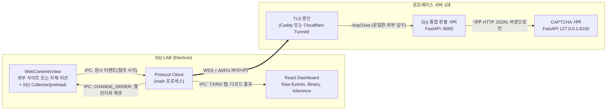
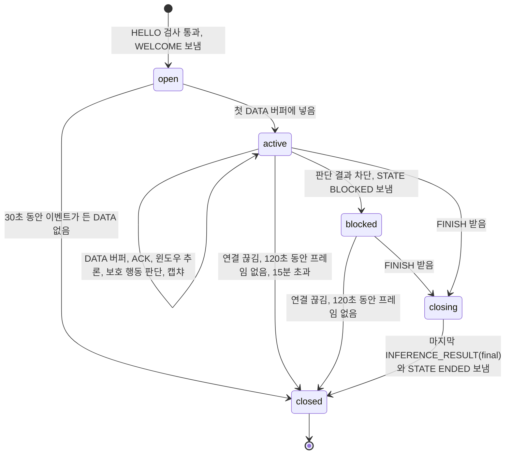
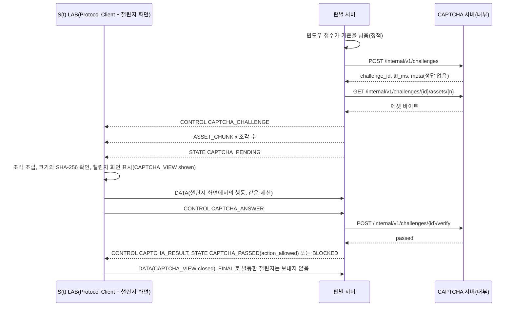

# AVP/1 프로토콜 명세 v0.3.1 (S(t) LAB)

AVP/1(Action Verification Protocol)은 S(t) LAB 클라이언트와 S(t) 통합 판별 서버가 WebSocket 바이너리 프레임으로 행동 이벤트, 판별 점수, 상태와 제어 메시지를 주고받는 애플리케이션 규격입니다. v0.2는 팀의 ML 입출력 스펙 v0.1을 기준으로 다시 짰고, 입력은 그 스펙의 이벤트와 필드, 출력은 `ai_score` 하나입니다. 구조는 팀 합의 문서를 따르고, 해커톤에서 2명이 5시간 안에 만들 범위를 항목마다 MVP 또는 나중으로 표시합니다.

v0.3은 v0.2 위에 판단 시점(보호할 행동), 차단 상태, 캡챠 답의 궤적 요약을 더했습니다. v0.3.1은 검토 4건(코드 검토 2건, 독립 공격 검토, 차등 퍼징)의 지적을 반영한 고침판이고, 위협 모델은 "클라이언트와 페이지는 믿지 않는다"입니다. 바뀐 곳은 바로 아래 표에 있고, 기존 필드의 뜻과 크기는 바꾸지 않아 헤더 Version은 그대로 1입니다. v0.3.1에서 더한 필드(`STATE` 선택 묶음)는 v0.3 디코더가 끝 바이트로 무시하던 자리라 HELLO `proto_minor` 는 3 그대로 둡니다. 버전별 변경 기록은 레포 최상위 `CHANGELOG.md` 에 있습니다.

v0.1(`avp1-protocol-v0.1.md`)과 그 검토 결과는 바이너리 골격의 근거로만 씁니다. 이 문서와 v0.1이 다르면 이 문서가 맞습니다.

## v0.3에서 바뀐 점 (v0.3.1)

에이전트는 페이지 JS 를 실행할 수 있고, CDP 로 입력 시각을 바꿀 수 있고, 프로토콜 메시지를 직접 만들 수 있다고 봅니다. 그래서 판단과 집행은 서버에 두고, 클라이언트가 만든 값(궤적 요약, 오류 보고, 시각)은 근거가 아니라 대조용으로만 씁니다. 근거가 없거나 오류가 나면 통과가 아니라 캡챠나 차단으로 닫고, 보호 행동 하나에는 결과 `STATE` 가 반드시 하나 나갑니다. A 번호는 v0.3.1 고침 항목 번호이고, 본문도 같은 번호로 가리킵니다.

| 번호 | v0.3 | v0.3.1 | 이유 |
|---|---|---|---|
| A1 | 캡챠 판정이 클라이언트가 만든 답과 궤적 요약에 기댐, 문제 시드도 클라이언트가 고름 | 판별 서버가 `CAPTCHA_CHALLENGE` `meta.seed` 로 문제를 정하고, `CAPTCHA_VIEW` shown 뒤 DATA 포인터 이벤트로 궤적 요약과 도달 여부를 다시 계산. 클라이언트 요약은 대조용이고, 그 구간 포인터가 없거나 크게 다르면 `fail` | 요약 JSON 은 앱에서 지어낼 수 있음 |
| A2 | 보호 행동 때 근거가 모자라면 `insufficient_data` 로 통과(정하지 않은 항목 23) | 근거 부족은 점수가 τ_captcha 이상인 것과 같게 봐서 캡챠. 새 세션의 첫 보호 행동도 같음. 캡챠 단계가 없으면(τ_captcha 0) `BLOCKED`(`insufficient_data`) | DOM 직접 조작 자동화는 이벤트를 남기지 않아 이 길로 빠져나감 |
| A3 | 클라이언트가 보낸 `asset_error` 는 통과(정하지 않은 항목 24) | 같은 판단에서 1번만 새 챌린지로 다시 띄우고, 또 오면 `BLOCKED`(`block_after_captcha_fail`). CAPTCHA 서버 자체 오류는 정하지 않은 항목 26(가안: 보류) | 클라이언트가 `asset_error` 만 보내면 캡챠를 건너뜀 |
| A4 | json 수와 BOM 을 두 언어가 다르게 읽음, verify 실패 구분 없음 | json 안 수가 유한하지 않거나 절댓값이 2^53-1 을 넘으면 `E_CONTROL_BODY`. BOM 은 글자로 둠(맨 앞 BOM 이 붙은 json 은 객체가 아니라 `E_CONTROL_BODY`). verify 의 4xx 는 `fail`, 연결 실패와 5xx 만 `error` | 차등 퍼징 F1~F4 |
| A5 | 페이지가 판단을 기다리는 관문은 속성 하나만 지우면 우회 | `action_allowed` `STATE` 에 1회용 행동 토큰(128비트)을 싣고, 행동 완료는 토큰을 서버에 확인한 쪽(데모는 Electron main, 운영은 사이트 백엔드)만 인정. `PROTECTED_ACTION` 수집은 협조형 계측이고 강제는 토큰 확인으로 함 | 페이지 안 관문은 에이전트가 고침 |
| A6 | 판단 결과에 어느 행동인지 없음 | 판단 결과 `STATE` 에 그 `PROTECTED_ACTION` 의 `event_seq` 를 선택 묶음 `action_event_seq` 로 실음. 앱은 `reason` 11 `action_allowed` 이고 번호가 같을 때만 진행 | 앞 행동의 허용으로 뒤 행동을 진행할 수 있었음 |
| A7 | 열린 챌린지 중 두 번째 판단이 판단 점수를 덮어씀 | 챌린지의 판단 점수는 그 챌린지에 걸린 판단 점수 가운데 가장 높은 값 | 낮은 점수 행동을 하나 더 끼워 차단 기준을 피함 |
| A8 | 지속 모드에서 챌린지가 열려 있어도 보호 행동을 바로 허용, 판단 결과 `STATE` 의 상태를 `SCORING` 으로 꾸밈 | 모든 모드에서 챌린지가 열려 있으면 보호 행동은 그 챌린지 결과를 기다림. `STATE` 의 `state` 는 실제 현재 상태 | 캡챠를 띄운 채 다른 행동으로 지나감 |
| A9 | 판단 범위가 클라이언트 시각(그 이벤트의 `t_us`)까지 | 서버가 그 행동이 든 프레임을 받아 버퍼에 넣은 순간까지 받은 이벤트 전체. 프레임 시각이 수신 시각과 2초 넘게 벌어지거나 이벤트 시각이 세션 범위 밖이면 `clock_suspect`, 그 세션은 근거 부족과 같게 처리 | 클라이언트가 시각을 앞당겨 근거를 잘라 냄 |
| A10 | 판단 여부를 HELLO `run_flags` 비트0 으로 클라이언트가 끔 | 판단 여부는 서버 설정(`client_key`, `mission_id`)이 정하고 HELLO 비트는 요청일 뿐. SDK 기본값은 1 | 에이전트가 비트 하나로 판단을 끔 |
| A11 | `challenge_id` 엔트로피와 1회 사용 규칙 없음 | `challenge_id` 는 128비트 난수, verify 는 id 당 1번, 판별 서버는 그 세션에 묶인 열린 챌린지의 id 만 넘김 | 다른 세션의 통과한 답을 다시 씀 |
| A12 | URL `k` 가 없으면 검사를 건너뜀 | `k` 가 없어도 `E_CLIENT_KEY` | 검사 우회 |
| A13 | 상태 기계 빈칸 | 차단 뒤 보호 행동에도 `STATE`(BLOCKED, 그 `action_event_seq`)를 다시 보냄. 챌린지를 만들지 못한 것도 판단 결과로 알림. FINISH 뒤 `ttl_ms` + 20초 안에 ENDED 가 없으면 클라이언트가 `ended`(timeout). FINISH 때 열려 있던 챌린지도 FINISH 뒤 DATA 허용. 답과 만료는 먼저 처리를 시작한 쪽이 이김. 두 번째 FINISH 는 `E_STATE` | 결과 없이 멈추는 길이 있었음 |
| A14 | WELCOME 값을 검사하지 않음 | 클라이언트가 WELCOME 값을 한도로 자름(HELLO와 WELCOME 절). 인코더도 프레임당 이벤트 1,024개 한도를 지킴 | 서버 값 하나로 클라이언트가 멈추거나 넘침 |
| A15 | 속도 제한은 나중 | `E_RATE_LIMIT` 을 MVP 로: IP 당 동시 세션, 연결당 초당 프레임, 세션당 이벤트 수. WebSocket 메시지 최대 65,560B. 디코드와 점수 계산은 실행기에서 | 공개 엔드포인트 |
| A16 | 로그에 클라이언트 문자열을 그대로 씀, HELLO 문자열 길이 한도 없음 | 서버 로그는 클라이언트 문자열을 `repr` 로, HELLO `sdk_version`, `client_key`, `mission_id` 는 각 128B 이하(넘으면 `E_CONTROL_TOO_LARGE`). 최소 길이 varint 만 받는 규칙은 v0.4 로 미루고 지금은 받는다고 적음 | 로그 위조, 메모리 |
| A17 | 민감 판정이 이벤트 대상만 봄 | 이벤트 대상이나 포커스 요소 가운데 하나라도 민감하면 민감. 한 번 민감했던 요소는 계속 민감. `inputmode=numeric`, `autocomplete` 이 `tel`, `bday` 로 시작하거나 `transaction-amount` 인 칸은 키 분류를 하나(`other`)로. 캡챠 답은 문제 종류마다 허용 키만, 앱과 서버 양쪽에서 거름 | 개인정보 |
| A18 | 가짜 서버 지속 모드 챌린지 송신 중 경합 | (가짜 서버 구현) 보내는 동안 챌린지를 지역 변수로 들고 await 뒤마다 아직 열려 있는지 확인 | 코드 검토 |
| A19 | 시험 빈틈 | 골든 벡터 TV36~TV73, 가짜 서버 시험을 모드별로 | 코드 검토 |
| 퍼징 F5 | 이벤트 시각 한도 없음 | `dt` 를 더한 이벤트 시각이 2^53-1 을 넘으면 `E_RANGE` | 두 언어가 다른 값을 냄 |
| 퍼징 F6 | json 안 짝 없는 서로게이트 처리 없음 | 두 디코더 모두 `E_CONTROL_BODY` | Python 인코더가 다시 쓰지 못함 |
| 퍼징 F8 | 표 밖 사전 종류, 겹친 종류 처리 없음 | 표 밖 종류는 읽고 버림(값에 넣지 않고 순서 보존), 겹치면 `E_MISSION` | JS 객체가 숫자 키 순서를 바꿈 |
| 퍼징 N2 | `STATE`, `ACK`, `MODEL_INPUT`, `INFERENCE_RESULT` 끝 남는 바이트를 두 코덱이 무시 | 정의된 필드, 선택 묶음, 확장 블록을 읽은 뒤 남으면 검사 순서 11단계대로 `E_LENGTH` | 규격 문장과 코드를 맞춤 |
| 퍼징 N1, N3 | 최소 길이가 아닌 varint, 이벤트 flags 예약 비트 처리를 적지 않음 | 둘 다 받는다고 적음(예약 비트는 무시) | 앞으로 확장 |
| A12, A13 문장 | 오류 표 `E_STATE` 행은 `FINAL` 로 발동한 챌린지만, `E_CLIENT_KEY` 행은 `k` 불일치만 적음 | `E_STATE` 행에 FINISH 때 열려 있던 챌린지도, `E_CLIENT_KEY` 행에 `k` 가 없음도 적음 | 본문과 오류 표가 달랐음 |
| `FINAL` 근거 부족 | 판단 표는 캡챠(`FINAL` 이면 사유 1), FINISH 순서 6번은 `STATE`(ENDED, `insufficient_data`)로 두 문장이 다름 | 판단 표를 FINISH 순서 6번에 맞춰 `FINAL` 에서 행동 이벤트가 모자라면 캡챠 없이 ENDED(`insufficient_data`) | `FINAL` 은 세션 끝 알림이고 보호 행동 판단은 행동 시점에 이미 끝남. 가짜 서버도 이렇게 동작 |
| 캡챠 통과 뒤 `clock_suspect` | 캡챠를 통과한 세션은 근거 부족이면 통과라 `clock_suspect` 도 통과 | `clock_suspect` 면 근거 부족 통과로 보지 않고 캡챠를 한 번 더, 그 캡챠를 통과한 뒤 또 `clock_suspect` 면 `BLOCKED`(`insufficient_data`) | 캡챠를 한 번 통과한 뒤 시각을 조작해 근거를 지우면 그대로 통과했음 |

결정 대기 4건(CAPTCHA 서버가 죽었을 때, 기준값 숫자, 캡챠 통과 뒤 재판단, 판단 점수 범위)은 정하지 않은 항목 26~29에 가안으로만 적었습니다.

## v0.2에서 바뀐 점 (v0.3)

| 바뀐 점 | v0.2 | v0.3 | 이유 |
|---|---|---|---|
| 판단 시점 | 윈도우 점수가 `T` 이상으로 10초 이어지거나 `FINAL` 점수가 `T` 이상이면 캡챠 | 보호할 행동(구매, 송금, 제출) 이벤트 `PROTECTED_ACTION` 을 받은 순간 그때까지의 근거로 판단. 10초 지속은 WELCOME `captcha_trigger` 로 고르는 선택 모드, 기본은 보호 행동 | AI는 짧게 일하고 나가서 지속을 기다리면 늦음. 보호 행동은 AI도 피할 수 없음 |
| 기준값 | `captcha_threshold_milli` 하나 | `captcha_threshold_milli`(τ_captcha)와 `block_threshold_milli`(τ_block) 2단계 | 캡챠를 차단보다 낮은 기준에서 먼저 걺. 숫자는 가안(`actveri-docs/captcha-trigger-formula.md`) |
| 서버 상태 | 6개, 차단 없음 | `STATE` 7 `BLOCKED`, 사유 `block_after_captcha_fail`, `block_above_threshold`, 통과 알림 `action_allowed` | 판단 결과를 앱이 받아 보호 행동을 막거나 진행해야 함 |
| 캡챠 실패 | 다시 유지 시간을 채우면 세션당 3번까지 재발동 | 다시 띄우지 않고 `BLOCKED` | 같은 문제를 여러 번 풀게 하면 에이전트가 답을 고쳐 냄 |
| 캡챠 통과 뒤 | 다시 발동하지 않음 | 판단 점수가 τ_block 이상일 때만 `BLOCKED` | 캡챠를 통과하면 점수가 정말 높을 때만 차단 |
| FINISH 뒤 DATA | 오류 표는 `E_STATE`, 클라이언트 표는 FINAL 챌린지 행동을 보낸다고 해 서로 부딪힘 | `FINAL` 로 발동한 챌린지가 열려 있는 동안만 허용, 그 밖은 `E_STATE` | 가짜 서버가 먼저 이렇게 동작했고 부딪힘이 풀림 |
| `CAPTCHA_ANSWER` 본문 | `answer` 모양 없음 | 캡챠 화면 궤적 요약 `trajectory` 필드 목록, 단위, 크기, 금지 항목 | 캡챠 화면(`actveri-web/captcha-ui`)이 요약을 만들어 싣기로 함 |
| 코덱이 알려 주는 것 | 없음 | 오류별 닫기 코드 표, CONTROL 끝 남는 바이트 위치 `trailing_offset`, ERROR `message` 256바이트 글자 경계 자르기 | 가짜 서버 어댑터가 따로 가지던 것을 정본으로 옮김 |
| 경로 | 규격 `/avp/1/ws`, 가짜 서버 `/avp` | 모두 `/avp/1/ws` | 앱 설정이 서버마다 달라지지 않게 |
| 규격 안 엇갈림 | `RUN_LABEL` 이 CONTROL MVP 줄과 "선택"에 함께, 서버 기록 모드, 불확실 구간, 기준값 정하는 사람, `client_key` 뜻 | `RUN_LABEL` 은 선택, 서버 기록은 나중(세션 파일은 앱이 저장), 불확실 구간 문장을 2단계 규칙으로, 기준값은 함께 정하는 가안, `client_key` 는 데모 사이트 구분용 | 규격 정합성 점검 |

## 개념

S(t) LAB은 Electron 앱 안의 Chromium 화면(`WebContentsView`)에서 사람이나 AI 에이전트가 웹페이지를 조작하는 동안 행동 이벤트를 모읍니다. Protocol Client가 이벤트를 AVP/1 바이너리로 묶어 판별 서버로 보내고, 서버는 세션 메모리에 쌓은 이벤트로 윈도우를 만들어 모델에 넣은 뒤 `ai_score` 를 바이너리로 돌려줍니다. 점수가 정책 기준을 넘으면 서버가 CAPTCHA 서버에서 문제와 에셋을 받아 같은 AVP/1 연결로 클라이언트에 중계하고, 대시보드는 원본 이벤트, 실제 TX/RX 바이트, 모델 입력, 출력을 같은 식별자로 이어 한 화면에 보여 줍니다.

| 입력 | 서버가 판단하는 근거 | 출력 |
|---|---|---|
| 포인터, 키 종류, 휠, 페이지 이동, 대상 요소 역할, 세션 환경(HELLO). 자체 미션에서는 서버가 지시한 화면 변화가 그려진 시각도 들어감 | 최근 10초(가안) 이벤트 윈도우에서 모델이 뽑는 시계열 특징. 자체 미션에서는 화면 변화(상태 앵커) 전후 행동 변화(ΔU, ΔA)를 더함 | `INFERENCE_RESULT`(1초마다 윈도우 하나의 `ai_score` float32, 0.0 사람에서 1.0 AI, 끝에 세션 전체로 `FINAL` 1번), `MODEL_INPUT`(모델에 실제로 넣은 윈도우), `STATE`(판별 상태), CAPTCHA 중계(`CAPTCHA_CHALLENGE`, `ASSET_CHUNK`, `CAPTCHA_RESULT`) |

정답 라벨(사람인지 AI인지), 에이전트 실행 로그, 과제 성공 여부는 추론 입력이 아닙니다. 상단의 Human / AI Agent 전환은 운영자가 정하는 정답 라벨이라, 점수 계산과 섞이지 않게 별도 CONTROL `RUN_LABEL` 로만 다루고 판별 코드는 이 값을 읽지 않습니다(라벨 절).

### 주장하지 않는 내용

- AVP/1 바이너리 형식은 전송 형식이고, 판별 정확도를 높인다고 주장하지 않습니다. JSON 대비 전송량, 지연, CPU는 측정 전이고, 측정 방법은 JSON 기준선 벤치마크 절에 적었습니다.
- 바이너리 프레임의 무결성은 사람임을 증명하지 않습니다. 클라이언트가 보낸 이벤트는 위조될 수 있고, 이 규격은 암호화나 호출자 인증을 대신하지 않습니다(TLS는 WSS가 맡음).
- 현재 사람과 AI를 실제로 구별한 성능 측정은 없습니다. 외부 사이트 1곳과 자체 미션 1개에서 나온 결과를 다른 사이트나 에이전트로 일반화하지 않습니다.

## v0.1에서 바뀐 점

| 바뀐 점 | v0.1 | v0.2 | 이유 |
|---|---|---|---|
| 기준 | 우리가 정한 S(t) 엔진과 판정 토큰 | ML 입출력 스펙의 이벤트 목록과 `ai_score` | 판별 모델의 입출력에 맞추기로 정함. 대응표 절에서 스펙 필드마다 위치를 확인 |
| 서버가 보내는 출력 | 판정 토큰만, 점수는 사이트 백엔드 검증 API로 | 서버가 클라이언트에 `INFERENCE_RESULT`, `MODEL_INPUT`, `STATE`, CAPTCHA 중계 메시지를 바이너리로 보냄 | 팀 합의 문서의 양방향 요구와 관측성 요구. 토큰과 검증 API는 운영 단계 부록으로 옮김 |
| 클라이언트 | 고객사 페이지의 브라우저 SDK | Electron 앱(수집기는 페이지 안, Protocol Client는 Electron 안) | 팀 합의 문서. 브라우저 SDK는 나중 배포 형태로 부록에 남김 |
| 이벤트 등록표 | 9종(KEY 하나로 down과 up) | 스펙 이벤트 전부에 코드 배정, 범위별 묶음, MVP 15종(CAPTCHA를 만들면 `CAPTCHA_VIEW` 를 더해 16종) | 스펙의 P0는 MVP, P1과 P2는 코드와 바이트 배치만 정함 |
| 순서와 식별자 | 프레임 순서 번호만 | 프레임 번호, 이벤트 번호(`event_seq`), 윈도우 번호(`window_id`), ACK의 CRC32 | 스펙 2.1의 열린 질문(이벤트 단위 누락)과 대시보드 연결 요구 |
| 상태와 재연결 | DB 저장 뒤 ACK, RESUME, beacon | 메모리 버퍼에 넣은 뒤 ACK, 재연결은 새 세션 | 팀 합의 문서(Redis와 DB 없음). RESUME과 beacon은 운영 단계 부록 |
| CONTROL 본문 | UTF-8 JSON | 고정 바이너리 레이아웃. 사이트마다 다른 변화 파라미터와 챌린지 메타데이터만 길이 붙은 JSON 문자열 | 스펙 원칙 1("JSON을 단순히 바이너리로 바꾸지 않음") |
| 화면 변화 | 모든 세션에 지시 | 자체 미션 세션에만, HELLO가 지원 여부를 밝힘 | 외부 사이트에는 변화를 넣을 수 없음 |

검토 결과 28개 항목의 반영 여부는 검토 반영표 절에 있습니다.

## 구성 요소와 연결

### 구성 요소

| 구성 요소 | 하는 일 | 어디서 도는지 | 맡은 쪽 |
|---|---|---|---|
| S(t) Collector | 페이지 안에서 DOM 이벤트를 듣고, 민감 필드를 거르고, 절대 시각과 함께 원시 이벤트를 넘김. 자체 미션에서는 화면 변화 적용과 그려진 시각 측정 | `WebContentsView` 의 preload 스크립트(contextIsolation 켬) | 클라이언트 담당 |
| Protocol Client | 원시 이벤트를 세션 시각으로 바꾸고 `event_seq` 와 대상 번호를 매김, AVP/1 인코딩, 50ms 묶음 전송, ACK 처리, 서버 메시지 디코드, TX/RX 바이트 탭 | Electron main 프로세스(Node 전역 `WebSocket`, 시험 구현에서 동작 확인) | 클라이언트 담당 |
| React Dashboard | Raw Events, Binary Protocol, Model Inference 패널. 탭으로 받은 실제 바이트와 디코드 결과만 그림 | Electron 대시보드 렌더러 | 클라이언트 담당 |
| S(t) 통합 판별 서버 | WebSocket 세션, 디코드와 검증, 세션 메모리 버퍼, 윈도우, 특징 추출, 추론, 결과 송신, CAPTCHA 발동 정책과 중계, 자체 미션 화면 변화 지시 | FastAPI, uvicorn 프로세스 1개 | 모델 담당(서버 기본, 모델), 클라이언트 담당(디코더) |
| CAPTCHA 서버 | 문제 선택, 메타데이터(정답 제외), 에셋, 답 검증. 자체 인증과 권한 검사는 없음 | FastAPI, 별도 프로세스, 판별 서버만 내부망에서 호출 | 여유 있으면 |

수집기와 Protocol Client 사이는 Electron IPC(구조화 복제)이고 AVP/1이 아닙니다. 판별 서버와 CAPTCHA 서버 사이는 내부 HTTP JSON이고 역시 AVP/1이 아닙니다. 판별 서버가 외부에서 받는 연결은 AVP/1 WebSocket 하나뿐이라, 앱은 CAPTCHA 서버에 직접 닿지 못하고 문제, 에셋, 답, 결과가 모두 AVP/1로 중계됩니다.

### 연결 구조 (외부 공개 방식만 미정)



에이전트(Claude Code와 agent-browser, Playwright)는 CDP로 왼쪽 `WebContentsView` 페이지만 조작합니다. Protocol Client가 main 프로세스에 있어서 `INFERENCE_RESULT`, `MODEL_INPUT`, CAPTCHA 중계 프레임은 그 페이지를 거치지 않고, 에이전트가 붙은 페이지에서는 이 WebSocket 프레임이 보이지 않습니다. v0.1이 "판정을 브라우저에 보내면 에이전트가 읽는다"며 막았던 문제는 이 배치로 풀리고, 운영 단계 부록의 브라우저 SDK 배포에서만 다시 생깁니다.

조건이 2가지 남습니다. 앱의 `remote-debugging-port` 로는 대시보드 뷰도 CDP 대상(`type: page`)으로 보이므로, 에이전트 실행 도구는 URL로 실험 페이지 대상 하나에만 붙어야 합니다(데모 실행기는 `shop-mission/index.html`, `stock.naver.com` URL로 고름). 창 전체 화면 캡처로 대시보드 점수를 볼 수 있는 경우는 정하지 않은 항목에 남겼습니다.

### 대안

| 안 | 내용 | 장점 | 단점 |
|---|---|---|---|
| A (채택) | Protocol Client가 Electron main에 있고 판별 서버에만 붙음. CAPTCHA 서버는 판별 서버 뒤 | 페이지를 새로 열어도 WebSocket이 끊기지 않음. 팀 합의 문서 구조와 같음 | main과 렌더러 사이 IPC가 하나 더 생김 |
| B | Protocol Client가 대시보드 렌더러에 있음 | 브라우저 WebSocket API와 같은 코드를 그대로 씀 | 대시보드를 다시 불러오면 세션이 끊김 |
| C | Protocol Client가 페이지 안(preload)에 있음 | 나중의 브라우저 SDK 배포와 같은 모양 | 외부 사이트에서 페이지를 옮길 때마다 연결이 끊겨 새 세션이 됨 |
| D | 클라이언트가 CAPTCHA 서버에도 직접 붙음 | 챌린지 화면을 CAPTCHA 서버가 바로 줌 | CAPTCHA 서버가 외부에 열리고 인증을 새로 만들어야 함. 쓰지 않기로 정함 |

### 서버 배치 (가안)

서버는 AWS가 아니라 팀 온프레미스 장비 1대에서 두 FastAPI 프로세스로 돕니다. 판별 서버는 8000번, CAPTCHA 서버는 127.0.0.1의 8100번에만 열고, 외부에는 TLS 종단 하나가 `wss://<공인 호스트>/avp/1/ws` 만 내보냅니다.

| 공개 방식 | 필요한 것 | 주의할 점 |
|---|---|---|
| Caddy + 공인 도메인 | 도메인, 공유기나 방화벽의 443 포트 포워딩, Let's Encrypt 자동 인증서 | 사내망이나 가정망에서 포트를 열 수 있어야 함 |
| Cloudflare Tunnel | Cloudflare 계정과 도메인, 서버에서 `cloudflared` 실행(바깥으로 나가는 연결만 씀) | Cloudflare 문서 기준 WebSocket 유휴 연결을 100초 뒤 끊음. AVP/1은 15초마다 빈 DATA를 보내 이 한도 안에 둠 |
| 로컬 개발 | `ws://127.0.0.1:8000/avp/1/ws` | TLS 없이 같은 장비에서만 |

uvicorn은 기본값으로 20초마다 WebSocket ping을 보냅니다. 빈 DATA keepalive(15초)와 ping 가운데 하나만 살아 있어도 프록시 유휴 한도에 걸리지 않습니다.

### CAPTCHA 서버 내부 API (가안)

AVP/1 밖의 서버 간 JSON입니다. 판별 서버만 바깥으로 부르고, CAPTCHA 서버는 자체 인증이 없는 대신 127.0.0.1(또는 내부망)에만 열어 앱과 외부에서 닿지 않게 합니다. `Origin` 과 `Host` 헤더는 인증으로 쓰지 않습니다.

팀 합의 문서의 서버 간 API Key는 CAPTCHA 서버를 인증 없이 두기로 정해 MVP에서 빼고, 같은 장비 밖으로 옮길 때 다시 붙입니다.

```http
POST /internal/v1/challenges
Content-Type: application/json

{"session_id":"019a6a3c5e107c4b8f213d9e0b7a4c12","challenge_no":1,"window_id":17,"ai_score":0.87,"reason":"sustained_above_threshold"}
```

```json
{"challenge_id":"ch_6b1f0c9e2d4a47f3b8e5a1c07d92e64f","ttl_ms":60000,
 "meta":{"kind":"guide_sol","prompt_code":"bring_sol_home","seed":2718281828,"assets":[{"index":0,"name":"stage.png","type":"image/png"}]}}
```

`challenge_id` 는 128비트 난수를 담습니다(v0.3.1, A11). `seed` 는 CAPTCHA 서버가 고른 0~2^32-1 정수이고, 챌린지 화면은 이 값으로만 문제를 그립니다(A1).

```http
GET /internal/v1/challenges/ch_6b1f0c9e2d4a47f3b8e5a1c07d92e64f/assets/0
```

응답 본문은 에셋 원본 바이트이고 `Content-Type` 은 `meta.assets[].type` 과 같습니다.

```http
POST /internal/v1/challenges/ch_6b1f0c9e2d4a47f3b8e5a1c07d92e64f/verify
Content-Type: application/json

{"answer":{"reached":true,"elapsed_ms":4210},"pointer":[{"t_ms":0,"x":96,"y":210,"kind":"down"}],"view":{"w":832,"h":420}}
```

```json
{"passed":true}
```

판별 서버는 CAPTCHA 서버가 준 `meta` 에서 `kind`, `prompt_code`, `seed`, `assets[].index`, `assets[].name`, `assets[].type` 만 골라 클라이언트에 넘깁니다. 정답과 판정 규칙은 CAPTCHA 서버에만 있고, 다른 키가 섞여 와도 이 허용 목록 밖이라 앱에 가지 않습니다.

v0.3.1에서 verify 본문에는 클라이언트의 `answer` 와 함께 판별 서버가 DATA 로 받은 챌린지 화면 포인터 이벤트(`pointer`, 아래 'CAPTCHA 답의 서버 재계산')와 그 화면 크기(`view`)가 실립니다. CAPTCHA 서버는 verify 를 `challenge_id` 마다 1번만 받고, 두 번째부터는 `passed: false` 입니다. 판별 서버는 verify 응답이 4xx 면 `fail`, 연결 실패, 3초 제한 초과, 5xx 면 `error` 로 봅니다(A4).

## 범위 표시

| 구분 | MVP(해커톤 5시간) | 나중 |
|---|---|---|
| 프레이밍 | 24바이트 헤더, 검사 순서 전부, 프레임 1개 = WebSocket 메시지 1개 | 압축, 여러 프레임 묶음 |
| 이벤트 | `CHECKPOINT`, `TARGET_INFO`, `POINTER_MOVE`, `POINTER_DOWN`, `POINTER_UP`, `KEY_DOWN`, `KEY_UP`, `INPUT`, `WHEEL`, `NAVIGATION_START`, `NAVIGATION_END`, `VIEWPORT_CHANGE`, `COLLECTION_LOSS`, `UI_CHANGE_RENDERED`, `UI_CHANGE_FAILED`, `PROTECTED_ACTION`, `CAPTCHA_VIEW` | P1과 P2 이벤트 구현(코드와 바이트 배치는 이 문서에 있음) |
| CONTROL | `HELLO`, `WELCOME`, `CHANGE_ORDER`, `FINISH`, `STOP`, `ERROR`, `FEATURE_SCHEMA`, `CAPTCHA_CHALLENGE`, `CAPTCHA_ANSWER`, `CAPTCHA_RESULT`(CAPTCHA 3종은 CAPTCHA를 만들면). `RUN_LABEL` 은 선택(라벨을 서버에 모을 때만) | `SCORE_REQUEST` |
| 서버 메시지 | `ACK`(CRC32 포함), `INFERENCE_RESULT`(확장 블록 포함), `STATE`, `ASSET_CHUNK` | `MODEL_INPUT`(전체 텐서), 근거 코드 확장, 에셋 재전송 |
| 신뢰성 | 저장 뒤 누적 ACK, 미확인 버퍼 64프레임, 넘치면 `POINTER_MOVE` 부터 버리고 `COLLECTION_LOSS` | SACK, 재전송, RESUME, beacon |
| 관측 | Protocol Client 탭, 프레임, 이벤트, 윈도우 번호 연결, TX/RX KB/s | 기록 파일 재생, 앱 안 JSON 크기 비교(둘 다 P1). 세션 기록 파일 저장은 MVP(학습 데이터) |
| 벤치마크 | 없음 | JSON 기준선 비교(P1) |
| 시험 | 골든 벡터 TV1~TV22(v0.2), TV23~TV35(v0.3), TV36~TV73(v0.3.1)을 TS와 Python이 양방향으로 통과 | 무작위 왕복 대량 시험 |

## 프레임 헤더

모든 프레임은 24바이트 헤더로 시작하고, 다중 바이트 정수와 float32는 리틀 엔디언입니다. WebSocket 바이너리 메시지 하나에 AVP/1 프레임 하나만 담고, 메시지 길이는 `24 + Payload Length` 와 같아야 합니다. 헤더 배치는 v0.1과 같습니다.

| 오프셋 | 크기 | 필드 | 값 |
|---:|---:|---|---|
| 0 | 2B | Magic | `0x41 0x56` (ASCII "AV") |
| 2 | 1B | Version | 메이저 버전 `0x01` |
| 3 | 1B | Message Type | 아래 표 |
| 4 | 2B | Flags | 아래 표 |
| 6 | 2B | Event Count | DATA는 이벤트 수, 나머지는 0 |
| 8 | 4B | Sequence | ACK가 아니면 보내는 쪽 프레임 번호, ACK는 누적 확인 번호 |
| 12 | 8B | Timestamp | 보내는 쪽 시계의 세션 기준 µs. 시간 절 참고 |
| 20 | 4B | Payload Length | 헤더 뒤 바이트 수 |

Python은 `struct.Struct('<2sBBHHIQI')`, TypeScript는 `DataView` 의 `getUint16(4, true)` 같은 리틀 엔디언 읽기로 헤더를 읽습니다.

### Message Type

| 값 | 이름 | 방향 | 순서 번호 공간 | 범위 |
|---:|---|---|---|---|
| `0x01` | DATA | 클라이언트에서 서버 | 클라이언트 | MVP |
| `0x02` | ACK | 양쪽 | 번호를 받지 않음(Sequence는 확인 번호) | MVP |
| `0x03` | CONTROL | 양쪽 | 보내는 쪽 | MVP |
| `0x04` | INFERENCE_RESULT | 서버에서 클라이언트 | 서버 | MVP |
| `0x05` | MODEL_INPUT | 서버에서 클라이언트 | 서버 | 나중(화면용 요약은 `INFERENCE_RESULT` 확장 블록) |
| `0x06` | STATE | 서버에서 클라이언트 | 서버 | MVP |
| `0x07` | ASSET_CHUNK | 서버에서 클라이언트 | 서버 | MVP(CAPTCHA를 만들면) |
| `0x08`~`0xFF` | 예약 | | | 받으면 `E_MSG_TYPE` |

방향이 틀린 메시지(클라이언트가 보낸 `INFERENCE_RESULT`, 서버가 보낸 DATA)는 `E_STATE` 입니다. 새 Message Type은 HELLO와 WELCOME의 `caps` 로 양쪽이 지원을 확인한 뒤에만 보냅니다.

### Flags

| 비트 | 이름 | 뜻 | 범위 |
|---:|---|---|---|
| 0 | `RETRANSMIT` | 다시 보낸 프레임. 재연결이 새 세션이라 MVP에서는 늘 0 | 나중 |
| 1 | `FINAL` | 클라이언트: FINISH 바로 앞 DATA(정보용). 서버: 세션의 마지막 `INFERENCE_RESULT` | MVP |
| 2 | `HAS_CHECKPOINT` | 첫 이벤트가 `CHECKPOINT`. 비어 있지 않은 DATA는 늘 1 | MVP |
| 3 | `ACK_REQUESTED` | 누름, 키, 입력(`INPUT`, TV22), 페이지 이동, 화면 변화, 보호 행동(`PROTECTED_ACTION`) 이벤트가 있어 서버가 모으지 않고 바로 ACK | MVP |
| 4 | `TRUNCATED` | 클라이언트가 버퍼 초과로 이벤트를 버렸고, 같은 프레임에 `COLLECTION_LOSS` 가 있음 | MVP |
| 5~15 | 예약 | 0이어야 함. 1이면 `E_FLAGS` | |

플래그와 내용이 다르면 서버는 내용을 따릅니다. 예를 들어 `HAS_CHECKPOINT` 가 0인데 첫 이벤트가 `CHECKPOINT` 이면 정상으로 받고, 통계에만 불일치를 셉니다.

## 기본 인코딩

| 형식 | 규칙 |
|---|---|
| `u8`, `u16`, `u32`, `u64` | 부호 없는 고정 길이 정수, 리틀 엔디언 |
| `f32` | IEEE 754 binary32, 리틀 엔디언. 유한수만 허용(NaN, 무한대는 `E_RANGE`) |
| `uvar` | LEB128 부호 없는 varint. 하위 7비트부터, 최상위 비트 1이면 다음 바이트가 이어짐. 값은 0~2^32-1, 최대 5바이트이고 5번째 바이트가 `0x0F` 를 넘으면 `E_VARINT_TOO_LONG`. 인코더는 최소 길이로 쓰지만 디코더는 최소 길이가 아닌 varint(`86 00` = 6)도 받습니다(v0.3.1, TV65). ACK CRC 는 받은 바이트로 재므로 영향이 없고, 거절할지는 v0.4 에서 다시 봅니다 |
| `svar` | ZigZag32 뒤 `uvar`. `zz(n) = ((n << 1) ^ (n >> 31)) >>> 0`, 복원은 `(z >>> 1) ^ -(z & 1)`. 값은 -2^31~2^31-1 |
| `str` | `uvar` 바이트 길이 + UTF-8 바이트. NUL 금지 |
| `bytes16` | 고정 16바이트 |
| `json` | `str` 과 같은 바이트이고 내용은 공백 없는 JSON 객체(Python `separators=(',',':')`, `ensure_ascii=False`). 최상위가 객체가 아니면 `E_CONTROL_BODY`. 키는 넣은 순서대로 씁니다(TV11의 `kind`, `prompt_code`, `assets` 순서). 같은 값을 두 언어가 같은 바이트로 쓰려면 키가 `"9"` 같은 배열 번호 모양이 아니어야 하고(JS 객체는 그런 키를 앞으로 옮김) 수는 정수여야 합니다(`1.0`, `1e-07` 처럼 실수 표기가 다름). 이 조건을 어겨도 디코드 값은 같고, ACK CRC는 보낸 바이트 그대로를 재므로 영향이 없습니다. v0.3.1부터 json 안 수는 유한하고 절댓값이 2^53-1 이하여야 하고, 글자열과 키에 짝 없는 서로게이트 이스케이프(`\ud800`)가 없어야 합니다. 어기면 두 디코더 모두 `E_CONTROL_BODY` 입니다(TV48, TV50, TV52). 2^53 을 넘는 double 은 모두 정수 값이라 "2^53 넘는 정수"도 이 규칙에 들어갑니다. UTF-8 맨 앞 BOM(U+FEFF)은 지우지 않고 글자로 두므로 `str` 에서는 값에 남고, `json` 에서는 객체가 아니게 되어 `E_CONTROL_BODY` 입니다(TV49) |

인코더는 범위를 넘는 값을 받으면 보내지 않고 예외를 냅니다(`E_ENCODE`, 내부 오류이고 선로에 나가지 않음). 소수가 있는 값은 고정 소수점 정수로 바꿉니다. 화면 배율은 1,000배(`dpr_milli`), 휠 이동량은 100배입니다. 배율을 곱한 뒤 `floor(v × 100 + 0.5)` 로 반올림합니다(TS `Math.round` 와 같은 결과이고, Python 기본 `round` 의 짝수 반올림은 쓰지 않음).

### 이벤트 묶음

DATA 페이로드는 이벤트를 `type(u8) + length(uvar) + payload(length 바이트)` 로 이어 붙인 것입니다. 모든 이벤트 payload의 첫 필드는 `dt(svar, µs)` 이고, 프레임의 첫 이벤트는 헤더 Timestamp에서, 나머지는 바로 앞 이벤트 시각에서 잰 차이입니다.

- 모르는 type: `dt` 는 읽어 시각 누적에 더하고, 남은 `length` 바이트를 건너뜁니다. 이벤트 번호도 1 늘립니다(검토 1번).
- `length` 가 0이거나 `dt` 가 `length` 를 넘으면 `E_TRUNCATED` 입니다(TV57).
- `dt` 를 더한 이벤트 시각이 2^53-1 을 넘으면 `E_RANGE` 입니다(v0.3.1, TV60). 헤더 Timestamp 와 같은 이유로, 넘으면 TS 가 다른 값을 냅니다.
- 아는 type에서 정의된 필드 뒤에 바이트가 남으면 무시합니다. 정의된 필드가 `length` 를 넘으면 `E_TRUNCATED` 입니다.
- 이벤트를 모두 읽은 뒤 페이로드에 바이트가 남으면 `E_LENGTH` 입니다.

### 선택 필드와 확장 규칙

선택 필드는 이벤트 끝에 정의된 순서대로만 붙입니다. 디코더는 남은 바이트가 있으면 다음 선택 묶음을 읽고, 없으면 그 묶음부터 없는 것으로 봅니다. 중간 묶음을 건너뛰고 뒤 묶음만 넣을 수는 없어서, 뒤 묶음이 필요하면 앞 묶음을 0으로 채웁니다.

새 필드는 같은 규칙으로 기존 이벤트 끝에만 붙이고, 새 이벤트는 등록표의 빈 코드에 넣습니다. 둘 다 Version을 올리지 않고 HELLO의 `proto_minor` 만 올립니다. 기존 필드의 뜻이나 크기를 바꿀 때만 Version을 올립니다.

### 버전

| 버전 | 어디에 실리는지 | 규칙 |
|---|---|---|
| 프로토콜 메이저 | 헤더 Version(`1`) | 다르면 `E_VERSION`, 닫기 4426 |
| 프로토콜 마이너 | HELLO `proto_minor`(v0.2는 `2`, v0.3은 `3`) | 서버는 2 이상을 받고 아는 범위만 해석. 1(v0.1)은 배치가 달라 `E_VERSION`. v0.3 서버는 2를 보낸 클라이언트에도 WELCOME v0.3 묶음을 보냄(v0.2 디코더는 끝 바이트로 건너뜀) |
| SDK 버전 | HELLO `sdk_version` 문자열(예: `stlab/0.2.0`) | 기록과 디버깅용. 서버 동작을 바꾸지 않음 |
| 선택 기능 | HELLO와 WELCOME의 `caps` 비트, 교집합만 사용 | 비트0 `SCORE_REQUEST`, 비트1 근거 코드, 비트2 SACK, 비트3 RESUME. MVP는 모두 0 |

## 시간

모든 시각은 정수 µs이고, 클라이언트 시각과 서버 시각은 서로 빼지 않습니다. 0점은 Protocol Client가 세션을 시작한 순간 하나로 못 박습니다(검토 3번).

| 시각 | 시계 | 0점 | 어디에 실리는지 |
|---|---|---|---|
| 관측 시각 `t_obs` | 클라이언트 | Protocol Client의 세션 시작 `t0` | 이벤트 `dt` 누적. DATA 헤더 Timestamp는 첫 이벤트 시각, 빈 DATA는 보낸 시각 |
| UI 시각 `t_ui` | 클라이언트 | 같은 `t0` | `UI_CHANGE_RENDERED` 의 `dt` 누적(그려진 시각)과 `apply_lag_us`(DOM 적용 시각까지 거리) |
| 서버 시각 | 서버 단조 시계(`time.monotonic_ns() // 1000`) | 세션을 연 순간 | 서버가 보내는 모든 프레임의 헤더 Timestamp(검토 9번) |
| 수신 시각 `t_recv` | 서버 | 서버 시각과 같음 | 프레임에 싣지 않음. 서버가 프레임마다 메모리에 둠 |

### 클라이언트 시각 변환

수집기는 페이지마다 시계 기준(`performance.timeOrigin`)이 다르고, 외부 사이트에서 페이지를 옮기면 수집기가 새로 주입됩니다. 그래서 수집기는 상대 시각이 아니라 절대 시각 `t_abs_ms = performance.timeOrigin + event.timeStamp` (ms, 소수)를 IPC로 넘깁니다.

1. Protocol Client는 세션을 시작할 때 `t0_abs_ms = performance.timeOrigin + performance.now()` 를 잡고, HELLO의 `t0_unix_us = Math.round(t0_abs_ms * 1000)` 로 보냅니다.
2. 이벤트 시각은 `t_us = Math.round(t_abs_ms * 1000) - t0_unix_us` 입니다. 먼저 절대 µs 정수로 반올림한 뒤 뺍니다.
3. `t_us` 가 0보다 작은 이벤트(세션 시작 전 발생)는 버리고 `COLLECTION_LOSS`(사유 `before_t0`)로 셉니다.
4. HELLO 헤더 Timestamp는 HELLO를 만든 순간의 `t_us` 입니다. WELCOME 전에 생긴 이벤트는 버퍼에 두었다가 WELCOME 뒤 번호 1부터 보냅니다.
5. `t_ui` 는 화면 변화를 DOM에 반영한 뒤 건 이중 `requestAnimationFrame` 의 두 번째 콜백 인자로 잽니다(검토 21번). 이 값도 `timeOrigin` 을 더한 절대 시각으로 넘깁니다.

인코더는 프레임 안 이벤트를 `t_us` 오름차순으로 안정 정렬하므로 프레임 안 `dt` 는 0 이상입니다. 디코더는 음수 `dt` 도 받되 서버 통계에 순서 위반으로 셉니다. 프레임 사이에는 뒤 프레임 이벤트가 앞 프레임 마지막 이벤트보다 이를 수 있고, 서버는 도착 순서가 아니라 `t_us` 로 정렬합니다.

프로세스와 페이지마다 `timeOrigin` 기준이 조금씩 달라, 다른 프로세스의 시각을 빼면 수 ms 어긋납니다(시험 구현에서 preload와 main 사이 편도가 -1.08~+2.72ms로 음수까지 나옴). 같은 페이지 이벤트끼리의 간격은 영향이 없고, 페이지와 `t0` 사이에 상수 차이만 생깁니다. 이 오차는 5시간 범위에서 보정하지 않고, 서버가 `t_recv` 와 비교해 2초 넘게 벌어지면 세션에 `clock_suspect` 를 표시합니다(검토 28번).

v0.3.1(A9, A16)에서 `clock_suspect` 는 아래 가운데 하나면 섭니다. 한 번 서면 세션 끝까지 남고, 그 세션의 보호 행동 판단은 근거 부족과 같게 처리합니다(캡챠). 캡챠를 통과한 세션의 근거 부족은 통과지만 `clock_suspect` 는 예외로, 캡챠를 한 번 더 띄우고 그 캡챠까지 통과한 뒤 또 `clock_suspect` 인 판단은 `BLOCKED`(`insufficient_data`)입니다. 캡챠를 한 번 통과한 뒤 시각을 조작해 근거를 지우는 길을 막기 위해서입니다. CDP 로 입력 시각을 바꾸거나 메시지를 직접 만들어 판단 범위를 줄이려는 시도를 근거로 받지 않기 위해서입니다.

- DATA 헤더 Timestamp 와 그 프레임의 `t_recv` 차이가 2초를 넘음
- 이벤트 시각이 0보다 작거나, 서버 세션 시각 + 2초보다 큼(아직 오지 않은 시각)

## 식별자와 관측

대시보드가 원본 이벤트, TX/RX 바이트, 서버 디코드, 모델 입력 윈도우, 출력을 잇도록 아래 번호를 씁니다. 모든 번호는 세션 안에서만 유효하고, 새 세션은 다시 1부터 셉니다.

| 식별자 | 매기는 쪽 | 형식 | 선로 위치 | 잇는 것 |
|---|---|---|---|---|
| `session_id` | 서버 | 16바이트(UUIDv7) | WELCOME | 세션 전체, 기록 파일 이름 |
| 프레임 번호 | 보내는 쪽 | `u32`, 방향마다 1부터 | 헤더 Sequence | TX#n, RX#n, ACK 대상 |
| `event_seq` | Protocol Client | `u32`, 1부터 | 프레임 첫 `CHECKPOINT` 의 `event_seq`, 뒤 이벤트는 1씩 더함 | 원본 이벤트와 프레임, 윈도우 범위 |
| 대상 번호 `target` | Protocol Client | `uvar`, 1부터, 0은 대상 없음 | 이벤트의 `target`, `TARGET_INFO` | 요소 역할과 위치 |
| `anchor` | 서버 | `uvar`, 1부터, 0은 첫 화면 | `CHANGE_ORDER`, `UI_CHANGE_*`, `CHECKPOINT` | 화면 변화와 그 뒤 행동(자체 미션만) |
| `window_id` | 서버 | `u32`, 1부터 | `INFERENCE_RESULT`, `MODEL_INPUT`, `STATE`, `CAPTCHA_CHALLENGE` | 모델 입력과 출력, `event_seq` 범위, 윈도우 시각 범위 |
| `challenge_id` | CAPTCHA 서버 | `str` | `CAPTCHA_CHALLENGE`, `ASSET_CHUNK`, `CAPTCHA_ANSWER`, `CAPTCHA_RESULT` | 챌린지, 에셋, 답, 결과 |
| `schema_id` | 서버 | `uvar`, 1부터 | `FEATURE_SCHEMA`, `INFERENCE_RESULT` 확장 태그 1 | 모델 이름, 버전, 특징과 채널 이름 |
| 특징 번호, 채널 번호 | 서버 | `uvar`, `FEATURE_SCHEMA` 목록의 1부터 시작하는 순번 | `INFERENCE_RESULT` 확장 태그 4, 5 | 특징 값과 시계열 채널의 이름 |
| `challenge_no` | 서버 | `uvar`, 1부터 | `CAPTCHA_CHALLENGE`, `CAPTCHA_VIEW` | 세션 안 몇 번째 챌린지인지, 챌린지 화면 이벤트 구간 |

### 이벤트 번호와 누락 (스펙 2.1의 열린 질문)

스펙의 `sequence` 는 두 층으로 나눕니다. 헤더 Sequence는 프레임 단위로 전송, ACK, 중복을 맡고, `event_seq` 는 이벤트 단위로 순서와 누락을 맡습니다.

- Protocol Client는 인코딩하는 이벤트마다 `event_seq` 를 1씩 매깁니다. 모르는 type으로 보낸 이벤트도 번호를 받습니다.
- 비어 있지 않은 DATA는 첫 이벤트가 `CHECKPOINT` 이고 그 안에 자기 `event_seq` 가 있으므로, 앞 프레임을 잃어도 이 프레임의 이벤트 번호를 정확히 압니다.
- 서버는 프레임마다 `[첫 event_seq, 첫 event_seq + Event Count - 1]` 을 기록하고, 앞 프레임 범위와 이어지지 않으면 그 사이를 전송 중 누락으로 셉니다.
- 수집 단계에서 버린 이벤트(버퍼 초과, 세션 시작 전)는 번호를 받지 않고 `COLLECTION_LOSS` 의 `count` 로 따로 셉니다. 스펙 2.7의 `collection_loss_count` 는 이 합이고 `FINISH` 에도 실립니다.

### 대상 번호

대상은 요소마다 세션 안에서 고유한 번호로 적고, 역할과 위치는 그 요소가 처음 나올 때 `TARGET_INFO` 로 한 번만 보냅니다. 문자열(클래스 이름, 글자, `id`)은 싣지 않습니다.

- 수집기는 문서마다 `WeakMap` 으로 지역 번호를 매기고, Protocol Client가 `(문서 번호, 지역 번호)` 를 세션 번호로 바꿉니다. 외부 사이트에서 페이지를 옮겨도 번호가 겹치지 않습니다.
- 처음 쓰는 대상이면 그 대상을 가리키는 이벤트 바로 앞에 같은 시각으로 `TARGET_INFO` 를 넣습니다.
- 자체 미션 페이지의 요소에 `data-av` 속성이 있으면 WELCOME 사전 `targets` 의 번호를 `av_key` 로 붙입니다. 외부 사이트는 사전이 없어 `av_key` 가 늘 0입니다.

### 경로 번호

`route` 는 `uvar` 하나이고 URL 문자열은 싣지 않습니다.

| 값 | 뜻 |
|---|---|
| 0 | 모름 |
| 짝수 `idx << 1` | WELCOME 사전 `routes[idx]`(자체 미션) |
| 홀수 `(n << 1) \| 1` | Protocol Client가 세션 안에서 처음 본 출처와 경로 조합마다 1부터 매긴 번호(외부 사이트). 쿼리와 해시는 빼고 셈 |

### Protocol Client 탭 (MVP)

Binary Protocol 패널은 탭이 넘긴 바이트만 그립니다. 탭은 `ws.send()` 에 넘긴 바이트와 `message` 이벤트로 받은 바이트를 복사해 그대로 넘기고, 장식용 바이트를 만들지 않습니다.

```ts
type TapRecord = {
  dir: "tx" | "rx";
  bytes: Uint8Array;          // 송신 직전 또는 수신 직후 바이트의 복사본
  byteLength: number;         // bytes.length. KB/s 계산용
  wallMs: number;             // performance.timeOrigin + performance.now()
  sessionUs: number;          // 세션 0점 기준
  msgType: number;            // 헤더 Message Type
  seq: number;                // 헤더 Sequence
  firstEventSeq?: number;     // DATA
  lastEventSeq?: number;      // DATA
  windowId?: number;          // INFERENCE_RESULT, MODEL_INPUT, STATE, CAPTCHA_CHALLENGE
  decoded?: unknown;          // 같은 코덱으로 디코드한 JSON(골든 벡터와 같은 모양)
  ackCrcMatch?: boolean;      // ACK: 서버가 보낸 CRC32와 TX 사본 CRC32가 같은지
};

interface ProtocolClient {
  onTap(cb: (r: TapRecord) => void): () => void;     // 해지 함수 반환
  onEventEncoded(cb: (e: { localId: string; eventSeq: number; frameSeq: number }) => void): () => void;
}
```

탭은 프레임마다 방향(`dir`), 프레임 번호(`seq`), 바이트 수(`byteLength`), 시각(`wallMs`, `sessionUs`)을 반드시 채웁니다. Binary Protocol 패널의 TX KB/s와 RX KB/s는 최근 1초 동안 들어온 탭 레코드의 `byteLength` 합으로 계산하고(WebSocket 프레임 머리 제외), 선택한 패킷의 필드 표는 `decoded` 로 그립니다.

`onEventEncoded` 는 수집기가 붙인 지역 번호(`localId`)와 `event_seq`, 프레임 번호를 잇습니다. Raw Events 패널의 행에서 TX 프레임으로, ACK의 `decoded_events` 와 CRC32로 서버 디코드 확인까지, `window_id` 로 모델 입력과 점수까지 따라갈 수 있습니다.

## 이벤트 등록표

코드 범위는 묶음별로 나눕니다. `0x70`~`0x7F` 는 연구 메타데이터 전용이라 서버가 저장만 하고 추론 입력에서 코드 범위로 뺍니다. `0x80`~`0xEF` 는 나중 확장, `0xF0`~`0xFF` 는 실험용이며 둘 다 모르는 type 규칙으로 건너뜁니다.

S(t) 칸은 U(t) UI 상태, A(t) 외부 행동, ΔU(t) UI 변화, ΔA(t) 변화 뒤 행동 수정, C(t) 과제 맥락입니다. ΔA는 서버가 앵커 전후를 비교해 계산하고 선로에는 따로 없습니다.

| 코드 | 이름 | 우선순위(스펙) | dt 뒤 필드 | 범위 | S(t) |
|---:|---|---|---|---|---|
| `0x01` | `POINTER_MOVE` | P0 | `dx svar`, `dy svar`, [`movement_x svar`, `movement_y svar`](P1), [`pressure u8`, `tilt_x svar`, `tilt_y svar`](P2) | MVP(대괄호 묶음은 나중) | A |
| `0x02` | `POINTER_DOWN` | P0 | `x svar`, `y svar`, `button u8`, `pointer_type u8`, `flags u8`, `target uvar`, [`pressure u8`, `tilt_x svar`, `tilt_y svar`](P2) | MVP | A |
| `0x03` | `POINTER_UP` | P0 | `POINTER_DOWN` 과 같음 | MVP | A |
| `0x04` | `POINTER_ENTER` | P1 | `target uvar` | 나중 | A |
| `0x05` | `POINTER_LEAVE` | P1 | `target uvar` | 나중 | A |
| `0x06` | `POINTER_CANCEL` | P1 | `pointer_type u8` | 나중 | A |
| `0x10` | `KEY_DOWN` | P0 | `key_category u8`, `flags u8`, `modifier_flags u8`, `target uvar` | MVP | A |
| `0x11` | `KEY_UP` | P0 | `KEY_DOWN` 과 같음 | MVP | A |
| `0x12` | `COMPOSITION_START` | P1 | `target uvar` | 나중 | A |
| `0x13` | `COMPOSITION_END` | P1 | `target uvar` | 나중 | A |
| `0x14` | `INPUT` | P1에서 MVP로 | `source u8`, `target uvar`, `input_type u8`, `text_length_delta svar`, `flags u8`(비트0 `trusted`) | MVP | A |
| `0x15` | `SELECTION_CHANGE` | P1 | `source u8`, `target uvar`, `selected_length uvar` | 나중 | A |
| `0x20` | `WHEEL` | P0 | `wheel_dx svar`(100배), `wheel_dy svar`(100배), `wheel_delta_mode u8`, `target uvar` | MVP | A |
| `0x21` | `SCROLL_POSITION` | P1 | `container uvar`(0은 문서), `scroll_x svar`, `scroll_y svar` | 나중 | U |
| `0x22` | `TOUCH_START` | P2 | `touch_count u8`, `x svar`, `y svar`, [`gesture_scale_milli uvar`] | 나중 | A |
| `0x23` | `TOUCH_MOVE` | P2 | `TOUCH_START` 와 같음 | 나중 | A |
| `0x24` | `TOUCH_END` | P2 | `TOUCH_START` 와 같음 | 나중 | A |
| `0x30` | `TARGET_INFO` | P0(`target_role`), P1(`target_bbox`, `target_id`) | `target uvar`, `role u8`, `av_key uvar`, `bbox_x svar`, `bbox_y svar`, `bbox_w uvar`, `bbox_h uvar` | MVP | U |
| `0x31` | `FOCUS` | P1 | `source u8`, `target uvar` | 나중 | A |
| `0x32` | `BLUR` | P1 | `source u8`, `target uvar` | 나중 | A |
| `0x33` | `SUBMIT` | P1 | `source u8`, `target uvar` | 나중 | A, C |
| `0x34` | `VISIBILITY_CHANGE` | P1 | `source u8`, `target uvar`, `visible_pct u8` | 나중 | U |
| `0x35` | `LAYOUT_CHANGE` | P2 | `source u8`, `target uvar`, `shift_milli uvar`(layout shift 값 1,000배) | 나중 | U |
| `0x36` | `MODAL_OPEN` | P2 | `source u8`, `target uvar` | 나중 | U |
| `0x37` | `MODAL_CLOSE` | P2 | `source u8`, `target uvar` | 나중 | U |
| `0x38` | `VALIDATION_ERROR` | P2 | `source u8`, `target uvar`, `code uvar`(사이트 오류 번호, 문구 없음) | 나중 | U, C |
| `0x39` | `PROTECTED_ACTION` | 추가(판단 시점, v0.3) | `action_kind u8`(1 `purchase` 구매, 2 `transfer` 송금, 3 `submit` 제출, 4 `other`), `target uvar`(누른 버튼, 모르면 0) | MVP | A, C |
| `0x40` | `NAVIGATION_START` | P0 | `source u8`, `nav_type u8`, `route uvar`(가는 곳, 모르면 0) | MVP | U |
| `0x41` | `NAVIGATION_END` | P0 | `source u8`, `nav_type u8`, `route uvar` | MVP | U |
| `0x42` | `DOCUMENT_READY` | P1 | `ready_state u8`(1 interactive, 2 complete) | 나중 | U |
| `0x43` | `TAB_FOCUS` | P1 | 없음 | 나중 | U |
| `0x44` | `TAB_BLUR` | P1 | 없음 | 나중 | U |
| `0x45` | `WINDOW_FOCUS` | P1 | 없음 | 나중 | U |
| `0x46` | `WINDOW_BLUR` | P1 | 없음 | 나중 | U |
| `0x47` | `HISTORY_BACK` | P1 | `route uvar` | 나중 | A, U |
| `0x48` | `HISTORY_FORWARD` | P1 | `route uvar` | 나중 | A, U |
| `0x49` | `ROUTE_CHANGE` | P1 | `source u8`, `route uvar` | 나중 | U |
| `0x4A` | `PAGE_VISIBILITY` | P1 | `state u8`(0 hidden, 1 visible) | 나중 | U |
| `0x4B` | `TASK_START` | P1 | `source u8`, `task uvar`(사전 `steps` 번호) | 나중 | C |
| `0x4C` | `TASK_END` | P1 | `source u8`, `task uvar` | 나중 | C |
| `0x4D` | `RETRY` | P2 | `source u8`, `target uvar` | 나중 | A |
| `0x4E` | `CORRECTION` | P2 | `source u8`, `target uvar` | 나중 | A |
| `0x50` | `CHECKPOINT` | 추가(무결성) | `event_seq uvar`, `flags u8`, `x svar`, `y svar`, `scroll_y uvar`, `anchor uvar` | MVP | U |
| `0x51` | `VIEWPORT_CHANGE` | P0(`viewport_width/height` 변경 시점), P1(`device_pixel_ratio`) | `viewport_width uvar`, `viewport_height uvar`, `dpr_milli uvar` | MVP | U |
| `0x52` | `COLLECTION_LOSS` | P1(`collection_loss_count`) | `reason u8`, `count uvar` | MVP | 품질 |
| `0x60` | `UI_CHANGE_RENDERED` | P2에서 P0으로(모델 담당 확인 필요) | `anchor uvar`, `apply_lag_us uvar`, `visible_pct u8` | MVP(자체 미션만) | ΔU |
| `0x61` | `UI_CHANGE_FAILED` | P2에서 P0으로(모델 담당 확인 필요) | `anchor uvar`, `reason u8` | MVP(자체 미션만) | ΔU |
| `0x62` | `CAPTCHA_VIEW` | 추가(챌린지 맥락) | `phase u8`(1 shown, 2 closed), `challenge_no uvar`, `view_x svar`, `view_y svar`, `view_w uvar`, `view_h uvar` | MVP(CAPTCHA를 만들면) | ΔU, C |
| `0x70` | `TASK_SUCCESS` | P1(메타데이터) | `source u8`, `task uvar` | 나중. 추론 입력 금지 | 없음 |
| `0x71` | `TASK_FAILURE` | P1(메타데이터) | `source u8`, `task uvar` | 나중. 추론 입력 금지 | 없음 |

`UNEXPECTED_UI_CHANGE` 는 스펙에서 P2이지만 v0.2는 `UI_CHANGE_RENDERED` 와 `UI_CHANGE_FAILED` 로 나눠 P0으로 둡니다. "그냥 300ms 멈춤"과 "UI가 바뀐 직후 300ms 멈춤"을 데이터에서 구별하려면 변화가 그려진 시각이 있어야 하고, 이 이벤트가 없으면 ΔU와 ΔA를 계산할 수 없기 때문입니다. 모델 담당 확인이 필요한 항목이고, 외부 사이트 세션에는 이 이벤트가 없어도 점수가 나오게 정했습니다(상태 앵커 절).

`source` 바이트가 없는 이벤트는 수집 출처가 정해져 있습니다. 포인터, 키, 휠, 스크롤, 터치, 조합 입력, 문서와 창 상태 이벤트는 `dom`, `CHECKPOINT`, `TARGET_INFO`, `VIEWPORT_CHANGE`, `COLLECTION_LOSS`, `UI_CHANGE_*`, `CAPTCHA_VIEW` 는 `sdk`, `PROTECTED_ACTION` 은 `site`(미션 페이지 계측 호출, 외부 사이트에서는 실험 설정이 정한 버튼 누름을 앱이 대신 보고) 입니다.

`SUBMIT`(`0x33`, 나중)은 DOM `submit` 이벤트를 그대로 옮긴 것이고 판단 시점이 아닙니다. 폼 없이 버튼으로 결제하는 페이지도 있어, 판단 시점은 페이지가 "지켜야 할 행동"이라고 직접 알리는 `PROTECTED_ACTION` 으로 따로 둡니다. `SUBMIT` 의 배치를 바꾸면 기존 필드의 뜻이 바뀌어 Version을 올려야 하므로 새 코드를 썼습니다.

### PROTECTED_ACTION 규칙 (MVP, v0.3)

- 미션 페이지가 구매, 송금, 제출 버튼을 누른 순간을 알리면 수집기가 그 `POINTER_UP`(또는 Enter의 `KEY_UP`) 바로 뒤에 같은 시각으로 `PROTECTED_ACTION` 을 넣습니다. 클라이언트는 이 이벤트를 받으면 묶음 간격을 기다리지 않고 바로 보내고 `ACK_REQUESTED` 를 켭니다.
- 페이지는 서버 판단(`STATE` 의 `action_allowed`, `CAPTCHA_PASSED`, `BLOCKED`)이 올 때까지 그 행동의 결과(결제 완료 화면 등)를 보여 주지 않습니다. 판단 규칙은 '판단 시점과 캡챠, 차단' 절에 있습니다.
- 행동 하나에 이벤트 하나입니다. 같은 버튼을 다시 누르면 새 이벤트이고 서버는 다시 판단합니다.
- `action_kind` 는 서버 기록과 대시보드 표시용이고, v0.3 판단 규칙은 종류와 상관없이 같습니다.
- (v0.3.1, A5) `PROTECTED_ACTION` 수집은 페이지가 스스로 알리는 협조형 계측이고, 이것만으로는 아무것도 강제하지 못합니다. 페이지 안 관문은 에이전트가 속성 하나를 지워 우회할 수 있기 때문입니다. 강제는 행동 토큰으로 합니다. 판별 서버가 통과 `STATE` 에 1회용 `action_token`(128비트)을 싣고, 행동을 완료하는 쪽(데모는 Electron main, 운영은 사이트 백엔드)은 그 토큰을 판별 서버에 확인한 뒤에만 결제 완료 같은 결과를 냅니다. 토큰은 한 번 확인하면 다시 쓸 수 없고 120초 뒤 만료됩니다(가안).
- (v0.3.1, A6) 앱은 판단 결과 `STATE` 의 `action_event_seq` 가 자기가 보낸 `PROTECTED_ACTION` 의 `event_seq` 와 같고 `reason` 이 11 `action_allowed` 일 때만 진행합니다. 번호가 없거나 다른 허용은 그 행동의 결과가 아닙니다. TS `Session.protectedAction()` 이 이 짝짓기를 하고 `{ allowed, eventSeq, state, reason, token }` 을 돌려줍니다.

### 값 표

| 필드 | 값 |
|---|---|
| `source` | 0 `dom`(표준 DOM 리스너), 1 `observer`(Intersection, Mutation, Performance 관측기), 2 `site`(미션 페이지 계측 호출), 3 `harness`(실험 도구), 4 `sdk`(수집기와 Protocol Client 내부), 5 `electron_main`(main 프로세스 `input-event` 관측), 15 `other` |
| `pointer_type` | 0 `mouse`, 1 `touch`, 2 `pen`, 3 `unknown` |
| `button` | `MouseEvent.button` 그대로(0 주, 1 가운데, 2 보조, 3 뒤로, 4 앞으로) |
| 포인터 `flags` | 비트0 `trusted`(`isTrusted`). 나머지 0 |
| 키 `flags` | 비트0 `trusted`, 비트1 `repeat`(P1), 비트2 `is_composing` |
| `modifier_flags`(P1) | 비트0 Shift, 비트1 Ctrl, 비트2 Alt, 비트3 Meta. 디코드 JSON은 켜진 비트의 이름 목록 `["shift","ctrl","alt","meta"]` |
| `wheel_delta_mode` | 0 pixel, 1 line, 2 page |
| `nav_type` | 1 `initial_load`, 2 `reload`, 3 `push`(링크, SPA 이동), 4 `replace`, 5 `back_forward`, 15 `other` |
| `role` | 0 unknown, 1 button, 2 link, 3 text_input, 4 sensitive_input, 5 checkbox, 6 radio, 7 select, 8 textarea, 9 image, 10 list_item, 11 label, 12 container, 13 form, 14 dialog, 15 other |
| `input_type`(P1) | 1 insertText, 2 insertFromPaste, 3 deleteContentBackward, 4 deleteContentForward, 5 insertCompositionText, 6 insertFromDrop, 7 historyUndo, 8 historyRedo, 9 insertLineBreak, 15 other |
| `CHECKPOINT` `flags` | 비트0 포인터 위치 앎, 비트1 문서 보임, 비트2 창 포커스, 비트3~4 `pointer_type`, 비트5~7 0 |
| `COLLECTION_LOSS` `reason` | 1 `buffer_overflow`, 2 `encode_failed`, 3 `before_t0`, 4 `clock_backwards`, 5 `apply_exception` |
| `UI_CHANGE_FAILED` `reason` | 화면 변화 절의 실패 사유 표 |

이벤트 `flags` 바이트(포인터, 키, `INPUT`, `CHECKPOINT`)의 표에 없는 비트는 보내는 쪽이 0으로 쓰고, 받는 쪽은 앞으로 확장을 위해 무시합니다(v0.3.1, TV66). 헤더 Flags 예약 비트만 `E_FLAGS` 입니다.

`role` 은 태그와 `type`, ARIA `role` 로 정합니다. `<button>` 과 `role=button` 은 1, `<a href>` 는 2, `<input type=text|search|email|tel|url|number>` 는 3, 민감 필드는 4입니다.

### key_category (검토 12번)

키 값은 보내지 않고 아래 분류만 보냅니다. 분류는 `KeyboardEvent.key` 로 정하고 위에서부터 처음 맞는 줄을 씁니다.

| 값 | 이름 | `key` 조건 |
|---:|---|---|
| 10 | `ime` | `"Process"` 이거나 `isComposing` 이 참 |
| 7 | `modifier` | Shift, Control, Alt, Meta, CapsLock, AltGraph |
| 5 | `enter` | Enter |
| 4 | `edit` | Backspace, Delete |
| 6 | `navigation` | Tab, ArrowUp, ArrowDown, ArrowLeft, ArrowRight, Home, End, PageUp, PageDown |
| 8 | `function` | Escape, F1~F12 |
| 3 | `whitespace` | `" "` |
| 2 | `digit` | 길이 1이고 `0`~`9` |
| 1 | `letter` | 길이 1이고 유니코드 문자(`\p{L}`) |
| 9 | `symbol` | 길이 1인 나머지 |
| 15 | `other` | 그 밖 |

### 포인터 규칙

- `isPrimary` 포인터만 보냅니다(검토 20번).
- `pointermove` 는 브라우저가 보낸 대로 하나씩 보냅니다(`sampling_policy` 0 `raw`). `getCoalescedEvents()` 로 늘리거나 rAF로 합치지 않고, 바꾸면 HELLO의 `sampling_policy` 를 바꿉니다.
- 좌표는 `WebContentsView` 뷰포트 기준 CSS 픽셀(`clientX`, `clientY` 반올림)이고 음수일 수 있어 `svar` 입니다(검토 4번). `scroll_y` 는 반올림 뒤 0보다 작으면 0입니다.
- `POINTER_MOVE` 의 `dx`, `dy` 는 같은 프레임 안 직전 위치에서 잰 차이입니다. 직전 위치는 `CHECKPOINT`(포인터 위치 앎), `POINTER_DOWN`, `POINTER_UP` 의 절대 좌표나 앞선 이동으로 정해지고, 프레임 경계를 넘지 않습니다.
- `CHECKPOINT` 가 포인터 위치 모름이면, 그 프레임의 첫 이동 앞에 이동 위치를 절대 좌표로 담은 `CHECKPOINT` 를 같은 시각으로 하나 더 넣고 그 이동은 `dx=0, dy=0` 으로 보냅니다.
- 이동이 이어지는 동안 `pointer_type` 은 프레임 첫 `CHECKPOINT` 의 비트3~4를 따르고, 바뀌면 새 `CHECKPOINT` 를 넣습니다.
- 선택 필드 `pressure` 는 0.0~1.0을 0~255로 반올림, `tilt_x`, `tilt_y` 는 도 단위 정수입니다.
- `trusted` 비트는 사람의 근거가 아닙니다. Playwright가 CDP로 넣은 입력도 `isTrusted` 가 참이었고(시험 구현에서 확인), 이 비트와 `navigator.webdriver` 는 자동화 흔적 기준선 입력으로만 씁니다.
- 화면 배율이 150%면 `clientX` 가 `267.75` 같은 소수로 옵니다. `Math.round` 로 반올림하고, HELLO `dpr_milli` 는 1,500입니다.

### INPUT 규칙 (MVP)

`INPUT` 은 `<input>`, `<textarea>`, `contenteditable` 요소의 DOM `input` 이벤트마다 1개 보냅니다. Playwright `fill()` 처럼 값만 바꾸는 자동화는 `KEY_DOWN`, `KEY_UP` 없이 `input` 이벤트만 남기므로, 키 이벤트와 따로 실어야 이 차이가 데이터에 남습니다.

- `input_type` 은 `InputEvent.inputType` 을 값 표 번호로 바꾼 것이고, 표에 없으면 15 `other` 입니다.
- `text_length_delta` 는 이벤트 직후 값 길이에서 직전 길이를 뺀 수입니다. 수집기는 요소마다 직전 길이를 `WeakMap` 에 두고, 처음 보는 요소는 포커스를 받은 순간의 길이를 직전 길이로 씁니다. 글자 자체는 읽지 않고 `value.length` 만 씁니다.
- `flags` 비트0은 `isTrusted` 입니다. CDP로 넣은 입력도 참이 될 수 있어 사람의 근거로 쓰지 않습니다.
- 민감 필드(개인정보 절)에서는 `INPUT` 도 보내지 않습니다. 길이 변화와 이벤트 수만으로 비밀번호 길이가 드러나기 때문이고, 그래서 아래 파생 특징은 민감 필드가 아닌 입력칸(검색창 등)에서만 계산됩니다.

### S(t) 파생 특징 예시

선로에는 원시 이벤트만 싣고 특징은 서버가 만듭니다(스펙 원칙 2). 아래는 MVP 이벤트로 계산할 수 있는 예시이고, 실제로 쓸지와 기준값은 모델 담당이 정합니다.

| 특징 | 계산 | 쓰는 이벤트 |
|---|---|---|
| 키 없는 값 변경(`keyless_input`) | 같은 `target` 에 `INPUT` 직전 N ms(가안 1,000) 안에 `KEY_DOWN` 이 없는 `INPUT` 의 수와 비율. 입력이 필요한 미션에서 키 입력이 하나도 없으면 강한 신호 | `INPUT`, `KEY_DOWN` |
| 누름 직전 이동 | `POINTER_DOWN` 직전 500ms 안 `POINTER_MOVE` 수 | `POINTER_MOVE`, `POINTER_DOWN` |
| 누름 유지 시간 | 같은 버튼의 `POINTER_UP` 시각에서 `POINTER_DOWN` 시각을 뺀 값 | `POINTER_DOWN`, `POINTER_UP` |
| 변화 뒤 첫 행동 지연(자체 미션) | `UI_CHANGE_RENDERED` 의 `t_ui` 부터 첫 행동 이벤트까지 | `UI_CHANGE_RENDERED`, 행동 이벤트 |

### CHECKPOINT

비어 있지 않은 모든 DATA 프레임의 첫 이벤트는 `CHECKPOINT` 이고, 아니면 `E_NO_CHECKPOINT` 입니다. 프레임 하나만 받아도 이벤트 번호, 포인터 위치, 스크롤, 현재 앵커를 알 수 있어서 앞 프레임 없이 디코드됩니다.

## 상태 앵커와 화면 변화 (자체 미션만)

화면 변화는 자체 미션 세션에만 있습니다. 외부 사이트(1곳)는 페이지를 우리가 바꿀 수 없어 수동 수집만 하고, 서버는 그 세션에 `CHANGE_ORDER` 를 보내지 않습니다.

- HELLO의 `run_flags` 비트2 `change_orders_supported` 가 1이고 `mission_kind` 가 `custom_mission` 일 때만 서버가 변화를 계획합니다. 둘 중 하나라도 아니면 WELCOME `server_flags` 비트3이 0이고, 그 세션의 `anchor` 는 끝까지 0입니다.
- 윈도우, 특징, `INFERENCE_RESULT`, CAPTCHA 정책은 앵커 없이 동작해야 합니다. 앵커가 0뿐인 세션에서는 ΔU와 ΔA 특징이 비어 있고, 모델이 이를 어떻게 다룰지는 모델 담당이 정합니다.
- 외부 사이트 세션의 점수와 자체 미션 세션의 점수를 같은 기준으로 비교한다고 주장하지 않습니다. 같은 모델에 들어가는 특징 묶음이 다릅니다.

### 계획과 지시 (MVP)

1. 미션 정의에 변화 슬롯을 적습니다. 예: `{ route: "/shop", kinds: ["reorder", "price_update", "async_reload"] }`.
2. HELLO를 받으면 서버가 암호학적 난수로 이번 세션의 변화 수(가안 1건), 종류, 대상, 파라미터, 지연(800~4,000ms 균등)을 정해 메모리에만 둡니다.
3. 슬롯 경로의 `NAVIGATION_END` 가 버퍼에 들어가면 서버가 지연만큼 기다린 뒤 `CHANGE_ORDER` 를 보냅니다. 내용이 미리 클라이언트에 가지 않게 서버 쪽에서 기다립니다(검토 8번).
4. 클라이언트는 받는 즉시 적용합니다. `deadline_ms` 는 받은 시각부터 셉니다.

계획은 서버 메모리에만 있고 WELCOME, 미션 페이지 소스, 앱 번들 어디에도 없습니다. 에이전트가 앞으로의 변화를 미리 읽을 수 없게 하기 위해서입니다.

### 앵커 규칙 (검토 7번)

- 서버는 `CHANGE_ORDER` 마다 세션 안에서 1부터 늘어나는 `anchor` 를 붙이고, 다시 지시하면 새 번호를 씁니다.
- 결과를 받지 않은 `CHANGE_ORDER` 는 한 번에 1개뿐입니다. 서버는 `UI_CHANGE_RENDERED` 나 `UI_CHANGE_FAILED` 를 받거나 `deadline_ms` + 2초가 지난 뒤에만 다음을 보냅니다.
- 현재 앵커는 `UI_CHANGE_RENDERED` 로 보고한 가장 큰 번호이고 줄지 않습니다. 실패한 변화는 현재 앵커를 바꾸지 않습니다.
- 앵커 n의 반응 구간은 `t_ui(n)` 부터 다음 앵커의 `t_ui` 전까지입니다. 서버는 행동 이벤트를 `t_us` 로 구간에 넣고, `CHECKPOINT` 의 `anchor` 는 클라이언트가 그 순간 알던 값으로 검산에만 씁니다.
- `visible_pct` 가 0이면 그려졌어도 노출 안 됨으로 기록합니다(검토 10번).

### 적용과 그려진 시각

수집기는 문서가 보이는 상태에서만 DOM을 바꿉니다. 숨겨져 있으면 보일 때까지 적용을 미루고, 그 사이 `deadline_ms` 가 지나면 사유 4로 실패를 보고합니다(검토 6번).

DOM을 바꾼 순간을 `t_applied`, 이어서 건 이중 rAF의 두 번째 콜백 인자를 `t_ui` 로 씁니다. `UI_CHANGE_RENDERED` 의 이벤트 시각이 `t_ui`, `apply_lag_us = t_ui - t_applied`, `visible_pct` 는 IntersectionObserver로 잰 대상의 보이는 비율(0~100)입니다. 한 번 DOM을 바꾼 변화는 반드시 `UI_CHANGE_RENDERED` 로 보고합니다.

| 사유 | 이름 | 뜻 | 서버 처리 |
|---:|---|---|---|
| 1 | `target_missing` | `target_av` 요소가 없음 | 노출 안 됨. 슬롯이 남으면 새 앵커로 1번 다시 지시 |
| 2 | `route_mismatch` | 현재 경로가 `require_route` 와 다름 | 노출 안 됨 |
| 3 | `deadline` | 보이는 상태였는데 적용 전에 기한이 지남 | 노출 안 됨 |
| 4 | `hidden` | 숨겨진 상태로 기한이 지나 적용하지 않음 | 노출 안 됨 |
| 5 | `apply_exception` | 적용 코드가 예외를 냄. `COLLECTION_LOSS` 사유 5도 함께 옴 | 노출 안 됨 |
| 6 | `session_finishing` | `FINISH` 를 보낸 뒤 받은 지시 | 노출 안 됨 |

## 세션

### 서버 세션 상태

서버는 연결 수명 동안 세션 상태를 프로세스 메모리에만 둡니다. 연결이 끊기면 그 세션은 끝나고, 클라이언트가 다시 붙으면 새 HELLO와 새 `session_id` 로 시작합니다(재접속은 새 세션).



`blocked` 에서 서버는 DATA를 받아 버퍼에 넣고 ACK하지만, 주기 추론 결과로 상태를 바꾸지 않고 판단과 캡챠도 하지 않습니다. 이 상태에서 `PROTECTED_ACTION` 이 오면 판단 없이 `STATE`(BLOCKED, 처음 차단 사유, 그 행동의 `action_event_seq`)를 다시 보냅니다(v0.3.1, A13, TV38, TV68). 클라이언트가 FINISH를 보내면 기록용 `FINAL` 결과(근거가 모자라면 생략)와 `STATE`(ENDED)를 보내고 닫습니다.

`closed` 가 되면 서버는 세션 메모리를 비웁니다. MVP 서버는 세션 기록을 파일로 남기지 않습니다. 학습용 세션 기록은 Electron 앱이 보낸 프레임 원본, 정답 라벨, 받은 점수를 세션 파일로 저장합니다(라벨 절). 서버가 받은 프레임 원본을 남기는 서버 기록 모드는 나중입니다.

### 클라이언트 상태

| 상태 | 들어가는 조건 | 하는 일 |
|---|---|---|
| `connecting` | 실험 시작 | WebSocket을 열고 HELLO를 보냄. 이벤트는 버퍼에 쌓음 |
| `open` | WELCOME 받음 | 50ms마다 DATA. 서버 프레임마다 처리 뒤 누적 ACK |
| `finishing` | 실험 중지, 미션 제출, 서버 STOP, `STATE`(BLOCKED) | 남은 이벤트를 보내고 `FINISH`(BLOCKED로 왔으면 사유 6 `blocked`). FINISH를 보내기 전에 받은 `CHANGE_ORDER` 는 ACK 뒤 실패 사유 6으로 보고하고, FINISH 뒤에 받은 지시는 ACK만 하고 적용도 보고도 하지 않음. FINISH 뒤에는 DATA를 보내지 않되, 챌린지가 열려 있는 동안(`FINAL` 결과로 FINISH 뒤에 받았든, FINISH 때 이미 열려 있었든, v0.3.1 A13)만 챌린지 화면 행동과 `CAPTCHA_VIEW`(shown)를 DATA로 보냄. 이 챌린지는 `CAPTCHA_ANSWER` 를 보내는 순간 닫히고, 서버가 곧 세션을 끝내므로 `CAPTCHA_VIEW`(closed)는 보내지 않음 |
| `ended` | `STATE`(ENDED) 받음, 연결 끊김, FINISH 뒤 3초 안에 아무 서버 프레임도 없음, FINISH 뒤 서버 프레임은 오지만 열린 챌린지의 `ttl_ms`(없으면 60초) + 20초 안에 ENDED 가 없음(v0.3.1, A13) | `{ reason, lastResult }` 를 대시보드에 넘김(뒤 두 경우 `reason` 은 `timeout`). 결과를 받지 못한 보호 행동은 허용하지 않음. 새 실험은 새 세션 |

`BLOCKED` 를 받은 앱은 보호 행동을 진행하지 않고 차단 화면을 띄운 뒤 바로 `finishing` 으로 갑니다. 같은 세션에서 다시 판단받을 길은 없고, 새 실험은 새 세션입니다.

### 순서 번호 규칙

- 클라이언트가 보내는 DATA와 CONTROL(FINISH, CAPTCHA_ANSWER, ERROR)은 같은 번호 공간에서 1부터 1씩 늘립니다. HELLO는 0이고 ACK 대상이 아닙니다.
- 서버가 보내는 CONTROL, `INFERENCE_RESULT`, `MODEL_INPUT`, `STATE`, `ASSET_CHUNK` 는 서버 번호 공간에서 1부터 셉니다. WELCOME이 1번입니다.
- 연결 안에서 번호는 바로 앞 번호 + 1이어야 하고, 아니면 `E_STATE` 입니다. WebSocket이 TCP 위에서 순서를 지키므로 연결 안에서 재전송 타이머는 두지 않습니다.
- 번호가 2^32-1에 닿으면 서버가 `STOP`(사유 `limit`)을 보냅니다.

### ACK

ACK의 Sequence는 상대가 보낸 프레임 가운데 빠짐없이 받은 마지막 번호입니다. 서버 ACK는 그 프레임을 검사, 디코드, 세션 버퍼 추가까지 마친 뒤에만 보냅니다(v0.1의 "DB 저장 뒤 ACK"를 DB가 없는 구조에 맞춘 것).

서버 ACK 페이로드(MVP)는 대시보드가 서버 디코드를 확인하는 데 씁니다.

| 필드 | 형식 | 뜻 |
|---|---|---|
| `frame_crc32` | `u32` | Sequence 번호 프레임을 받은 그대로의 바이트(헤더 포함) CRC-32(IEEE, `zlib.crc32` 와 같음) |
| `decoded_events` | `uvar` | 그 프레임에서 디코드해 버퍼에 넣은 이벤트 수(모르는 type 포함) |

- 서버는 ACK를 200ms까지 모아 보낼 수 있고, 이때 페이로드는 마지막 프레임 것입니다. `ACK_REQUESTED` 프레임에는 버퍼에 넣은 직후 바로 보냅니다.
- 클라이언트가 보내는 ACK는 페이로드가 비어 있습니다. 서버 프레임을 처리한 뒤 보내고, `CHANGE_ORDER` 는 적용을 예약한 순간이 처리 완료입니다.
- 클라이언트는 ACK 받은 번호까지만 버퍼에서 지웁니다. 미확인 프레임이 64개나 1MiB를 넘으면 새 `POINTER_MOVE` 부터 버리고 `TRUNCATED` 와 `COLLECTION_LOSS` 를 붙입니다.
- 보낸 적 없는 번호의 ACK는 `E_STATE` 입니다.

### HELLO와 WELCOME

WebSocket은 `wss://<호스트>/avp/1/ws?k=<client_key>` 로, 서브프로토콜 `avp.1` 을 요청해 엽니다. 서버는 응답에 `avp.1` 을 돌려주고, 연결 뒤 5초 안에 HELLO가 오지 않으면 `E_HELLO_REQUIRED` 로 닫습니다.

세션과 환경 정보(스펙 2.7)는 HELLO에 한 번만 싣고, 바뀌면 `VIEWPORT_CHANGE` 로 보냅니다. Electron 앱이라 `Origin` 은 의미가 없습니다. `client_key` 는 앱에 들어 있는 공개 값이라 인증이 아니고, 어느 데모 사이트(실험)의 세션인지 구분하는 데만 씁니다. 서버는 URL `k` 가 없거나(v0.3.1, A12), URL `k` 와 HELLO `client_key` 가 다르거나, 허용 목록을 둔 서버에서 목록에 없으면 `E_CLIENT_KEY` 로 닫습니다(판별 서버는 인증 없이 누구나 붙음).

HELLO `sdk_version`, `client_key`, `mission_id` 는 각 UTF-8 128B 이하이고, 넘으면 디코더가 `E_CONTROL_TOO_LARGE` 입니다(v0.3.1, A16, TV73). 서버는 이 문자열을 로그에 쓸 때 줄바꿈과 제어 글자가 그대로 나가지 않게 `repr` 모양으로 씁니다.

클라이언트는 WELCOME 의 묶음과 한도 값을 그대로 쓰지 않고 아래 범위로 자릅니다(v0.3.1, A14). 서버 설정 실수나 위조된 서버 값 하나로 묶음 타이머가 멈추거나 프레임이 한도를 넘지 않게 하려는 것입니다.

| 필드 | 범위(가안) |
|---|---|
| `flush_ms` | 10~1,000 |
| `keepalive_ms` | 100~60,000 |
| `max_payload_bytes` | 4,096~65,536 |
| `max_events_per_frame` | 2~1,024 |
| `max_unacked_frames` | 1~64 |

### FINISH와 마지막 결과

1. 클라이언트는 남은 이벤트를 DATA로 보내고 마지막 DATA에 `FINAL` 을 켭니다.
2. `FINISH` 를 다음 번호로 보냅니다. 사유, 마지막 DATA 번호, 이벤트 총수, 수집 누락 수를 싣습니다.
3. 서버는 `FINISH` 헤더 번호보다 작은 번호가 모두 버퍼에 있으면(연결 안에서는 늘 참) 세션 전체 이벤트로 마지막 점수를 계산합니다. `last_data_seq` 는 검산용입니다(검토 14번).
4. 서버는 헤더 `FINAL` 플래그를 켠 `INFERENCE_RESULT` 를 1번 보내고, 그 점수로 '판단 시점과 캡챠, 차단' 절의 판단을 한 번 합니다. 캡챠가 나오면 CAPTCHA 중계를 끝낸 뒤, 차단이면 `STATE`(BLOCKED)를 보낸 뒤 `STATE`(ENDED)를 보냅니다. 이미 `blocked` 인 세션은 판단하지 않고 바로 `STATE`(ENDED)입니다. 그 뒤 클라이언트 ACK를 받거나 2초가 지나면 닫기 코드 1000으로 닫습니다.
5. 두 번째 FINISH 는 `E_STATE` 입니다(v0.3.1, A13, TV72).
6. 점수를 낼 근거가 모자라면(세션 전체 행동 이벤트가 `min_action_events` 미만, 포인터 이벤트 0개 포함) `INFERENCE_RESULT` 대신 `STATE`(ENDED, 사유 7 `insufficient_data`)를, 모델이 실패하면 `STATE`(ENDED, 사유 8 `model_unavailable`)를 보냅니다. 어느 경우든 끝을 알리는 메시지가 오므로 결과 없이 끝나는 경로는 없습니다(검토 13번).

## 서버가 보내는 결과

### 윈도우와 추론 주기 (가안, 모델 담당 확인 전)

행동 DATA는 클라이언트에서 50ms 묶음으로 계속 들어오고, 서버는 1초마다 최근 10초 이벤트로 윈도우를 다시 만들어 추론합니다. 값은 합성 스트림으로 돌린 주기 실험의 권장값입니다. 윈도우 길이, 주기, 최소 행동 수, CAPTCHA 기준, 유지 시간은 모두 WELCOME으로 알려서, 바꿀 때 프로토콜을 고치지 않습니다.

- 윈도우는 시각 기준 슬라이딩 구간입니다. 추론 시점에 버퍼에 있는 가장 늦은 이벤트 시각을 끝(`window_end_ms`)으로 두고 `window_ms`(가안 10,000)만큼 앞을 시작으로 둡니다. 시작이 0보다 작으면 0이고, `시작 < t <= 끝` 인 이벤트가 들어갑니다.
- 행동 이벤트는 `POINTER_DOWN`, `KEY_DOWN`, `WHEEL` 입니다. 윈도우 안 행동 이벤트가 `min_action_events`(가안 3) 미만이면 점수를 내지 않고 `INFERENCE_RESULT` 도 보내지 않습니다. 첫 점수 전까지 상태는 `WARMING_UP`(대시보드 표시 "수집 중")입니다.
- 추론은 `infer_interval_ms`(가안 1,000)마다 합니다. 앞 추론 뒤 새 이벤트가 없으면 같은 결과를 다시 보내지 않습니다(가안).
- 점수를 낼 때마다 `window_id` 를 1씩 늘려 `INFERENCE_RESULT` 를 보냅니다. Model Inference 패널은 이 메시지와 확장 블록으로 1초마다 갱신됩니다.
- `FINISH` 를 받으면 마지막 윈도우가 아니라 세션 전체 이벤트로 1번 계산해 `FINAL` 플래그를 켠 `INFERENCE_RESULT` 를 보냅니다. 실험에서 세션 전체가 10초 윈도우 하나보다 근거가 많았기 때문입니다(90초 에이전트 세션의 행동 이벤트 중앙값 51개, 10초 윈도우 중앙값 3개).
- 포인터 이벤트가 하나도 없는 세션은 사람으로 보지 않고 `insufficient_data` 로 끝냅니다. `el.click()`, `page.fill()` 처럼 DOM을 직접 건드리는 자동화는 수집기에 이벤트를 남기지 않아(시험 구현에서 확인), 이벤트가 없다는 사실이 사람의 근거가 될 수 없습니다.
- 모델 추론과 특징 계산은 이벤트 루프를 막지 않게 별도 실행기(`run_in_executor` 또는 프로세스 풀)에서 돌리고, 세션마다 대기 중인 추론은 1개만 둡니다. 추론이 1초를 넘으면 `infer_interval_ms` 를 2,000으로 올립니다.

이 실험은 합성 스트림으로 윈도우 안 이벤트 수, 첫 점수까지 시간, 통신량, 규칙 구조를 본 것이고 판별 성능은 알려 주지 않습니다. 실제 사람과 에이전트 세션이 생기면 최소 행동 수와 기준, 유지 시간을 사람 오탐률로 다시 정합니다.

### INFERENCE_RESULT (`0x04`, MVP)

| 순서 | 필드 | 형식 | 뜻 |
|---:|---|---|---|
| 1 | `window_id` | `u32` | 이 점수를 낸 윈도우. `FINAL` 결과도 새 번호를 받음 |
| 2 | `window_start_ms` | `uvar` | 윈도우 시작(클라이언트 세션 ms, 포함하지 않음). `FINAL` 은 0 |
| 3 | `window_end_ms` | `uvar` | 윈도우 끝(클라이언트 세션 ms, 포함) |
| 4 | `event_count` | `uvar` | 윈도우에 든 이벤트 수(CHECKPOINT 포함). 누락이 있으면 번호 범위보다 작음 |
| 5 | `ai_score` | `f32` | 0.0 사람에 가까움, 1.0 AI에 가까움. 유한수, 0~1 |
| 6 | [`first_event_seq`] | `uvar` | 선택 묶음(6과 7은 한 묶음이라 함께 오거나 함께 빠짐). 윈도우 첫 이벤트 번호 |
| 7 | [`last_event_seq`] | `uvar` | 선택 묶음. 윈도우 마지막 이벤트 번호 |

마지막 결과는 헤더 Flags의 `FINAL` 비트로 구별합니다. 1~5번만 쓰면 헤더 24B를 더해 36~40B로 실험이 가정한 크기와 같고, MVP는 대시보드 연결을 위해 6~7번도 보내 2~6B가 늘어납니다. 스펙의 설명용 응답(10B)은 헤더를 줄인 모양입니다.

점수가 없는 경우(행동 부족, 모델 오류)는 `ai_score` 에 가짜 값을 넣지 않고 메시지를 보내지 않습니다. 상태는 `STATE` 로만 알립니다. `ai_score` 는 판별 점수이지 보정된 확률이 아니고, 대시보드는 "AI 87%" 같은 확률 표기 대신 점수와 `window_id` 를 함께 보여 주는 쪽을 가안으로 둡니다.

#### 확장 블록 (MVP, 모두 선택)

Model Inference 패널에 모델 이름, 추론 시간, 윈도우 크기, 입력 시계열, 특징 값을 실제 값으로 채우도록, 이벤트 번호 범위 뒤에 확장 블록을 붙일 수 있습니다. 모델이 실제로 계산한 값만 보내고, 계산하지 않은 특징이나 꾸민 그래프를 채우지 않습니다. 블록이 없으면 메시지는 이벤트 번호 범위에서 끝나고, TV9와 TV10이 그 모양입니다.

모양은 `ext_count u8` 뒤에 `tag u8`, `length uvar`, `body`(length 바이트)가 `ext_count` 번 이어지는 것입니다. 모르는 `tag` 는 `length` 만큼 건너뛰고, 같은 `tag` 가 두 번 오면 처음 것만 씁니다. `body` 안 필드가 `length` 를 넘으면 `E_TRUNCATED`, 남는 바이트는 무시합니다.

새 플래그 비트로 존재를 알리지 않은 이유는 Flags 비트5~15가 예약이라 옛 디코더가 `E_FLAGS` 로 연결을 끊기 때문입니다. 확장 블록은 끝에 붙는 선택 필드라서 옛 디코더도 건너뛸 수 있습니다.

| tag | 이름 | body | 화면에서 쓰는 곳 |
|---:|---|---|---|
| 1 | `schema` | `schema_id uvar` | 모델 이름과 버전(`FEATURE_SCHEMA` 에서 찾음) |
| 2 | `inference_time` | `inference_time_us uvar`(이 윈도우의 특징 추출과 추론에 걸린 시간) | 추론 시간 |
| 3 | `shape` | `steps uvar`, `features uvar`(모델에 넣은 텐서 모양) | 윈도우 크기(예: 128 steps × 4 features) |
| 4 | `features` | `count uvar`, (`feature_id uvar`, `value f32`) × count | 특징 벡터 표 |
| 5 | `series` | `channel_count u8`, `point_count u16`, 채널마다 `channel_id uvar`, `scale f32`, `offset f32`, `q i16` × point_count | 모델 입력 시계열 그래프(v(t), a(t), Δt, Δy 같은 채널) |
| 6 | `reasons` | `count u8`, `reason u8` × count(나중, `caps` 비트1) | 데이터 품질 표시 |

`series` 의 값은 `offset + scale × q` 로 되돌립니다. 서버는 모델 입력을 채널마다 `point_count` 개로 고르게 솎아 int16으로 양자화하고, 채널 8개, 점 128개까지만 보냅니다. 화면용 요약이라 모델이 받은 텐서 그대로가 아니고, 그대로가 필요하면 `MODEL_INPUT`(나중)을 씁니다.

`reasons` 는 모델 설명이 아니라 데이터 품질 표시입니다. 1 `data_gap`(이벤트 번호 누락), 2 `no_anchor`(앵커 없는 세션), 3 `clock_suspect`, 4 `collection_loss`, 5 `few_events` 를 예약합니다.

화면의 "AI 91.2% / Human 8.8%" 같은 표시는 `ai_score` 하나에서 나옵니다(`ai_score × 100` 과 그 나머지). 보정된 확률이 아니므로 표기 방식은 정하지 않은 항목에 남겼습니다.

### MODEL_INPUT (`0x05`, 나중)

화면용 요약(확장 블록 `series`)으로 모자랄 때 모델이 받은 입력 텐서 전체를 `INFERENCE_RESULT` 와 같은 `window_id` 로 보내는 메시지입니다(나중). 보낼 때는 `INFERENCE_RESULT` 보다 먼저 보냅니다.

| 오프셋 | 크기 | 필드 | 뜻 |
|---:|---:|---|---|
| 0 | 4B | `window_id u32` | |
| 4 | 4B | `first_event_seq u32` | |
| 8 | 4B | `last_event_seq u32` | |
| 12 | 1B | `dtype u8` | 1 `f32`. 나머지 예약 |
| 13 | 1B | `flags u8` | 비트0 `downsampled`(크기 제한으로 행을 줄여 보냄) |
| 14 | 2B | `rows u16` | 시간 축 |
| 16 | 2B | `cols u16` | 특징 축. 열 이름은 `FEATURE_SCHEMA` 의 채널 목록 |
| 18 | `rows × cols × 4` | `data f32[]` | 행 우선, 리틀 엔디언 |

`rows × cols × 4` 는 65,518B 이하여야 합니다. 넘으면 서버가 행을 고르게 솎아 `downsampled` 를 켜고, 모델이 받은 텐서와 다르다는 표시를 대시보드에 띄웁니다.

### STATE (`0x06`, MVP)

| 필드 | 형식 | 뜻 |
|---|---|---|
| `state` | `u8` | 1 `WARMING_UP`, 2 `SCORING`, 3 `CAPTCHA_PENDING`, 4 `CAPTCHA_PASSED`, 5 `CAPTCHA_FAILED`(v0.2 값, v0.3 서버는 보내지 않음), 6 `ENDED`, 7 `BLOCKED` |
| `reason` | `u8` | 0 `none`, 1 `final_above_threshold`, 2 `sustained_above_threshold`, 3 `challenge_timeout`, 4 `captcha_server_error`, 5 `finish`, 6 `limit`, 7 `insufficient_data`, 8 `model_unavailable`, 9 `block_after_captcha_fail`, 10 `block_above_threshold`, 11 `action_allowed` |
| `window_id` | `u32` | 상태를 바꾼 윈도우(판단이면 판단에 쓴 윈도우). 없으면 0 |
| [`action_event_seq`] | `uvar` | v0.3.1 선택 묶음 1(A6). 이 `STATE` 가 판단 결과인 `PROTECTED_ACTION` 의 `event_seq`. 보호 행동 판단 결과에만 실음 |
| [`action_token`] | `bytes16` | v0.3.1 선택 묶음 2(A5). `reason` 11 `action_allowed` 일 때만 싣는 1회용 행동 토큰. 디코드 JSON 은 소문자 hex 32자. 묶음 1 없이 올 수 없음 |

선택 묶음 규칙대로 묶음 2만 따로 올 수 없고(인코더는 `E_ENCODE`), 묶음까지 읽은 뒤 바이트가 남으면 `E_LENGTH` 입니다(TV61). `state` 는 실제 현재 상태를 그대로 싣고, 판단 결과라고 `SCORING` 으로 바꿔 보내지 않습니다(A8). 아직 첫 점수 전이면 `WARMING_UP` 그대로입니다.

서버는 상태가 바뀔 때와 보호 행동 판단을 끝냈을 때 `STATE` 를 보냅니다. 첫 결과 전에는 `WARMING_UP`, 첫 `INFERENCE_RESULT` 뒤 `SCORING`, 챌린지와 에셋을 다 보낸 직후 `CAPTCHA_PENDING` 입니다. 챌린지 내용은 `STATE` 가 아니라 CAPTCHA 중계 메시지에 실립니다.

판단 결과는 아래처럼 알립니다. 보호 행동 하나에는 결과 `STATE` 가 반드시 하나 나가고, 모두 그 행동의 `action_event_seq` 를 싣습니다(v0.3.1). 앱은 `action_event_seq` 가 같고 `reason` 이 `action_allowed` 일 때만 진행하고, 행동 완료는 `action_token` 을 확인한 쪽만 인정합니다.

| 판단 결과 | `STATE` | 앱이 할 일 |
|---|---|---|
| 통과 | `state` 는 그때 상태 그대로(`WARMING_UP`, `SCORING`, 캡챠를 거쳤으면 `CAPTCHA_PASSED`), `reason` 11 `action_allowed`, `action_token` 있음 | 토큰을 확인한 뒤 보호 행동을 진행 |
| 캡챠 실패, 시간 초과, 에셋 오류 두 번 | 7 `BLOCKED`, `reason` 9 `block_after_captcha_fail` | 진행하지 않고 차단 화면, `FINISH`(사유 `blocked`) |
| 캡챠 통과 뒤 τ_block 이상, 또는 캡챠 단계 없이 τ_block 이상 | 7 `BLOCKED`, `reason` 10 `block_above_threshold` | 위와 같음 |
| 근거 부족이고 캡챠 단계 없음(τ_captcha 0) | 7 `BLOCKED`, `reason` 7 `insufficient_data`(TV36) | 위와 같음 |
| 캡챠를 두 번 통과한 뒤에도 `clock_suspect` | 7 `BLOCKED`, `reason` 7 `insufficient_data` | 위와 같음 |
| 이미 차단된 세션의 보호 행동 | 7 `BLOCKED`, 처음 차단 사유(TV38) | 위와 같음 |
| CAPTCHA 서버 오류(챌린지 생성 실패, verify 5xx) | 그때 상태 그대로, `reason` 4 `captcha_server_error`(TV39) | 진행하지 않고 "잠시 뒤 다시" 안내(가안, 정하지 않은 항목 26) |

근거 부족(행동 이벤트가 `min_action_events` 미만, 포인터 0개, `clock_suspect`)은 v0.3.1부터 통과가 아니라 캡챠입니다(A2).

### 판단 시점과 캡챠, 차단 (판별 서버, 기준값 가안)

v0.1 브리프의 "POC 프론트 토글"은 쓰지 않고, 팀 합의 문서대로 판별 서버가 정책을 가집니다. 기준값은 WELCOME의 `captcha_threshold_milli`(τ_captcha), `block_threshold_milli`(τ_block), 발동 방식은 `captcha_trigger`, 지속 모드의 유지 시간은 `captcha_sustain_ms` 로 알립니다. 숫자는 클라이언트 담당과 모델 담당이 함께 정하고, 지금 값(τ_captcha 0.80, τ_block 0.90)은 가안입니다(`actveri-docs/captcha-trigger-formula.md`).

점수는 1초마다 계산해 화면에 보여 주고, 판단은 지켜야 할 행동을 하는 순간 한 번 합니다. AI가 일을 빨리 끝내도 그 행동은 해야 하므로 판단을 피할 수 없습니다.

1. 판단 여부는 서버 설정이 정합니다(v0.3.1, A10). 서버는 `(client_key, mission_id)` 마다 "판단을 끄는 요청을 받아 줄지"를 설정으로 두고, HELLO `run_flags` 비트0 `captcha_enabled` 가 0인 요청은 설정이 받아 줄 때만 판단을 끕니다(캡챠도 차단도 없음). 사람 데이터 수집처럼 방해하면 안 되는 실험에서만 그 실험 키를 설정에 넣습니다. 설정이 받아 주지 않으면 비트가 0이어도 판단합니다. 판단을 끈 세션의 `PROTECTED_ACTION` 에는 판단 대신 `STATE`(그때 상태, `action_allowed`, 토큰)를 보냅니다.
2. 판단 점수: `PROTECTED_ACTION` 이 든 프레임을 받아 버퍼에 넣은 순간까지 받은 이벤트 전체를 윈도우 하나로 계산합니다(v0.3.1, A9. `window_start_ms` 0, `window_end_ms` 는 그 이벤트들의 가장 늦은 시각). 클라이언트 시각으로 범위를 자르지 않는 것은 시각을 앞당겨 근거를 줄이는 것을 막기 위해서입니다. 이 점수도 새 `window_id` 로 `INFERENCE_RESULT` 를 보내고(`FINAL` 플래그 없음) 이어서 판단 결과를 보냅니다. `FINISH` 의 `FINAL` 점수도 같은 방식이고 그 점수로 한 번 더 판단합니다. 10초 윈도우가 아니라 그때까지 전체를 쓰는 이유는 `FINAL` 과 같습니다(세션 전체가 근거가 많음).
3. 판단 규칙은 아래 표를 위에서부터 봅니다.

| 조건 | 결과 |
|---|---|
| 이미 `BLOCKED` | 판단하지 않고 `STATE`(BLOCKED)를 다시 보냄 |
| 챌린지가 열려 있음(모든 모드, A8) | 그 챌린지의 결과를 기다려 이 판단에도 씀(실패면 차단, 통과면 아래 '캡챠 통과 뒤' 줄). 챌린지의 판단 점수는 걸린 판단 점수 가운데 가장 높은 값(A7) |
| 캡챠를 통과한 적 있음 | 점수 ≥ τ_block 이면 `BLOCKED`(`block_above_threshold`), 아니면 통과. 근거 부족이면 통과. 단 `clock_suspect` 는 근거 부족 통과로 보지 않고 캡챠를 한 번 더 띄우고(사유 3), 그 캡챠까지 통과한 뒤 또 `clock_suspect` 인 판단은 `BLOCKED`(`insufficient_data`) |
| 근거 부족이고 τ_captcha > 0 | 캡챠(사유 3). 점수 없음(A2). `FINAL` 에서 행동 이벤트가 모자라면 캡챠 없이 `STATE`(ENDED, `insufficient_data`)(FINISH 순서 6번) |
| 근거 부족이고 τ_captcha = 0 | `BLOCKED`(`insufficient_data`). `FINAL` 은 위 줄과 같이 ENDED |
| τ_captcha > 0 이고 점수 ≥ τ_captcha | 캡챠(`CAPTCHA_CHALLENGE` 사유 3 `action_above_threshold`, `FINAL` 이면 1) |
| τ_captcha = 0 이고 τ_block > 0 이고 점수 ≥ τ_block | `BLOCKED`(`block_above_threshold`) |
| 그 밖 | 통과 |

`FINAL` 에서 근거 부족을 캡챠로 보내지 않는 것은 `FINAL` 이 세션 끝 알림이고, 보호 행동 판단은 그 행동 시점에 이미 끝났기 때문입니다.

4. 캡챠 결과: 실패(`fail`), 서버 시간 초과(`expired`), 클라이언트의 `timeout`, `cancelled` 는 다시 띄우지 않고 `BLOCKED`(`block_after_captcha_fail`)입니다. 통과하면 이 캡챠의 판단 점수(걸린 판단 점수 가운데 가장 높은 값)가 τ_block 이상(τ_block > 0)일 때 `BLOCKED`(`block_above_threshold`), 아니면 통과입니다. 클라이언트가 보고한 에셋 오류(`asset_error`)는 같은 판단에서 1번만 새 챌린지로 다시 띄우고(`CAPTCHA_RESULT` `error`, 다음 상태 3, TV47), 다시 오면 `BLOCKED`(`block_after_captcha_fail`)입니다(v0.3.1, A3). 클라이언트 보고만으로 캡챠를 건너뛰지 못하게 하려는 것입니다. CAPTCHA 서버 쪽 오류(챌린지 생성 실패, verify 5xx와 연결 실패)는 정하지 않은 항목 26의 가안대로 1번 다시 시도한 뒤에도 실패하면 보호 행동을 보류합니다(`STATE` 사유 4, 통과 아님).
5. 한 세션에서 열려 있는 챌린지는 1개뿐이고, 한 번 통과하면 다시 띄우지 않습니다. 실패하면 차단이라 두 번째 챌린지는 없습니다. 에셋 오류 다시 띄우기, CAPTCHA 서버 오류 뒤 다음 판단의 챌린지, 캡챠 통과 뒤 `clock_suspect` 로 한 번 더 띄우는 챌린지는 예외입니다.
6. 답과 서버 만료(`ttl_ms` + 5초)가 겹치면 먼저 처리를 시작한 쪽이 이깁니다(v0.3.1, A13). 서버는 처리를 시작하는 순간 챌린지를 닫힘으로 표시하고, 늦게 온 쪽은 무시합니다. 닫힌 챌린지, 모르는 id, 만료된 챌린지의 답은 결과 없이 ACK 만 하고 무시합니다(TV69~TV71).

`captcha_trigger` 는 발동 방식을 고릅니다. 판단 규칙과 캡챠 결과 처리는 모든 모드에서 같습니다.

| 값 | 이름 | 동작 |
|---|---|---|
| 0 | `protected_action` | 기본값. `PROTECTED_ACTION` 과 `FINAL` 에서만 판단 |
| 1 | `sustained` | v0.2 방식. 윈도우 점수가 τ_captcha 이상으로 `captcha_sustain_ms`(가안 10,000) 동안 이어지면 캡챠(사유 2), `FINAL` 에서 판단. `PROTECTED_ACTION` 은 판단하지 않고 `action_allowed` 를 받되, 챌린지가 열려 있으면 그 결과를 기다림(v0.3.1, A8) |
| 2 | `both` | 0과 1을 함께 |

지속 모드에서 "이어짐"은 점수를 낸 윈도우의 `window_end_ms` 로 잽니다. 점수가 τ_captcha 미만이거나 행동 부족으로 점수를 내지 않은 윈도우가 끼면 처음부터 다시 셉니다. 지속으로 발동한 캡챠는 판단 점수가 없어, 통과하면 `CAPTCHA_PASSED` 로 두고 차단 여부는 다음 판단(보호 행동이나 `FINAL`)에서 봅니다.

연속 윈도우 개수(예: 3개)로 세지 않는 이유는 윈도우가 겹치기 때문입니다. 10초 윈도우를 1초마다 만들면 클릭 하나가 윈도우 10개에 들어가, 실험에서 "연속 3개" 규칙은 사람 세션 55%를 촉발했고 "10초 유지" 규칙은 5%였습니다(합성 스트림, 임시 점수).

### CAPTCHA 중계 (가안, 구조는 확정)

판별 서버가 외부에서 받는 연결은 AVP/1 하나뿐이고 CAPTCHA 서버는 앱에서 닿지 않습니다. 그래서 문제, 에셋, 답, 결과를 모두 판별 서버가 AVP/1로 중계하고, 정답은 CAPTCHA 서버 밖으로 나오지 않습니다.



1. 발동하면 판별 서버가 CAPTCHA 서버에 문제를 요청하고 에셋을 하나씩 받습니다. 요청마다 제한 시간은 3초이고, 실패하거나 에셋 합이 512KiB를 넘으면 챌린지를 보내지 않고 `STATE`(2, 사유 4)로 둔 뒤 다음 윈도우에서 다시 판단합니다.
2. 서버는 `CAPTCHA_CHALLENGE` 를 보내고, 이어서 에셋마다 `ASSET_CHUNK` 를 `asset_index`, `chunk_index` 오름차순으로 보낸 뒤 `STATE`(3)를 보냅니다.
3. 클라이언트는 `CAPTCHA_CHALLENGE` 를 받은 뒤 10초 안에 모든 조각을 받아 크기와 SHA-256을 확인합니다. 하나라도 어긋나거나 늦으면 챌린지를 버리고 `CAPTCHA_ANSWER`(상태 `asset_error`)를 보냅니다. 서버는 이 보고를 같은 판단에서 1번만 받아 새 챌린지를 띄우고, 두 번째는 차단합니다(판단 시점 절 4번).
4. 클라이언트는 챌린지를 `WebContentsView` 위 별도 챌린지 화면에 띄우고, 이중 rAF로 그려진 시각에 `CAPTCHA_VIEW`(shown)를 넣습니다. 에셋은 Blob URL로만 쓰고, 형식은 `image/png`, `image/jpeg`, `image/webp` 만 받습니다(스크립트가 들어갈 수 있는 SVG와 HTML은 받지 않음).
5. 사람이나 에이전트가 답하면 `CAPTCHA_ANSWER`(상태 `answered`)를 보냅니다. `CAPTCHA_CHALLENGE` 를 받은 뒤 `ttl_ms`(가안 60,000) 안에 답이 없으면 상태 `timeout` 으로 보냅니다.
6. 서버는 답과 서버가 다시 계산한 근거(아래 'CAPTCHA 답의 서버 재계산')를 verify에 넘기고(3초 제한) `CAPTCHA_RESULT` 와 `STATE` 를 보냅니다. `CAPTCHA_RESULT.next_state` 는 이어서 보낼 `STATE` 와 같고, 실패면 7 `BLOCKED` 입니다(판단 시점 절 4번). 서버 쪽에서도 `ttl_ms` + 5초 안에 답이 오지 않으면 결과 `expired`, `STATE`(7, 사유 9)입니다.
7. 클라이언트는 결과를 보여 준 뒤 챌린지 화면을 닫고 `CAPTCHA_VIEW`(closed)를 넣습니다.

`FINAL` 결과로 발동하면 세션은 `CAPTCHA_RESULT` 를 보낼 때까지 `closing` 에 머물고, 그 뒤(차단이면 `STATE`(BLOCKED) 다음에) `STATE`(ENDED)로 닫습니다. 챌린지가 열려 있는 동안(`CAPTCHA_CHALLENGE` 를 보낸 때부터 `CAPTCHA_RESULT` 를 보낼 때까지)만 서버는 FINISH 뒤 DATA를 받습니다. v0.3.1부터 FINISH 때 이미 열려 있던 챌린지도 같고(A13), 그 챌린지의 결과를 보낸 뒤 세션을 닫습니다. 그 구간의 DATA는 챌린지 화면 이벤트라고 보고 내용을 따로 검사하지 않으며, 그 밖의 FINISH 뒤 DATA는 `E_STATE` 입니다(TV32, TV33).

### CAPTCHA 답의 서버 재계산 (v0.3.1, A1)

클라이언트가 보낸 `answer` 의 문제별 키와 `trajectory` 요약은 앱에서 지어낼 수 있어서 판정 근거로 쓰지 않고 대조용으로만 씁니다. 판정 근거는 판별 서버가 같은 세션 DATA 로 받은 챌린지 화면 포인터 이벤트입니다.

1. 구간: 그 챌린지 번호의 `CAPTCHA_VIEW`(shown)부터 답을 받은 순간까지(closed 는 결과 뒤에 오므로) 받은 `POINTER_MOVE`, `POINTER_DOWN`, `POINTER_UP`. 좌표는 챌린지 화면 뷰포트 CSS 픽셀입니다.
2. 궤적 요약: 캡챠 화면의 `summarizeTrajectory`(`actveri-web/captcha-ui/trajectory.js`)와 같은 계산을 서버 쪽에서 합니다. 점은 첫 `POINTER_DOWN` 600ms 앞부터 마지막 `POINTER_UP` 까지(그 앞 마지막 점 하나를 창 시작 시각으로 붙임)이고, 화면 쪽이 잡기 직전 다가오는 손을 넣는 방식과 같습니다.
3. 도달 여부(`guide_sol`): 서버가 `meta.seed` 로 문제(빛길 꼭짓점, 둥지 자리)를 다시 만들고, 첫 `POINTER_DOWN` 이 솔 처음 자리 가까이, 마지막 `POINTER_UP` 이 둥지 가까이 있는지 봅니다. 문제 좌표(832×420)와 화면 좌표는 `CAPTCHA_VIEW` 의 `view_w`, `view_h` 로 맞춥니다. 따라서 `guide_sol` 챌린지 화면은 놀이판이 챌린지 화면 뷰포트 전체를 차지해야 합니다(가안). 둥지가 열린 박자는 페이지 시계를 서버가 모르므로 보지 않습니다.
4. `fail` 조건: 구간 포인터 이벤트가 없음, 도달하지 않음, 서버 요약이 사람 손 기준(캡챠 화면 `judgeTrajectory` 와 같은 계산)에 못 미침, 클라이언트 `trajectory` 가 있는데 서버 요약과 크게 다름(`durationMs` 차이가 500ms 와 서버 값의 25% 가운데 큰 쪽을 넘거나, `pathLengthPx` 차이가 60px 와 서버 값의 25% 가운데 큰 쪽을 넘음, 가안).
5. 문제 시드는 서버가 정합니다. 클라이언트가 고른 시드로 그린 문제의 답은 서버가 다시 계산한 문제와 맞지 않아 `fail` 입니다.

### 챌린지 중 행동 수집

챌린지를 푸는 행동도 S(t) 데이터라서 수집, 윈도우, 추론을 멈추지 않습니다. 챌린지 화면에도 같은 수집기를 넣고, 이벤트는 같은 세션에 같은 `event_seq` 로 이어 붙습니다.

- 챌린지 화면의 좌표는 그 화면의 뷰포트 기준입니다. `CAPTCHA_VIEW` 가 그 화면의 위치와 크기(앱 창 기준 CSS 픽셀)를 실어, 서버가 실험 페이지 좌표와 구별합니다.
- `CAPTCHA_VIEW` shown과 closed 사이 이벤트는 챌린지 맥락입니다. 서버가 이 구간을 같은 윈도우에 섞을지 따로 모델링할지는 모델 담당이 정합니다.
- 챌린지 화면 요소도 `TARGET_INFO` 로 대상 번호를 받습니다. 사전 `av_key` 는 0입니다.
- `CAPTCHA_RESULT` 의 통과와 실패는 정책용 결과이고 추론 입력이 아닙니다. 정답 라벨과 같은 이유로 모델에 넣지 않습니다.

### ASSET_CHUNK (`0x07`, MVP는 CAPTCHA를 만들면)

| 순서 | 필드 | 형식 | 뜻 |
|---:|---|---|---|
| 1 | `challenge_id` | `str` | 어느 챌린지의 에셋인지 |
| 2 | `asset_index` | `u8` | `meta.assets[].index` |
| 3 | `chunk_index` | `u16` | 0부터 |
| 4 | `chunk_count` | `u16` | 이 에셋의 조각 수 |
| 5 | `asset_size` | `u32` | 에셋 전체 바이트 수 |
| 6 | `asset_sha256` | 32바이트 | 에셋 전체의 SHA-256 |
| 7 | `data` | 나머지 페이로드 전부 | 이 조각의 바이트 |

| 한도(가안) | 값 |
|---|---|
| 조각 하나의 `data` | 32,768B 이하 |
| 에셋 하나의 조각 수 | 16개 이하 |
| 챌린지 하나의 에셋 수 | 8개 이하 |
| 챌린지 하나의 에셋 합 | 524,288B(512KiB) 이하 |
| 모든 조각 도착 | `CAPTCHA_CHALLENGE` 수신 뒤 10초 |

클라이언트가 받은 조각이 한도를 넘거나, `asset_size` 와 `asset_sha256` 이 조각마다 다르거나, 모르는 `challenge_id` 면 연결 오류로 보지 않습니다. 앞 두 경우는 챌린지를 버리고 `CAPTCHA_ANSWER`(`asset_error`)를 보내고, 모르는 `challenge_id` 는 무시합니다. `ASSET_CHUNK` 도 다른 서버 프레임처럼 번호를 받고 ACK 대상이며, 탭에 실제 바이트가 그대로 지나갑니다(대시보드는 앞 64바이트만 보여 줘도 됨).

## CONTROL 레이아웃

CONTROL 페이로드는 `subtype(u8) + body` 입니다. body는 아래 순서의 바이너리 필드이고, 끝에 남는 바이트는 무시합니다. 모르는 subtype은 비치명 `E_SUBTYPE` 을 보낸 뒤 ACK하고 계속합니다(검토 15번).

| subtype | 이름 | 방향 | Sequence | 범위 |
|---:|---|---|---|---|
| `0x01` | HELLO | 클라이언트에서 서버 | 0 | MVP |
| `0x02` | WELCOME | 서버에서 클라이언트 | 서버 1 | MVP |
| `0x03` | CHANGE_ORDER | 서버에서 클라이언트 | 서버 번호 | MVP(자체 미션만) |
| `0x04` | FINISH | 클라이언트에서 서버 | 클라이언트 번호 | MVP |
| `0x05` | STOP | 서버에서 클라이언트 | 서버 번호 | MVP |
| `0x06` | ERROR | 양쪽 | 보내는 쪽 번호, HELLO 전이면 0 | MVP |
| `0x07` | FEATURE_SCHEMA | 서버에서 클라이언트 | 서버 번호 | MVP |
| `0x08` | CAPTCHA_ANSWER | 클라이언트에서 서버 | 클라이언트 번호 | MVP(CAPTCHA를 만들면) |
| `0x09` | SCORE_REQUEST | 클라이언트에서 서버 | 클라이언트 번호 | 나중(`caps` 비트0) |
| `0x0A` | CAPTCHA_CHALLENGE | 서버에서 클라이언트 | 서버 번호 | MVP(CAPTCHA를 만들면) |
| `0x0B` | CAPTCHA_RESULT | 서버에서 클라이언트 | 서버 번호 | MVP(CAPTCHA를 만들면) |
| `0x0C` | RUN_LABEL | 클라이언트에서 서버 | 클라이언트 번호 | 선택(라벨을 서버에 모을 때) |
| `0x0D`~`0x7F` | 예약 | | | |
| `0x80`~`0xFF` | 실험용 | | | |

### HELLO (`0x01`)

| 순서 | 필드 | 형식 | 스펙 필드 | 뜻 |
|---:|---|---|---|---|
| 1 | `proto_minor` | `u8` | `protocol_version`(P0) | v0.2는 2, v0.3은 3 |
| 2 | `caps` | `uvar` | | 선택 기능 비트 |
| 3 | `client_kind` | `u8` | | 1 `electron_lab`, 2 `browser_sdk`(나중) |
| 4 | `mission_kind` | `u8` | | 1 `external_site`, 2 `custom_mission`, 3 `captcha` |
| 5 | `run_flags` | `u8` | | 비트0 `captcha_enabled`, 비트1 `replay`(기록 재생, 나중), 비트2 `change_orders_supported` |
| 6 | `sdk_version` | `str` | (4.3 SDK 버전 분리) | 예: `stlab/0.2.0` |
| 7 | `client_key` | `str` | | 공개 앱 키. 인증이 아니라 데모 사이트 구분용. URL `k` 와 다르면 서버가 `E_CLIENT_KEY` 로 닫음 |
| 8 | `mission_id` | `str` | | 예: `mission_compare_v1`, `ext_finance_v1` |
| 9 | `t0_unix_us` | `u64` | `timestamp` 기준점 | 세션 0점의 유닉스 µs |
| 10 | `viewport_width` | `uvar` | P0 | CSS 픽셀 |
| 11 | `viewport_height` | `uvar` | P0 | CSS 픽셀 |
| 12 | `dpr_milli` | `uvar` | `device_pixel_ratio`(P1) | 배율 × 1,000 |
| 13 | `input_caps` | `u8` | `input_capabilities`(P1) | 비트0 `(any-pointer: fine)`, 비트1 `(any-pointer: coarse)`, 비트2 `(any-hover: hover)`, 비트3 `maxTouchPoints > 0` |
| 14 | `max_touch_points` | `u8` | `input_capabilities`(P1) | 255에서 자름 |
| 15 | `browser_family` | `u8` | `browser_family`(P1) | 0 unknown, 1 chromium, 2 firefox, 3 webkit, 15 other |
| 16 | `browser_major` | `uvar` | `browser_family`(P1) | Electron이면 내장 Chromium 주 버전 |
| 17 | `sampling_policy` | `u8` | `sampling_policy`(P1) | 0 `raw`, 1 `raf_coalesced`, 2 `fixed_rate` |
| 18 | `env_flags` | `u8` | | 비트0 `navigator.webdriver` 참, 비트1 webdriver 값 모름, 비트2 문서 보임, 비트3 창 포커스 |
| 19 | [`timer_resolution_us`] | `uvar` | | 선택. `performance.now()` 연속 호출에서 잰 가장 작은 0 아닌 차이 |

`session_id` 는 HELLO에 없습니다. 클라이언트가 고른 세션 번호를 받지 않고 서버가 WELCOME에서 새로 만듭니다(바꾸지 않을 설계). `network_rtt`(P2)는 서버가 WELCOME을 보낸 시각과 그 ACK를 받은 시각으로 재고 선로에 따로 싣지 않습니다.

### WELCOME (`0x02`)

| 순서 | 필드 | 형식 | 뜻 |
|---:|---|---|---|
| 1 | `session_id` | `bytes16` | UUIDv7. 대시보드는 소문자 hex 32자로 보여 줌 |
| 2 | `server_open_unix_us` | `u64` | 세션을 연 서버 벽시계. 기록용이고 계산에 쓰지 않음 |
| 3 | `caps` | `uvar` | HELLO `caps` 와의 교집합 |
| 4 | `server_flags` | `u8` | 비트0 `INFERENCE_RESULT` 보냄, 비트1 `MODEL_INPUT` 보냄, 비트2 `STATE` 보냄, 비트3 `CHANGE_ORDER` 쓸 수 있음 |
| 5 | `flush_ms` | `uvar` | DATA 묶음 간격. 가안 50 |
| 6 | `keepalive_ms` | `uvar` | 보낼 이벤트가 없을 때 빈 DATA 간격. 가안 15,000 |
| 7 | `infer_interval_ms` | `uvar` | 주기 추론 간격. 가안 1,000 |
| 8 | `window_ms` | `uvar` | 윈도우 길이. 가안 10,000 |
| 9 | `min_action_events` | `uvar` | 점수를 낼 최소 행동 이벤트 수. 가안 3 |
| 10 | `captcha_threshold_milli` | `uvar` | 캡챠 기준 τ_captcha × 1,000. 0이면 캡챠 단계 없음. 값은 가안 |
| 11 | `captcha_sustain_ms` | `uvar` | 지속 모드(`captcha_trigger` 1, 2)에서 τ_captcha 이상이 이어져야 하는 시간. 가안 10,000 |
| 12 | `max_payload_bytes` | `uvar` | 65,536 |
| 13 | `max_events_per_frame` | `uvar` | 1,024 |
| 14 | `max_unacked_frames` | `uvar` | 64 |
| 15 | `dict_count` | `u8` | 뒤에 오는 사전 수 |
| 16 | 사전 × `dict_count` | `kind u8`, `n uvar`, `str` × n | kind 1 `targets`, 2 `routes`, 3 `states`, 4 `steps`. 0번은 빈 문자열이고 보내지 않음 |
| 17 | [`block_threshold_milli`] | `u16` | v0.3 선택 묶음(17과 18은 함께 오거나 함께 빠짐). 차단 기준 τ_block × 1,000, 0~1,000. 0이면 점수만으로는 차단하지 않음(캡챠 실패 차단은 그대로). 값은 가안 |
| 18 | [`captcha_trigger`] | `u8` | v0.3 선택 묶음. 0 `protected_action`(기본), 1 `sustained`, 2 `both`. 판단 시점 절 |

17~18번은 v0.3 서버가 늘 보냅니다. 묶음이 없는 WELCOME(v0.2 서버)은 차단 기준이 없고 지속 모드(1)로 봅니다. 디코드 JSON은 묶음이 없으면 두 키를 넣지 않습니다(TV2, TV23). 가짜 서버가 v0.2 WELCOME 끝에 붙이던 `block_threshold_milli`(`uvar`)는 같은 자리지만 형식이 달라 이 정식 형식(`u16` 과 `captcha_trigger`)으로 바꿨습니다.

사전 항목은 UTF-8 64바이트 이하, 종류마다 64개 이하, WELCOME body 전체는 8,192B 이하입니다. 넘으면 서버 설정 오류로 보고 `E_MISSION` 으로 닫습니다(검토 17번). 외부 사이트 세션은 `dict_count` 가 0입니다.

### CHANGE_ORDER (`0x03`)

| 순서 | 필드 | 형식 | 뜻 |
|---:|---|---|---|
| 1 | `anchor` | `uvar` | 1부터 |
| 2 | `kind` | `u8` | 1 `reorder`, 2 `price_update`, 3 `inline_error`, 4 `async_reload`, 15 `custom` |
| 3 | `target_av` | `uvar` | 사전 `targets` 번호 |
| 4 | `deadline_ms` | `uvar` | 받은 뒤 이 시간 안에 못 그리면 실패 보고 |
| 5 | `require_route` | `uvar` | 경로 번호 규칙. 0이면 경로 무관 |
| 6 | `params` | `json` | 2,048B 이하. 종류별 모양은 아래 |

| `kind` | `params` |
|---|---|
| `reorder` | `{"order":["p3","p1","p2"]}` 새 순서의 항목 ID |
| `price_update` | `{"item":"p2","price":31900}` |
| `inline_error` | `{"field":"qty","code":"stock_low"}` 문구는 미션 페이지가 `code` 로 찾음 |
| `async_reload` | `{"region":"result_list","spinner_ms":1200}` |

### FINISH (`0x04`)

| 순서 | 필드 | 형식 | 뜻 |
|---:|---|---|---|
| 1 | `reason` | `u8` | 1 `submit`, 2 `stop`(서버 STOP), 3 `pagehide`, 4 `client_timeout`, 5 `user_stop`(실험 중지 버튼), 6 `blocked`(`STATE` BLOCKED를 받음, v0.3) |
| 2 | `last_data_seq` | `uvar` | 이 FINISH 바로 앞 DATA 번호. 검산용 |
| 3 | `event_count` | `uvar` | 보낸 마지막 `event_seq` |
| 4 | `collection_loss_count` | `uvar` | `COLLECTION_LOSS` 의 `count` 합(스펙 2.7) |

### STOP, ERROR, SCORE_REQUEST

| subtype | 필드 순서 |
|---|---|
| STOP `0x05` | `reason u8`(1 `max_duration`, 2 `limit`, 3 `server_shutdown`) |
| ERROR `0x06` | `code u16`, `fatal u8`(0 또는 1), `message str`(256B 이하, 개발자용, 개인정보 없음) |
| SCORE_REQUEST `0x09` | 본문 없음(나중). 서버는 다음 주기를 기다리지 않고 지금 윈도우로 `INFERENCE_RESULT` 를 보냄 |

ERROR `message` 의 256B는 글자 수가 아니라 UTF-8 바이트 수입니다. 한글은 한 글자가 3바이트라 85자가 한도입니다. 오류를 알리는 일이 메시지 길이 때문에 실패하면 안 되므로, 인코더는 이 필드만은 예외를 내지 않고 256바이트 안에서 글자 경계로 잘라 씁니다(TV35). 디코더는 256B를 넘게 받으면 그대로 `E_CONTROL_TOO_LARGE` 입니다(extra X21).

### FEATURE_SCHEMA (`0x07`)

모델 이름과 특징, 채널 이름을 세션에 한 번 알려, `INFERENCE_RESULT` 확장 블록이 짧은 번호만 싣게 합니다. WELCOME 바로 뒤와 모델이 바뀔 때 보냅니다(v0.2 초안의 `MODEL_INFO` 를 대신함).

| 순서 | 필드 | 형식 | 뜻 |
|---:|---|---|---|
| 1 | `schema_id` | `uvar` | 1부터. 모델이 바뀌면 새 번호 |
| 2 | `model_id` | `str` | 모델 이름(64B 이하) |
| 3 | `model_version` | `str` | 모델 버전(32B 이하) |
| 4 | `window_steps` | `uvar` | 고정 길이 입력이면 행 수, 아니면 0 |
| 5 | `feature_count` | `uvar` | 64개 이하 |
| 6 | `feature_name` × `feature_count` | `str` | 특징 이름(각 64B 이하). 특징 번호는 1부터 순번 |
| 7 | `channel_count` | `uvar` | 8개 이하 |
| 8 | (`channel_name` `str`, `unit` `str`) × `channel_count` | | 시계열 채널 이름과 단위. 채널 번호는 1부터 순번 |

모델이 쓰지 않는 특징, 설명, 중요도는 넣지 않습니다. 윈도우 길이와 주기는 WELCOME에 있습니다.

### RUN_LABEL (`0x0C`, 선택)

| 순서 | 필드 | 형식 | 뜻 |
|---:|---|---|---|
| 1 | `label` | `u8` | 0 `unset`, 1 `human`, 2 `ai_agent`(상단 Human / AI Agent 전환) |
| 2 | `input_path` | `u8` | 0 모름, 1 물리 장치(사람 손), 2 CDP Input(Playwright `mouse`, `keyboard`), 3 DOM 직접 조작(`el.click()`, `fill()`, `dispatchEvent`), 4 섞임. 디코드 JSON 이름은 0 `unknown`, 1 `physical`, 2 `cdp_input`, 3 `dom_direct`, 4 `mixed` |
| 3 | `set_at_ms` | `uvar` | 운영자가 값을 정한 클라이언트 세션 시각(ms). 실험 시작 전에 정했으면 0 |

라벨 절의 규칙을 따릅니다.

### CAPTCHA_CHALLENGE, CAPTCHA_ANSWER, CAPTCHA_RESULT

| subtype | 순서 | 필드 | 형식 | 뜻 |
|---|---:|---|---|---|
| CAPTCHA_CHALLENGE `0x0A` | 1 | `challenge_id` | `str` | CAPTCHA 서버가 준 번호 |
| | 2 | `challenge_no` | `uvar` | 세션 안 몇 번째 챌린지인지 |
| | 3 | `window_id` | `u32` | 발동시킨 윈도우 |
| | 4 | `reason` | `u8` | 1 `final_above_threshold`, 2 `sustained_above_threshold`, 3 `action_above_threshold`(보호 행동 판단, v0.3) |
| | 5 | `ttl_ms` | `uvar` | 받은 뒤 답할 수 있는 시간 |
| | 6 | `asset_count` | `u8` | 뒤따를 에셋 수(0~8) |
| | 7 | `asset_total_bytes` | `uvar` | 에셋 합(512KiB 이하) |
| | 8 | `meta` | `json` | 허용 목록 키만(`kind`, `prompt_code`, `seed`(v0.3.1), `assets[].index`, `name`, `type`). 정답 없음, 2,048B 이하 |
| CAPTCHA_ANSWER `0x08` | 1 | `challenge_id` | `str` | |
| | 2 | `status` | `u8` | 0 `answered`, 1 `asset_error`, 2 `timeout`, 3 `cancelled` |
| | 3 | `answer` | `json` | 답(2,048B 이하). `answered` 가 아니면 `{}` 이거나 `trajectory` 만. 모양은 아래 |
| CAPTCHA_RESULT `0x0B` | 1 | `challenge_id` | `str` | |
| | 2 | `result` | `u8` | 0 `fail`, 1 `pass`, 2 `expired`, 3 `error`(CAPTCHA 서버 오류, 에셋 오류) |
| | 3 | `next_state` | `u8` | 이어서 보낼 `STATE` 값(4 `CAPTCHA_PASSED`, 7 `BLOCKED`, 2 `SCORING` 같은 판단 전 상태, 에셋 오류로 다시 띄울 때 3 `CAPTCHA_PENDING`). v0.3 서버는 5 `CAPTCHA_FAILED` 를 보내지 않음 |

`CAPTCHA_RESULT` 에는 정답이나 정답과의 차이를 싣지 않습니다. 에이전트가 결과를 보고 답을 고쳐 다시 내는 것을 막기 위해서입니다.

#### CAPTCHA_ANSWER `answer` 의 모양 (v0.3)

`answer` 는 공백 없는 JSON 객체이고 키는 셋으로 나뉩니다. 판별 서버는 객체를 그대로 verify에 넘기고, CAPTCHA 서버가 문제 종류(`meta.kind`)에 맞는 키로 판정합니다.

| 키 | 형식 | 뜻 |
|---|---|---|
| 문제 종류별 키 | 종류마다 | `guide_sol` 은 `reached`(불리언, 클라이언트 주장, 대조용), `drag_order` 는 `order`. 표에 없는 종류별 키는 앱과 판별 서버 양쪽에서 버림(v0.3.1, A17). 판정은 서버 재계산으로 함 |
| `elapsed_ms` | 정수, ms | 선택. 챌린지 화면을 그린 때(`CAPTCHA_VIEW` shown)부터 답할 때까지 |
| `trajectory` | 객체 | 선택. 챌린지 화면 포인터 궤적 요약. 아래 필드만 |

`trajectory` 는 캡챠 화면(`actveri-web/captcha-ui/trajectory.js` 의 `summarizeTrajectory`)이 만든 요약을 키 이름 그대로 싣습니다. v0.3.1부터 판정에는 쓰지 않고 서버 재계산 값과 대조만 합니다. 좌표는 챌린지 화면 뷰포트 CSS 픽셀, 시각은 그 화면의 `performance.now()` 기준이고, 포인터 이벤트 간격이 기기마다 달라 20ms 간격으로 다시 뽑은 뒤 계산합니다.

| 필드 | 형식 | 단위와 뜻 |
|---|---|---|
| `v` | 정수 | 요약 형식 번호. 지금 1 |
| `n` | 정수 | 요약에 쓴 포인터 점 수 |
| `durationMs` | 정수 | ms. 첫 점부터 마지막 점까지 |
| `pathLengthPx` | 수(소수 2자리) | px. 지나간 길이 합 |
| `straightness` | 수(소수 3자리) | 0~1. 처음과 끝 직선 거리 ÷ 지나간 길이 |
| `speedMean` | 수(소수 3자리) | px/ms. 움직이는 구간 평균 속도(순간 이동 제외) |
| `speedCV` | 수(소수 3자리) | 단위 없음. 속도 표준편차 ÷ 평균 |
| `pauseCount` | 정수 | 60ms 넘게 멈춘 횟수 |
| `subMovements` | 정수 | 속도 봉우리 수(손이 한 번 미는 동작) |
| `jitterPx` | 수(소수 3자리) | px. 앞뒤 60ms 평균선에서 벗어난 거리의 중앙값(손떨림) |
| `maxJumpPx` | 수(소수 2자리) | px. 이웃한 두 점 사이 가장 큰 거리(순간 이동) |
| `dtCV` | 수(소수 3자리) | 단위 없음. 원래 이벤트 간격의 변동계수 |
| `speedProfile` | 수 배열(소수 2자리), 32개 이하(지금 24개) | px/ms. 시간을 고르게 나눈 구간별 평균 속도 |

- 크기: `trajectory` 는 직렬화해 1,024B 이하, `answer` 전체는 기존대로 2,048B 이하입니다. 넘으면 앱은 `trajectory` 를 빼고 보냅니다.
- 금지: 좌표 원본(점 배열, `x`, `y`), 시각 원본(`t`, 타임스탬프 배열), 키 값(`key`, `code`)과 입력 글자는 `answer` 어디에도 넣지 않습니다. 위 표에 없는 키는 서버가 저장과 추론 전에 버립니다.
- 클라이언트가 스스로 낸 판정(캡챠 화면의 `human` 점수, `result`)은 싣지 않습니다. 앱에서 고칠 수 있는 값이라 CAPTCHA 서버는 요약과 문제별 답으로만 판정합니다.
- 추론 입력: `trajectory` 는 행동 요약이라 서버가 판별 모델의 추론 입력(챌린지 맥락 특징)으로 쓸 수 있습니다. 반대로 `CAPTCHA_RESULT` 의 통과와 실패, 문제별 답이 맞았는지, 클라이언트 판정은 정답 라벨과 같은 성격이라 추론 입력에 넣지 않습니다. 서버는 `RUN_LABEL` 과 같은 방식으로 이 값들을 세션 메타데이터에만 두고, 판별 모듈에는 `trajectory` 객체만 넘깁니다.

## 개인정보

| 수집하지 않는 정보 | 대신 보내는 값 |
|---|---|
| 키 값(`key`, `code`, `keyCode`) | `key_category` 와 down, up |
| 입력 필드의 글자 | 없음. `INPUT` 은 길이 변화와 입력 종류만 |
| 비밀번호, 카드 번호, 일회용 코드 필드의 키와 길이 | 아무 키, 입력, 조합, 선택 이벤트도 보내지 않음. `TARGET_INFO`(role 4)와 P1 `FOCUS`, `BLUR` 만 |
| 페이지 글자, 상품명, 검색어 원문 | 사전 번호와 대상 번호 |
| URL, 쿼리, 해시 | 경로 번호 |
| 쿠키, 저장소, 인증 정보, 클립보드 | 없음 |
| CAPTCHA 정답과 판정 규칙 | 선로에 없음. 판별 서버가 `meta` 를 허용 목록 키로만 넘기고, `CAPTCHA_RESULT` 는 통과 여부만 |
| 챌린지 화면 포인터 좌표와 시각 원본 | `CAPTCHA_ANSWER.answer.trajectory` 요약 수치만. 챌린지 화면 행동 자체는 DATA 이벤트로 감 |
| 정답 라벨, 에이전트 실행 로그, 과제 성공 여부 | 행동 데이터와 섞지 않음. 라벨은 `RUN_LABEL`(선택)과 앱 기록 파일에만, 메타데이터 범위 `0x70`~`0x7F` 는 서버가 추론 입력에서 뺌 |

민감 필드는 아래 가운데 하나라도 맞는 요소입니다(검토 12번). 이벤트 대상이나 포커스를 가진 요소 가운데 하나라도 민감 필드면(v0.3.1, A17) 수집기는 `keydown`, `keyup`, `input`, `compositionstart`, `compositionend`, `selectionchange` 를 버리고 버린 수도 세지 않습니다. 한 번 민감 필드였던 요소는 비밀번호 보기처럼 `type` 이 바뀌어도 그 문서 안에서 계속 민감 필드로 봅니다.

- `<input type="password">`
- `autocomplete` 가 `cc-` 로 시작하거나 `one-time-code`, `current-password`, `new-password`
- 요소나 조상에 `data-av-ignore` 속성

`inputmode=numeric` 이거나 `autocomplete` 가 `tel`, `bday` 로 시작하거나 `transaction-amount` 인 칸(전화번호, 생일, 금액)은 민감 필드는 아니지만, 숫자와 글자와 편집 키를 나누면 친 값의 자릿수와 형식이 드러나므로 그 칸의 키는 모두 `key_category` 15 `other` 로 보냅니다(v0.3.1, A17).

한글과 일본어 입력은 조합 중에도 `keydown` 이 `key: "Process"` 로 오므로 `key_category` 10과 `is_composing` 비트로 보냅니다. 조합 경계는 P1 `COMPOSITION_START`, `COMPOSITION_END` 가 맡습니다.

## 라벨

상단의 Human / AI Agent 전환은 운영자가 정하는 정답 라벨입니다. 점수 계산에 새어 들어가면 모델이 행동 대신 라벨을 읽게 되므로 아래처럼 떼어 둡니다.

- 라벨은 HELLO, DATA, 이벤트 어디에도 넣지 않고 CONTROL `RUN_LABEL` 하나로만 보냅니다. 앱은 같은 값을 실험 기록 파일에도 `session_id` 와 함께 적습니다.
- MVP 앱은 라벨을 기록 파일에만 두고 `RUN_LABEL` 을 보내지 않아도 됩니다. 서버에 학습 데이터를 모아야 할 때만 보냅니다.
- 서버는 `RUN_LABEL` 을 세션 메타데이터 저장소에만 두고, 윈도우, 특징, 추론, CAPTCHA 정책 코드는 이 저장소를 읽지 않습니다. 코드에서는 판별 모듈에 메타데이터 객체를 넘기지 않는 것으로 지킵니다.
- 실험 중 전환을 바꾸면 `RUN_LABEL` 을 다시 보내고, 서버는 `set_at_ms` 와 함께 모두 남깁니다.
- `input_path` 도 사실상 라벨입니다(2와 3은 에이전트). 입력 경로마다 남는 이벤트가 달라서 기록이 필요합니다. CDP Input은 `isTrusted` 가 사람과 같이 참이고, DOM 직접 조작은 수집기에 이벤트를 거의 남기지 않습니다(Electron 시험 구현에서 확인).

## 오류와 검사 순서

### 검사 순서 (검토 16번)

서버와 클라이언트 디코더는 아래 순서로 검사하고, 처음 걸린 오류를 냅니다. 모든 검사를 통과한 프레임만 버퍼에 넣고 ACK합니다.

1. 텍스트 메시지면 `E_MAGIC`
2. 길이 24 미만이면 `E_HEADER`
3. Magic이 `AV` 가 아니면 `E_MAGIC`
4. Version이 1이 아니면 `E_VERSION`
5. Message Type이 1~7이 아니면 `E_MSG_TYPE`
6. Flags 예약 비트가 1이면 `E_FLAGS`
7. Payload Length가 65,536 초과면 `E_FRAME_TOO_LARGE`
8. `24 + Payload Length` 가 메시지 길이와 다르면 `E_LENGTH`
9. DATA의 Event Count가 1,024 초과면 `E_FRAME_TOO_LARGE`, DATA가 아닌데 0이 아니면 `E_HEADER`
10. Timestamp가 2^53-1 초과면 `E_HEADER`
11. 본문 디코드: `E_TRUNCATED`, `E_VARINT_TOO_LONG`, `E_EVENT_TOO_LARGE`, `E_NO_CHECKPOINT`, `E_CONTROL_TOO_LARGE`, `E_CONTROL_BODY`, `E_RANGE`, 남는 바이트면 `E_LENGTH`. 남는 바이트 규칙은 메시지마다 이렇습니다(v0.3.1에서 코드와 맞춤): DATA 는 이벤트를 다 읽은 뒤 남으면 `E_LENGTH`, `STATE`, `ACK`, `MODEL_INPUT`, `INFERENCE_RESULT` 는 정의된 필드와 선택 묶음, 확장 블록을 읽은 뒤 남으면 `E_LENGTH`(TV61~TV64), CONTROL 은 무시하고 `trailing_offset` 을 알림(TV34), 아는 이벤트의 정의된 필드 뒤는 무시
12. 상태와 방향: `E_HELLO_REQUIRED`, `E_STATE`, `E_SUBTYPE`(비치명)
13. 한도: `E_SESSION_LIMIT`

### 오류 코드

ERROR body의 `code` 는 아래 숫자입니다. 치명 오류는 ERROR 프레임을 보낸 뒤 닫기 코드로 연결을 닫습니다.

| 숫자 | 이름 | 닫기 코드 | 뜻 | 받은 쪽이 할 일 |
|---:|---|---|---|---|
| 1 | `E_HEADER` | 4400 | 헤더가 짧거나 Event Count, Timestamp 규칙 위반 | 코덱 버그. 새 세션으로 다시 붙지 않음 |
| 2 | `E_MAGIC` | 4400 | Magic 불일치 또는 텍스트 메시지 | 코덱 버그 |
| 3 | `E_VERSION` | 4426 | 메이저 버전이 다르거나 `proto_minor` 가 2 미만 | 앱 갱신 |
| 4 | `E_MSG_TYPE` | 4400 | 모르는 Message Type | 앱 갱신 |
| 5 | `E_FLAGS` | 4400 | 예약 플래그 비트가 1 | 코덱 버그 |
| 6 | `E_LENGTH` | 4400 | 길이 불일치, 이벤트 뒤 남는 바이트 | 코덱 버그 |
| 7 | `E_TRUNCATED` | 4400 | 필드가 이벤트나 페이로드 끝을 넘음, 이벤트 `length` 0 | 코덱 버그 |
| 8 | `E_VARINT_TOO_LONG` | 4400 | varint 5바이트 초과 또는 5번째 바이트 `0x0F` 초과 | 코덱 버그 |
| 9 | `E_FRAME_TOO_LARGE` | 4413 | 페이로드 65,536B 초과, 이벤트 1,024개 초과 | 프레임을 나눠 보냄 |
| 10 | `E_EVENT_TOO_LARGE` | 4413 | 이벤트 하나가 1,024B 초과 | 코덱 버그 |
| 11 | `E_CONTROL_TOO_LARGE` | 4413 | CONTROL body(subtype 제외) 8,192B 초과, `json` 필드 한도 초과 | 코덱 버그 |
| 12 | `E_CONTROL_BODY` | 4400 | `json` 이 UTF-8 JSON 객체가 아님, `str` UTF-8 오류 | 코덱 버그 |
| 13 | `E_SUBTYPE` | 비치명 | 모르는 CONTROL subtype | 무시하고 계속 |
| 14 | `E_HELLO_REQUIRED` | 4401 | 첫 프레임이 HELLO가 아니거나 5초 안에 안 옴 | 새로 연결 |
| 15 | `E_STATE` | 4422 | HELLO 중복, 방향이 틀린 메시지, 번호 건너뜀, FINISH 뒤 DATA(`FINAL` 로 발동한 챌린지나 FINISH 때 열려 있던 챌린지가 열려 있는 동안은 허용, A13), 보낸 적 없는 번호의 ACK | 코덱이나 상태 기계 버그 |
| 16 | `E_CLIENT_KEY` | 4403 | URL `k` 가 없음(A12), URL `k` 와 HELLO `client_key` 불일치, 허용 목록을 둔 서버에서 목록 밖 키. 인증이 아니라 데모 사이트 구분 | 설정 확인 |
| 17 | `E_MISSION` | 4404 | 모르는 `mission_id`, 사전 한도 초과 | 설정 확인 |
| 18 | `E_NO_CHECKPOINT` | 4400 | 비어 있지 않은 DATA의 첫 이벤트가 `CHECKPOINT` 가 아님 | 코덱 버그 |
| 19 | `E_RANGE` | 4400 | f32가 NaN이나 무한대, `ai_score` 가 0~1 밖, 값 표 밖 enum을 필수 판단에 씀 | 코덱 버그 |
| 20 | `E_SESSION_LIMIT` | 4429 | 세션 한도 초과(아래 표) | 새 세션 |
| 21 | `E_RATE_LIMIT` | 4429 | IP 당 동시 세션 수, 연결당 초당 프레임 수, 서버 동시 세션 수 초과(v0.3.1 MVP, A15) | 잠시 뒤 시도 |
| 22 | `E_INTERNAL` | 1011 | 서버 오류 | 새 세션 |

값 표에 없는 enum 값(예: 모르는 `role`)은 오류가 아니라 숫자로 보존합니다(검토 28번). 정상 종료는 1000입니다.

닫기 코드 열은 두 코덱이 표로 내보냅니다(TS `CLOSE_CODES`, Python `CLOSE_CODES`, 오류 이름에서 닫기 코드로, `E_SUBTYPE` 은 닫지 않아 `null`/`None`). 서버와 Protocol Client는 이 표를 가져다 쓰고 따로 적지 않습니다.

### 한도

| 항목 | 최대 | 넘으면 |
|---|---|---|
| Payload Length | 65,536B | `E_FRAME_TOO_LARGE` |
| 프레임당 이벤트 | 1,024개 | `E_FRAME_TOO_LARGE` |
| 이벤트 payload | 1,024B | `E_EVENT_TOO_LARGE` |
| CONTROL body | 8,192B(subtype 제외) | `E_CONTROL_TOO_LARGE` |
| `params`, `answer`, `meta` | 2,048B | `E_CONTROL_TOO_LARGE` |
| CAPTCHA 에셋 | 조각 32,768B, 에셋당 16조각, 챌린지당 8개, 합 512KiB | 서버는 챌린지를 보내지 않음. 클라이언트는 `CAPTCHA_ANSWER`(`asset_error`) |
| CAPTCHA 시간 | 서버의 CAPTCHA 서버 호출 3초, 조각 도착 10초, 답 `ttl_ms`(가안 60초), 서버 대기 `ttl_ms` + 5초 | 사유 4 또는 `expired` |
| `message` | 256B | `E_CONTROL_TOO_LARGE` |
| `INFERENCE_RESULT` 확장 | `series` 채널 8개, 점 128개, `features` 64개 | 서버가 보내기 전에 자름. 넘게 받으면 클라이언트는 그 블록만 버림 |
| `FEATURE_SCHEMA` | 특징 64개, 채널 8개, 이름 64B | `E_CONTROL_TOO_LARGE` |
| 사전 | 종류마다 64개, 항목 64B | `E_MISSION` |
| 미확인 프레임(클라이언트) | 64개 또는 1MiB | `POINTER_MOVE` 부터 버림, `TRUNCATED` |
| 세션당 이벤트 | 200,000개 또는 16MiB | `STOP`(limit) 뒤 `E_SESSION_LIMIT` |
| WebSocket 메시지 | 65,560B(헤더 24 + 페이로드 65,536) | WebSocket 계층에서 받지 않음(닫기 1009, v0.3.1) |
| IP 당 동시 세션 | 4개(가안) | 새 연결을 `E_RATE_LIMIT` 로 거절 |
| 연결당 초당 프레임 | 200개(가안, ACK 포함) | `E_RATE_LIMIT` |
| HELLO 문자열 | `sdk_version`, `client_key`, `mission_id` 각 128B | `E_CONTROL_TOO_LARGE` |
| 세션 길이 | 15분 | `STOP`(max_duration) |
| HELLO 대기 | 5초 | `E_HELLO_REQUIRED` |
| 프레임 사이 간격 | 120초(클라이언트는 15초마다 빈 DATA) | 세션 닫기 |
| 서버 메모리 | 세션마다 위 이벤트 한도. 동시 세션 가안 20개 | 새 연결을 `E_RATE_LIMIT` 로 거절 |

디코드와 점수 계산은 이벤트 루프를 막지 않게 실행기(스레드나 프로세스 풀)에서 돌립니다(v0.3.1, A15). 큰 프레임 하나로 다른 세션의 ACK 가 늦어지지 않게 하려는 것입니다.

## JSON 기준선 벤치마크 (P1, MVP 아님)

팀 합의 문서의 성능 검증을 위한 요구 사항입니다. 바이너리가 더 빠르다고 미리 적지 않고, 같은 조건에서 잰 값만 보고합니다.

### 비교 대상

| 항목 | AVP/1 | JSON 기준선 |
|---|---|---|
| 엔드포인트 | `/avp/1/ws` | `/bench/json/ws`(같은 서버, 같은 프로세스) |
| 메시지 | AVP/1 프레임 | WebSocket 텍스트 메시지 하나에 `{"seq":n,"timestamp_us":t,"events":[...]}`. 이벤트 객체는 골든 벡터 디코드 JSON과 같은 필드에서 파생 값(`x`, `y` 누적, `applied_at_us`)을 뺀 것 |
| 묶음 | 50ms | 50ms, 같은 이벤트를 같은 묶음으로 |
| ACK | AVP/1 ACK | `{"ack":n}` |
| 압축 | permessage-deflate 끔 | 끔. 켠 조건을 따로 한 줄 더 잼 |

### 측정 항목

| 항목 | 정의 |
|---|---|
| 선로 바이트 | WebSocket 프레임 헤더를 포함한 송신 바이트 합. TLS 오버헤드는 빼고 따로 적음 |
| 이벤트당 바이트 | 선로 바이트 ÷ 이벤트 수, 이벤트 종류별로도 |
| 처리량 | 서버가 디코드해 버퍼에 넣은 이벤트 수 ÷ 초, 재생 속도를 올려 포화점까지 |
| 인코드와 디코드 시간 | 프레임마다 µs, p50, p95, p99 |
| 왕복 지연 | DATA 송신부터 해당 ACK 수신까지, p50, p95, p99 |
| CPU와 메모리 | 클라이언트(Electron main)와 서버 프로세스의 CPU 사용률 평균, 최대 RSS |
| 추론 비용 | 윈도우마다 특징 추출과 추론 시간을 따로 잼. 전송 비용과 섞지 않음 |

### 작업량과 보고

같은 이벤트 열을 두 방식에 넣습니다. 기록 파일(P1)로 사람 세션 1개와 에이전트 세션 1개를 각각 60초 이상 남겨 1배속과 최대 속도로 재생하고, 재생 세션은 HELLO `run_flags` 비트1로 표시해 LIVE와 구분합니다. 보고에는 장비, OS, Python과 Electron 버전, 네트워크(로컬 루프백인지 터널인지), 잰 날짜를 붙입니다.

### 앱 안 실시간 비교 (P1)

Binary Protocol 패널의 "JSON(기준) KB/s"와 절감률은 앱이 직접 잽니다. Protocol Client가 보낸 DATA 프레임마다 같은 디코드 이벤트를 비교 대상 표의 JSON 모양으로 공백 없이 직렬화해 UTF-8 바이트 수를 세고, 최근 1초 합을 실제 TX `byteLength` 합과 나란히 보여 줍니다. JSON은 선로로 보내지 않고 크기만 셉니다.

이 값은 같은 이벤트의 인코딩 크기 비교이고, 압축, TLS, 실제 지연, CPU는 들어 있지 않습니다. 화면에도 "같은 이벤트를 JSON으로 직렬화한 크기"라고 표시합니다.

## 골든 테스트 벡터

TS와 Python 코덱은 모든 벡터를 양쪽으로 통과해야 합니다. JSON에서 인코딩한 바이트가 hex와 같아야 하고, hex를 디코딩한 결과가 JSON과 같아야 합니다. 벡터는 Python 3 참조 스크립트로 인코딩하고 다시 디코딩해 일치를 확인했고, 스크립트는 지웠습니다.

- 방향 표시: "클라이언트 발신"은 TS 인코더가 만들고 Python 디코더가 읽는 프레임, "서버 발신"은 Python 인코더가 만들고 TS 디코더가 읽는 프레임입니다. 시험은 두 코덱 모두 인코드와 디코드를 다 돌립니다.
- 비교 규칙: JSON은 파싱한 값끼리 비교합니다. `ai_score` 같은 f32는 양쪽을 f32로 반올림(`Math.fround`, `struct.pack('<f')`)한 뒤 비교하고, 비트 hex도 함께 확인합니다.
- 디코드 JSON의 `x`, `y`(이동 누적), `applied_at_us` 는 디코더가 계산한 값이고 인코더 입력에서는 무시합니다.
- 벡터에 나오지 않는 모양은 아래로 정합니다(v0.2 구현에서 정함). `target`, `av_key`, `target_av` 가 0이면 `null`, `route`, `require_route` 가 0이면 `null`, 홀수 경로 번호나 사전 밖 번호는 선로 값 그대로 숫자. 값 표에 없는 enum은 숫자. 페이로드가 빈 클라이언트 ACK는 `ack` 키가 없음. 모르는 CONTROL subtype은 `{"subtype":<숫자>,"body_hex":"..."}` 이고 `E_SUBTYPE` 판단은 세션이 함. `STATE` 는 `{"state":{"state":"SCORING","reason":"none","window_id":3}}`, ERROR는 `code` 를 오류 이름(`E_STATE`)으로, `fatal` 을 불리언으로 둠.
- 프레임 중간 `CHECKPOINT` 의 `event_seq` 는 그 자리 번호(첫 `CHECKPOINT` 번호 + 순번)와 같아야 합니다. 인코더는 다르면 `E_ENCODE` 로 거절하고, 디코더는 그 필드 값을 그대로 보이되 다른 이벤트 번호는 첫 `CHECKPOINT` 기준으로 셉니다.
- `str` 의 UTF-8 오류와 NUL은 CONTROL 밖(`ASSET_CHUNK` 의 `challenge_id`)에서도 `E_CONTROL_BODY` 입니다.
- 본문의 `u64`(`t0_unix_us`, `server_open_unix_us`)는 헤더 Timestamp와 같은 이유로 2^53-1 이하여야 하고, 넘으면 `E_RANGE` 입니다.
- 벡터의 사전은 `targets = ["", "search_box", "result_list", "cart_button"]`, `routes = ["", "/shop", "/shop/cart"]` 입니다.
- 파일 원본은 protocol 저장소 `test-vectors/avp1-v0.2.json`(TV1~TV22), `test-vectors/avp1-v0.3.json`(TV23~TV35), `test-vectors/avp1-v0.3.1.json`(TV36~TV73)이고 서버 저장소는 복사해 씁니다(가안). v0.3에서 TV1~TV22, v0.3.1에서 TV1~TV35 는 바뀌지 않았습니다.
- v0.3.1 벡터 가운데 `error` 가 있는 것은 두 디코더가 같은 오류를 내야 하고, `encode: false` 는 정규형이 아닌 입력이라 디코드만 봅니다. TV67~TV72 의 `session` 은 세션 규칙 기대값(`wait_for_challenge_result`, `state_blocked_again`, `ignore`, `E_STATE`)입니다. `session.server_e2e` 는 그 서버 규칙을 확인하는 가짜 서버 시험 이름이고, `session.client_replay` 가 있는 벡터는 같은 상황에서 클라이언트가 지킬 쪽(결과 전에는 허용으로 보지 않음, 한 챌린지에 답 한 번, 만료 뒤 답 없음, FINISH 한 번)을 TS Session 시험이 재생해 확인합니다(A19).
- CONTROL body 끝에 정의된 필드 뒤로 바이트가 남으면 디코드 JSON의 `control` 에 `trailing_offset`(남는 바이트가 시작하는 위치, 프레임 처음부터 센 바이트 수)을 넣습니다. 남는 바이트가 없으면 키가 없고, 인코더는 이 키를 무시합니다(TV34). 확장을 시험하는 서버가 끝 바이트를 다시 계산하지 않고 읽게 하려는 것입니다.
- v0.3 벡터 가운데 TV32, TV33은 `session` 항목으로 세션 규칙(FINISH 뒤, `FINAL` 챌린지가 열렸는지)과 기대 결과(`accept` 또는 `E_STATE`)를 함께 적습니다. 코덱은 두 벡터를 똑같이 디코드하고, 허용 여부는 서버와 Protocol Client 시험이 봅니다.

| 번호 | 내용 | 방향 | 기대 |
|---|---|---|---|
| TV1 | HELLO(자체 미션, CAPTCHA 켬, 변화 지원) | 클라이언트 발신 | 디코드 |
| TV2 | WELCOME(사전 2종) | 서버 발신 | 디코드 |
| TV3 | 포인터: CHECKPOINT, 이동 2개, TARGET_INFO, 누름, 뗌 | 클라이언트 발신 | 디코드 |
| TV4 | 키 2개, 휠, 페이지 이동 시작과 끝 | 클라이언트 발신 | 디코드 |
| TV5 | 화면 변화 그려짐(앵커 1)과 뒤따른 누름 | 클라이언트 발신 | 디코드 |
| TV6 | 모르는 이벤트 `0x6E` 건너뛰기 | 클라이언트 발신 | 디코드, 뒤 이벤트 시각 6,006,000µs |
| TV7 | 서버 ACK(TV5의 CRC32와 디코드 수) | 서버 발신 | 디코드 |
| TV8 | CHANGE_ORDER(가격 갱신) | 서버 발신 | 디코드 |
| TV9 | INFERENCE_RESULT 주기 결과(`ai_score` 0.87, 윈도우 #3, 38B) | 서버 발신 | 디코드 |
| TV10 | INFERENCE_RESULT 마지막 결과(`FINAL` 플래그, 세션 전체, `ai_score` 0.91) | 서버 발신 | 디코드 |
| TV11 | CONTROL CAPTCHA_CHALLENGE | 서버 발신 | 디코드 |
| TV12 | ASSET_CHUNK(에셋 8바이트, 조각 1개) | 서버 발신 | 디코드, SHA-256 일치 |
| TV13 | CONTROL CAPTCHA_ANSWER | 클라이언트 발신 | 디코드 |
| TV14 | CONTROL CAPTCHA_RESULT | 서버 발신 | 디코드 |
| TV15 | MODEL_INPUT 2×3 | 서버 발신 | 디코드 |
| TV16 | FINISH | 클라이언트 발신 | 디코드 |
| TV17 | 5번째 varint 바이트 `0x1F` | 양쪽 디코더 | `E_VARINT_TOO_LONG` |
| TV18 | Message Type `0x08` | 양쪽 디코더 | `E_MSG_TYPE` |
| TV19 | INFERENCE_RESULT 확장 블록(스키마, 추론 시간, 모양, 특징 2개, 시계열 2채널) | 서버 발신 | 디코드 |
| TV20 | FEATURE_SCHEMA | 서버 발신 | 디코드 |
| TV21 | RUN_LABEL | 클라이언트 발신 | 디코드 |
| TV22 | 키 없는 INPUT(CHECKPOINT, INPUT) | 클라이언트 발신 | 디코드 |
| TV23 | WELCOME v0.3(외부 사이트, `block_threshold_milli` 900, `captcha_trigger` 보호 행동) | 서버 발신 | 디코드 |
| TV24 | 보호 행동: CHECKPOINT, TARGET_INFO, 누름, 뗌, PROTECTED_ACTION(구매) | 클라이언트 발신 | 디코드 |
| TV25 | STATE BLOCKED(`block_after_captcha_fail`) | 서버 발신 | 디코드 |
| TV26 | STATE BLOCKED(`block_above_threshold`) | 서버 발신 | 디코드 |
| TV27 | STATE SCORING(`action_allowed`) | 서버 발신 | 디코드 |
| TV28 | CAPTCHA_CHALLENGE(`action_above_threshold`) | 서버 발신 | 디코드 |
| TV29 | CAPTCHA_ANSWER(문제별 답, `elapsed_ms`, `trajectory` 요약) | 클라이언트 발신 | 디코드 |
| TV30 | CAPTCHA_RESULT(통과, 다음 상태 BLOCKED) | 서버 발신 | 디코드 |
| TV31 | FINISH(`blocked`) | 클라이언트 발신 | 디코드 |
| TV32 | FINISH 뒤 DATA(CHECKPOINT, CAPTCHA_VIEW shown, 이동), `FINAL` 챌린지 열림 | 클라이언트 발신 | 디코드, 세션은 받음 |
| TV33 | FINISH 뒤 DATA(CHECKPOINT, 누름), 챌린지 없음 | 클라이언트 발신 | 디코드, 세션은 `E_STATE` |
| TV34 | STATE 가 아닌 CONTROL(STOP) 끝에 남는 바이트 3개 | 서버 발신 | 디코드, `trailing_offset` 26 |
| TV35 | ERROR `message` 한글 100자(300B)를 인코드하면 85자(255B)로 잘림 | 양쪽 | 인코드 입력과 디코드 결과가 다름 |
| TV36 | STATE BLOCKED(`insufficient_data`, 캡챠 단계 없음) + `action_event_seq` | 서버 발신 | 디코드 |
| TV37 | STATE CAPTCHA_PASSED(`action_allowed`) + `action_event_seq` + `action_token` | 서버 발신 | 디코드 |
| TV38 | 차단 뒤 보호 행동에 다시 보내는 STATE BLOCKED | 서버 발신 | 디코드 |
| TV39 | STATE SCORING(`captcha_server_error`) 보호 행동 보류(가안) | 서버 발신 | 디코드 |
| TV40 | CAPTCHA_CHALLENGE(`guide_sol`, `meta.seed`, 128비트 `challenge_id`) | 서버 발신 | 디코드 |
| TV41~TV44 | CAPTCHA_ANSWER `answered`, `asset_error`, `timeout`, `cancelled` | 클라이언트 발신 | 디코드 |
| TV45~TV47 | CAPTCHA_RESULT `error`(다음 SCORING), `expired`(다음 BLOCKED), `error`(에셋 오류 다시 띄움, 다음 CAPTCHA_PENDING) | 서버 발신 | 디코드 |
| TV48 | json 수 1e400 | 양쪽 디코더 | `E_CONTROL_BODY` |
| TV49 | json 맨 앞 BOM | 양쪽 디코더 | `E_CONTROL_BODY` |
| TV50 | json 정수 2^53 | 양쪽 디코더 | `E_CONTROL_BODY` |
| TV51 | json 2,049B | 양쪽 디코더 | `E_CONTROL_TOO_LARGE` |
| TV52 | json 짝 없는 서로게이트 이스케이프 | 양쪽 디코더 | `E_CONTROL_BODY` |
| TV53 | CONTROL body 8,193B | 양쪽 디코더 | `E_CONTROL_TOO_LARGE` |
| TV54 | WELCOME v0.3 묶음 반만 옴 | 양쪽 디코더 | `E_TRUNCATED` |
| TV55 | WELCOME 표 밖 사전 종류 9 | 서버 발신 | 디코드(종류 9 버림) |
| TV56 | WELCOME 사전 종류 겹침 | 양쪽 디코더 | `E_MISSION` |
| TV57 | `dt` 가 이벤트 `length` 를 넘음 | 양쪽 디코더 | `E_TRUNCATED` |
| TV58 | POINTER_MOVE `dx` -2^31 | 클라이언트 발신 | 디코드 |
| TV59 | FINISH `event_count` 2^32-1 | 클라이언트 발신 | 디코드 |
| TV60 | 이벤트 시각 2^53 초과 | 양쪽 디코더 | `E_RANGE` |
| TV61~TV64 | STATE, ACK, MODEL_INPUT, INFERENCE_RESULT 끝 남는 바이트 | 양쪽 디코더 | `E_LENGTH` |
| TV65 | 최소 길이가 아닌 varint | 클라이언트 발신 | 디코드 |
| TV66 | 이벤트 flags 예약 비트 | 클라이언트 발신 | 디코드(무시) |
| TV67 | 챌린지가 열린 동안 보호 행동 | 클라이언트 발신 | 디코드, 세션은 결과를 기다림 |
| TV68 | 차단 뒤 보호 행동 | 클라이언트 발신 | 디코드, 세션은 STATE BLOCKED 다시 |
| TV69~TV71 | 결과 뒤 같은 답, 모르는 id, 만료 뒤 답 | 클라이언트 발신 | 디코드, 세션은 무시 |
| TV72 | 두 번째 FINISH | 클라이언트 발신 | 디코드, 세션은 `E_STATE` |
| TV73 | HELLO `sdk_version` 129B | 양쪽 디코더 | `E_CONTROL_TOO_LARGE` |

v0.3.1 벡터(TV36~TV73)도 코덱을 쓰지 않고 바이트를 손으로 이어 붙이는 스크립트로 만든 뒤 두 코덱이 같은 값을 내는지 확인했습니다. hex 와 JSON 은 `test-vectors/avp1-v0.3.1.json` 에 있습니다.

v0.3 벡터의 hex와 JSON은 `test-vectors/avp1-v0.3.json` 에 있습니다. 두 코덱을 쓰지 않고 바이트를 손으로 이어 붙이는 스크립트로 hex를 만든 뒤 TS와 Python 코덱이 같은 값을 내는지 확인했고, 스크립트는 지웠습니다.

### TV1 HELLO (클라이언트 발신)

```text
41 56 01 03 00 00 00 00 00 00 00 00 FC 08 00 00 00 00 00 00 49 00 00 00
01
02 00 01 02 05
0B 73 74 6C 61 62 2F 30 2E 32 2E 30
0D 70 6B 5F 73 74 6C 61 62 5F 64 65 6D 6F
12 6D 69 73 73 69 6F 6E 5F 63 6F 6D 70 61 72 65 5F 76 31
00 E4 30 7B CD 5F 06 00
A0 08 D4 07 E8 07 05 00 01 8E 01 00 0C 64
```

```json
{"header":{"version":1,"msg_type":"CONTROL","flags":[],"event_count":0,"seq":0,"timestamp_us":2300,"payload_length":73},
 "control":{"subtype":"HELLO","proto_minor":2,"caps":0,"client_kind":"electron_lab","mission_kind":"custom_mission","run_flags":5,
  "sdk_version":"stlab/0.2.0","client_key":"pk_stlab_demo","mission_id":"mission_compare_v1","t0_unix_us":1794186000000000,
  "viewport_width":1056,"viewport_height":980,"dpr_milli":1000,"input_caps":5,"max_touch_points":0,"browser_family":1,
  "browser_major":142,"sampling_policy":0,"env_flags":12,"timer_resolution_us":100}}
```

`t0_unix_us` 1,794,186,000,000,000은 2026-11-09 10:00 KST입니다. `run_flags` 5는 비트0 `captcha_enabled` 와 비트2 `change_orders_supported` 입니다.

### TV2 WELCOME (서버 발신)

```text
41 56 01 03 00 00 00 00 01 00 00 00 B0 04 00 00 00 00 00 00 66 00 00 00
02
01 9A 6A 3C 5E 10 7C 4B 8F 21 3D 9E 0B 7A 4C 12
28 84 31 7B CD 5F 06 00
00 0F 32 98 75 E8 07 90 4E 03 A0 06 90 4E 80 80 04 80 08 40
02
01 03 0A 73 65 61 72 63 68 5F 62 6F 78 0B 72 65 73 75 6C 74 5F 6C 69 73 74 0B 63 61 72 74 5F 62 75 74 74 6F 6E
02 02 05 2F 73 68 6F 70 0A 2F 73 68 6F 70 2F 63 61 72 74
```

```json
{"header":{"version":1,"msg_type":"CONTROL","flags":[],"event_count":0,"seq":1,"timestamp_us":1200,"payload_length":102},
 "control":{"subtype":"WELCOME","session_id":"019a6a3c5e107c4b8f213d9e0b7a4c12","server_open_unix_us":1794186000041000,
  "caps":0,"server_flags":15,"flush_ms":50,"keepalive_ms":15000,"infer_interval_ms":1000,"window_ms":10000,
  "min_action_events":3,"captcha_threshold_milli":800,"captcha_sustain_ms":10000,"max_payload_bytes":65536,
  "max_events_per_frame":1024,"max_unacked_frames":64,
  "dict":{"targets":["","search_box","result_list","cart_button"],"routes":["","/shop","/shop/cart"]}}}
```

헤더 Timestamp 1,200µs는 서버 시계 기준이고 클라이언트 시각과 비교하지 않습니다. `captcha_threshold_milli` 800은 형식 확인용 예시이고, 실제 기준값은 정하지 않았습니다.

### TV3 포인터 (클라이언트 발신)

```text
41 56 01 01 0C 00 06 00 01 00 00 00 40 42 0F 00 00 00 00 00 3F 00 00 00
50 09 00 01 07 80 0A D0 05 00 00
01 05 D8 81 01 06 03
01 05 BC 82 01 0A 01
30 0C EC CE 0C 01 01 03 B0 09 A8 05 78 28
02 09 00 90 0A CA 05 00 00 01 01
03 0B E8 B4 0A 90 0A CC 05 00 00 01 01
```

```json
{"header":{"version":1,"msg_type":"DATA","flags":["HAS_CHECKPOINT","ACK_REQUESTED"],"event_count":6,"seq":1,"timestamp_us":1000000,"payload_length":63},
 "events":[
  {"t_us":1000000,"event_seq":1,"event_type":"CHECKPOINT","pointer_known":true,"doc_visible":true,"window_focused":true,"pointer_type":"mouse","x":640,"y":360,"scroll_y":0,"anchor":0},
  {"t_us":1008300,"event_seq":2,"event_type":"POINTER_MOVE","dx":3,"dy":-2,"x":643,"y":358},
  {"t_us":1016650,"event_seq":3,"event_type":"POINTER_MOVE","dx":5,"dy":-1,"x":648,"y":357},
  {"t_us":1120000,"event_seq":4,"event_type":"TARGET_INFO","target":1,"target_role":"button","av_key":"cart_button","target_bbox":[600,340,120,40]},
  {"t_us":1120000,"event_seq":5,"event_type":"POINTER_DOWN","x":648,"y":357,"button":0,"pointer_type":"mouse","trusted":true,"target":1},
  {"t_us":1205300,"event_seq":6,"event_type":"POINTER_UP","x":648,"y":358,"button":0,"pointer_type":"mouse","trusted":true,"target":1}]}
```

첫 이동의 `dt` 8,300µs는 ZigZag로 16,600이 되어 `D8 81 01` 로 실립니다. 좌표 640은 ZigZag로 1,280이 되어 `80 0A` 입니다.

### TV4 키, 휠, 페이지 이동 (클라이언트 발신)

```text
41 56 01 01 0C 00 07 00 02 00 00 00 80 84 1E 00 00 00 00 00 44 00 00 00
50 09 00 07 07 90 0A CC 05 00 00
30 0C E0 A7 12 02 03 01 50 A0 01 90 03 24
10 05 00 01 01 00 02
11 07 98 D4 0B 01 01 00 02
20 09 88 A3 2B 00 A0 9C 01 00 00
40 06 A0 C2 1E 02 03 04
41 06 A0 8D 06 02 03 04
```

```json
{"header":{"version":1,"msg_type":"DATA","flags":["HAS_CHECKPOINT","ACK_REQUESTED"],"event_count":7,"seq":2,"timestamp_us":2000000,"payload_length":68},
 "events":[
  {"t_us":2000000,"event_seq":7,"event_type":"CHECKPOINT","pointer_known":true,"doc_visible":true,"window_focused":true,"pointer_type":"mouse","x":648,"y":358,"scroll_y":0,"anchor":0},
  {"t_us":2150000,"event_seq":8,"event_type":"TARGET_INFO","target":2,"target_role":"text_input","av_key":"search_box","target_bbox":[40,80,400,36]},
  {"t_us":2150000,"event_seq":9,"event_type":"KEY_DOWN","key_category":"letter","trusted":true,"repeat":false,"is_composing":false,"modifier_flags":[],"target":2},
  {"t_us":2245500,"event_seq":10,"event_type":"KEY_UP","key_category":"letter","trusted":true,"repeat":false,"is_composing":false,"modifier_flags":[],"target":2},
  {"t_us":2600000,"event_seq":11,"event_type":"WHEEL","wheel_dx":0,"wheel_dy":100,"wheel_delta_mode":"pixel","target":null},
  {"t_us":2850000,"event_seq":12,"event_type":"NAVIGATION_START","source":"site","nav_type":"push","route":"/shop/cart"},
  {"t_us":2900000,"event_seq":13,"event_type":"NAVIGATION_END","source":"site","nav_type":"push","route":"/shop/cart"}]}
```

휠 100px은 100배인 10,000을 ZigZag로 20,000으로 바꿔 `A0 9C 01` 로 실립니다. 경로 값 4는 짝수라 사전 `routes[2]` 입니다.

### TV5 화면 변화 그려짐 (클라이언트 발신)

```text
41 56 01 01 0C 00 03 00 05 00 00 00 40 4B 4C 00 00 00 00 00 23 00 00 00
50 0A 00 28 07 F8 0A C8 06 B0 09 00
60 08 F8 84 02 01 BC 82 01 64
02 0B A8 DC 65 FC 0A C4 06 00 00 01 01
```

```json
{"header":{"version":1,"msg_type":"DATA","flags":["HAS_CHECKPOINT","ACK_REQUESTED"],"event_count":3,"seq":5,"timestamp_us":5000000,"payload_length":35},
 "events":[
  {"t_us":5000000,"event_seq":40,"event_type":"CHECKPOINT","pointer_known":true,"doc_visible":true,"window_focused":true,"pointer_type":"mouse","x":700,"y":420,"scroll_y":1200,"anchor":0},
  {"t_us":5016700,"event_seq":41,"event_type":"UI_CHANGE_RENDERED","anchor":1,"apply_lag_us":16700,"applied_at_us":5000000,"visible_pct":100},
  {"t_us":5850000,"event_seq":42,"event_type":"POINTER_DOWN","x":702,"y":418,"button":0,"pointer_type":"mouse","trusted":true,"target":1}]}
```

`CHECKPOINT` 의 `event_seq` 40은 앞 프레임(seq 3, 4)이 이벤트 26개를 실었다는 가정입니다. 누름은 `t_ui` 5,016,700µs 뒤라 앵커 1 구간에 들어가고, 변화 뒤 첫 유효 행동까지 833,300µs입니다.

### TV6 모르는 이벤트 건너뛰기 (클라이언트 발신)

```text
41 56 01 01 0C 00 03 00 06 00 00 00 80 8D 5B 00 00 00 00 00 1E 00 00 00
50 0A 00 2B 07 FC 0A C4 06 B0 09 01
6E 04 D0 0F AA BB
03 0A 90 4E FC 0A C4 06 00 00 01 01
```

```json
{"header":{"version":1,"msg_type":"DATA","flags":["HAS_CHECKPOINT","ACK_REQUESTED"],"event_count":3,"seq":6,"timestamp_us":6000000,"payload_length":30},
 "events":[
  {"t_us":6000000,"event_seq":43,"event_type":"CHECKPOINT","pointer_known":true,"doc_visible":true,"window_focused":true,"pointer_type":"mouse","x":702,"y":418,"scroll_y":1200,"anchor":1},
  {"t_us":6001000,"event_seq":44,"event_type":"UNKNOWN","type_code":110,"length":4},
  {"t_us":6006000,"event_seq":45,"event_type":"POINTER_UP","x":702,"y":418,"button":0,"pointer_type":"mouse","trusted":true,"target":1}]}
```

`0x6E` 는 등록표에 없는 코드입니다. 디코더는 `dt`(`D0 0F`, 1,000µs)를 더하고 `AA BB` 를 건너뛰어, 뒤 `POINTER_UP` 이 6,006,000µs가 됩니다. `dt` 를 더하지 않으면 6,005,000µs로 밀립니다.

인코더 시험은 `{"event_type":"UNKNOWN","type_code":110,"raw":"D00FAABB"}` 처럼 payload 원본을 받아 그대로 씁니다.

### TV7 서버 ACK (서버 발신)

```text
41 56 01 02 00 00 00 00 05 00 00 00 40 9E 53 00 00 00 00 00 05 00 00 00
0E AF 5F 27 03
```

```json
{"header":{"version":1,"msg_type":"ACK","flags":[],"event_count":0,"seq":5,"timestamp_us":5480000,"payload_length":5},
 "ack":{"frame_crc32":"275FAF0E","decoded_events":3}}
```

`275FAF0E` 는 TV5 프레임 59바이트 전체의 CRC-32입니다. 클라이언트는 TX 사본의 CRC-32와 비교해 `ackCrcMatch` 를 채웁니다.

### TV8 CHANGE_ORDER (서버 발신)

```text
41 56 01 03 00 00 00 00 03 00 00 00 40 16 40 00 00 00 00 00 23 00 00 00
03
01 02 02 C0 3E 02
1B 7B 22 69 74 65 6D 22 3A 22 70 32 22 2C 22 70 72 69 63 65 22 3A 33 31 39 30 30 7D
```

```json
{"header":{"version":1,"msg_type":"CONTROL","flags":[],"event_count":0,"seq":3,"timestamp_us":4200000,"payload_length":35},
 "control":{"subtype":"CHANGE_ORDER","anchor":1,"kind":"price_update","target_av":"result_list","deadline_ms":8000,"require_route":"/shop","params":{"item":"p2","price":31900}}}
```

### TV9 INFERENCE_RESULT 주기 결과 (서버 발신)

```text
41 56 01 04 00 00 00 00 05 00 00 00 14 16 5D 00 00 00 00 00 0E 00 00 00
03 00 00 00 00 F6 2E 2D 52 B8 5E 3F 01 2D
```

```json
{"header":{"version":1,"msg_type":"INFERENCE_RESULT","flags":[],"event_count":0,"seq":5,"timestamp_us":6100500,"payload_length":14},
 "result":{"window_id":3,"window_start_ms":0,"window_end_ms":6006,"event_count":45,"ai_score":0.87,"ai_score_bits":"3F5EB852",
  "first_event_seq":1,"last_event_seq":45}}
```

전체 38B입니다. `window_end_ms` 6,006은 `F6 2E`, `ai_score` 0.87은 `52 B8 5E 3F` 이고, 마지막 `01 2D` 가 선택 묶음(이벤트 1~45번)입니다. 세션 시작 6초라 윈도우 시작이 0으로 잘렸습니다.

0.87은 f32로 정확히 표현되지 않아 디코드 값이 0.8700000047683716이고, 비교는 f32 반올림 뒤 합니다.

### TV10 INFERENCE_RESULT 마지막 결과 (서버 발신)

```text
41 56 01 04 02 00 00 00 09 00 00 00 10 B7 5F 01 00 00 00 00 0E 00 00 00
19 00 00 00 00 F6 2E 2D C3 F5 68 3F 01 2D
```

```json
{"header":{"version":1,"msg_type":"INFERENCE_RESULT","flags":["FINAL"],"event_count":0,"seq":9,"timestamp_us":23050000,"payload_length":14},
 "result":{"window_id":25,"window_start_ms":0,"window_end_ms":6006,"event_count":45,"ai_score":0.91,"ai_score_bits":"3F68F5C3",
  "first_event_seq":1,"last_event_seq":45}}
```

헤더 Flags `02 00` 이 `FINAL` 입니다. 세션 전체로 계산해 `window_start_ms` 가 0이고, 벡터 이야기에서는 6초 뒤 행동이 없었다고 가정해 끝이 6,006ms입니다.

### TV11 CAPTCHA_CHALLENGE (서버 발신)

```text
41 56 01 03 00 00 00 00 06 00 00 00 30 B9 42 01 00 00 00 00 85 00 00 00
0A
07 63 68 5F 37 66 33 61
01 11 00 00 00 02 E0 D4 03 01 08
70 7B 22 6B 69 6E 64 22 3A 22 64 72 61 67 5F 6F 72 64 65 72 22 2C 22 70 72 6F 6D 70 74 5F 63 6F 64 65 22 3A 22 6F 72 64 65 72 5F 62 79 5F 73 69 7A 65 22 2C 22 61 73 73 65 74 73 22 3A 5B 7B 22 69 6E 64 65 78 22 3A 30 2C 22 6E 61 6D 65 22 3A 22 74 69 6C 65 73 2E 70 6E 67 22 2C 22 74 79 70 65 22 3A 22 69 6D 61 67 65 2F 70 6E 67 22 7D 5D 7D
```

```json
{"header":{"version":1,"msg_type":"CONTROL","flags":[],"event_count":0,"seq":6,"timestamp_us":21150000,"payload_length":133},
 "control":{"subtype":"CAPTCHA_CHALLENGE","challenge_id":"ch_7f3a","challenge_no":1,"window_id":17,"reason":"sustained_above_threshold",
  "ttl_ms":60000,"asset_count":1,"asset_total_bytes":8,
  "meta":{"kind":"drag_order","prompt_code":"order_by_size","assets":[{"index":0,"name":"tiles.png","type":"image/png"}]}}}
```

### TV12 ASSET_CHUNK (서버 발신)

```text
41 56 01 07 00 00 00 00 07 00 00 00 C0 BA 42 01 00 00 00 00 39 00 00 00
07 63 68 5F 37 66 33 61
00 00 00 01 00 08 00 00 00
4C 4B 6A 3B E1 31 4A B8 61 38 BE F4 31 4D DE 02 2E 60 09 60 D8 68 9A 2C 8F 86 31 80 2D 20 DA B6
89 50 4E 47 0D 0A 1A 0A
```

```json
{"header":{"version":1,"msg_type":"ASSET_CHUNK","flags":[],"event_count":0,"seq":7,"timestamp_us":21150400,"payload_length":57},
 "asset_chunk":{"challenge_id":"ch_7f3a","asset_index":0,"chunk_index":0,"chunk_count":1,"asset_size":8,
  "asset_sha256":"4c4b6a3be1314ab86138bef4314dde022e600960d8689a2c8f8631802d20dab6","data_hex":"89504E470D0A1A0A"}}
```

에셋은 형식 확인용으로 PNG 파일 서명 8바이트만 담았습니다. 클라이언트는 조립한 8바이트의 SHA-256이 `asset_sha256` 과 같은지 확인합니다.

### TV13 CAPTCHA_ANSWER (클라이언트 발신)

```text
41 56 01 03 00 00 00 00 07 00 00 00 20 38 51 01 00 00 00 00 22 00 00 00
08
07 63 68 5F 37 66 33 61
00
17 7B 22 6F 72 64 65 72 22 3A 5B 22 62 22 2C 22 61 22 2C 22 63 22 5D 7D
```

```json
{"header":{"version":1,"msg_type":"CONTROL","flags":[],"event_count":0,"seq":7,"timestamp_us":22100000,"payload_length":34},
 "control":{"subtype":"CAPTCHA_ANSWER","challenge_id":"ch_7f3a","status":"answered","answer":{"order":["b","a","c"]}}}
```

### TV14 CAPTCHA_RESULT (서버 발신)

```text
41 56 01 03 00 00 00 00 08 00 00 00 C0 BE 52 01 00 00 00 00 0B 00 00 00
0B 07 63 68 5F 37 66 33 61 01 04
```

```json
{"header":{"version":1,"msg_type":"CONTROL","flags":[],"event_count":0,"seq":8,"timestamp_us":22200000,"payload_length":11},
 "control":{"subtype":"CAPTCHA_RESULT","challenge_id":"ch_7f3a","result":"pass","next_state":"CAPTCHA_PASSED"}}
```

### TV15 MODEL_INPUT (서버 발신)

```text
41 56 01 05 00 00 00 00 04 00 00 00 20 14 5D 00 00 00 00 00 2A 00 00 00
03 00 00 00 01 00 00 00 2D 00 00 00 01 00 02 00 03 00
00 00 00 00 00 00 08 41 00 00 00 C0
00 00 80 3F 00 00 86 41 00 00 A0 40
```

```json
{"header":{"version":1,"msg_type":"MODEL_INPUT","flags":[],"event_count":0,"seq":4,"timestamp_us":6100000,"payload_length":42},
 "model_input":{"window_id":3,"first_event_seq":1,"last_event_seq":45,"dtype":"f32","downsampled":false,"rows":2,"cols":3,
  "data":[[0.0,8.5,-2.0],[1.0,16.75,5.0]]}}
```

값은 f32로 정확히 표현되는 수만 골랐습니다. 실제 열 이름과 크기는 `FEATURE_SCHEMA` 를 따르고, 이 벡터의 2×3은 형식 확인용입니다. 같은 `window_id` 3의 점수가 TV9입니다.

### TV16 FINISH (클라이언트 발신)

```text
41 56 01 03 00 00 00 00 08 00 00 00 C0 F3 5E 01 00 00 00 00 05 00 00 00
04 01 06 2D 00
```

```json
{"header":{"version":1,"msg_type":"CONTROL","flags":[],"event_count":0,"seq":8,"timestamp_us":23000000,"payload_length":5},
 "control":{"subtype":"FINISH","reason":"submit","last_data_seq":6,"event_count":45,"collection_loss_count":0}}
```

클라이언트 번호 7은 TV13 `CAPTCHA_ANSWER` 가 썼으므로 FINISH는 8번이고, 마지막 DATA는 6번입니다.

### TV17 varint 5번째 바이트 초과

```text
41 56 01 01 04 00 01 00 08 00 00 00 80 96 98 00 00 00 00 00 0D 00 00 00
50 0B 00 FF FF FF FF 1F 07 00 00 00 00
```

기대 결과는 `E_VARINT_TOO_LONG` 입니다. `CHECKPOINT` 의 `event_seq` 가 `FF FF FF FF 1F` 이고, 5번째 바이트 `0x1F` 가 `0x0F` 를 넘어 u32 범위를 벗어납니다.

### TV18 모르는 Message Type

```text
41 56 01 08 00 00 00 00 09 00 00 00 80 96 98 00 00 00 00 00 00 00 00 00
```

기대 결과는 `E_MSG_TYPE` 입니다.

### TV19 INFERENCE_RESULT 확장 블록 (서버 발신)

```text
41 56 01 04 00 00 00 00 0A 00 00 00 54 58 6C 00 00 00 00 00 4F 00 00 00
04 00 00 00 00 E2 36 34 00 00 60 3F 01 34
05
01 01 01
02 02 E0 5D
03 03 80 01 04
04 0B 02 01 00 00 40 3F 03 00 00 00 3E
05 25 02 04 00 01 00 00 00 3F 00 00 00 00 00 00 02 00 04 00 06 00 03 00 00 80 3F 00 00 00 00 08 00 10 00 09 00 11 00
```

```json
{"header":{"version":1,"msg_type":"INFERENCE_RESULT","flags":[],"event_count":0,"seq":10,"timestamp_us":7100500,"payload_length":79},
 "result":{"window_id":4,"window_start_ms":0,"window_end_ms":7010,"event_count":52,"ai_score":0.875,"ai_score_bits":"3F600000","first_event_seq":1,"last_event_seq":52,
  "ext":{"schema_id":1,"inference_time_us":12000,"shape":{"steps":128,"features":4},
   "features":[{"id":1,"value":0.75},{"id":3,"value":0.125}],
   "series":{"points":4,"channels":[
    {"id":1,"scale":0.5,"offset":0.0,"q":[0,2,4,6],"values":[0.0,1.0,2.0,3.0]},
    {"id":3,"scale":1.0,"offset":0.0,"q":[8,16,9,17],"values":[8.0,16.0,9.0,17.0]}]}}}}
```

전체 103B입니다. `05` 가 확장 블록 수이고, `02 02 E0 5D` 가 추론 시간 12,000µs(12ms)입니다. 디코드 JSON의 `values` 는 디코더가 `offset + scale × q` 로 계산한 값이라 인코더 입력에서는 무시합니다.

특징 번호 1과 3, 채널 번호 1과 3은 TV20의 이름 목록을 가리킵니다. 서버 번호 10과 시각은 다른 벡터의 이야기와 맞추지 않은 형식 확인용 값입니다.

### TV20 FEATURE_SCHEMA (서버 발신)

```text
41 56 01 03 00 00 00 00 02 00 00 00 14 05 00 00 00 00 00 00 67 00 00 00
07 01
07 73 74 75 62 2D 72 66
05 30 2E 30 2E 31
80 01
04 0A 6D 65 61 6E 5F 73 70 65 65 64 0A 6D 65 61 6E 5F 61 63 63 65 6C 0B 70 61 75 73 65 5F 72 61 74 69 6F 13 63 6C 69 63 6B 5F 69 6E 74 65 72 76 61 6C 5F 6D 65 61 6E
04 01 76 05 70 78 2F 6D 73 01 61 06 70 78 2F 6D 73 32 02 64 74 02 6D 73 02 64 79 02 70 78
```

```json
{"header":{"version":1,"msg_type":"CONTROL","flags":[],"event_count":0,"seq":2,"timestamp_us":1300,"payload_length":103},
 "control":{"subtype":"FEATURE_SCHEMA","schema_id":1,"model_id":"stub-rf","model_version":"0.0.1","window_steps":128,
  "features":["mean_speed","mean_accel","pause_ratio","click_interval_mean"],
  "channels":[{"name":"v","unit":"px/ms"},{"name":"a","unit":"px/ms2"},{"name":"dt","unit":"ms"},{"name":"dy","unit":"px"}]}}
```

모델 이름, 특징, 채널은 형식 확인용 예시이고 실제 모델이 정해지면 모델 담당이 바꿉니다.

### TV21 RUN_LABEL (클라이언트 발신)

```text
41 56 01 03 00 00 00 00 01 00 00 00 60 09 00 00 00 00 00 00 04 00 00 00
0C 02 02 00
```

```json
{"header":{"version":1,"msg_type":"CONTROL","flags":[],"event_count":0,"seq":1,"timestamp_us":2400,"payload_length":4},
 "control":{"subtype":"RUN_LABEL","label":"ai_agent","input_path":"cdp_input","set_at_ms":0}}
```

다른 세션(AI 에이전트 실행)이 HELLO와 WELCOME 직후 DATA보다 먼저 보낸 첫 클라이언트 프레임 예시입니다. 실험 시작 전에 전환을 정해 `set_at_ms` 가 0입니다.

### TV22 키 없는 INPUT (클라이언트 발신)

```text
41 56 01 01 0C 00 02 00 03 00 00 00 70 03 2D 00 00 00 00 00 15 00 00 00
50 09 00 0E 07 90 0A CC 05 00 00
14 08 A0 9C 01 00 02 01 0C 01
```

```json
{"header":{"version":1,"msg_type":"DATA","flags":["HAS_CHECKPOINT","ACK_REQUESTED"],"event_count":2,"seq":3,"timestamp_us":2950000,"payload_length":21},
 "events":[
  {"t_us":2950000,"event_seq":14,"event_type":"CHECKPOINT","pointer_known":true,"doc_visible":true,"window_focused":true,"pointer_type":"mouse","x":648,"y":358,"scroll_y":0,"anchor":0},
  {"t_us":2960000,"event_seq":15,"event_type":"INPUT","source":"dom","target":2,"input_type":"insertText","text_length_delta":6,"trusted":true}]}
```

`fill()` 로 검색창(대상 2, TV4의 `TARGET_INFO`)에 6글자를 넣은 모양입니다. 같은 프레임과 앞 1,000ms 안에 대상 2의 `KEY_DOWN` 이 없어 `keyless_input` 으로 셉니다. `text_length_delta` 6은 ZigZag로 12가 되어 `0C` 입니다.

## ML 스펙 대응표

ML 입출력 스펙 v0.1의 필드가 v0.2 어디에 있는지 적었습니다. "합침"과 "파생"은 아래 주의에 이유를 적었습니다.

| 스펙 위치 | 스펙 필드 | 우선순위 | AVP/1 v0.2 위치 | 범위 |
|---|---|---|---|---|
| 2.1 | `event_type` | P0 | 이벤트 `type u8`(등록표) | MVP |
| 2.1 | `timestamp` | P0 | 헤더 Timestamp + 이벤트 `dt` 누적, µs, 0점은 HELLO `t0_unix_us` | MVP |
| 2.1 | `sequence` | P0 | 프레임: 헤더 Sequence. 이벤트: `CHECKPOINT.event_seq` + 프레임 안 순번 | MVP |
| 2.1 | `source` | P0 | 의미 이벤트의 `source u8`. 입력 이벤트는 type별로 `dom` 또는 `sdk` 고정 | MVP |
| 2.1 | `target_id` | P0 | 이벤트 `target uvar`(세션 고유) | MVP |
| 2.2 | `POINTER_MOVE`, `POINTER_DOWN`, `POINTER_UP` | P0 | `0x01`, `0x02`, `0x03` | MVP |
| 2.2 | `x`, `y` | P0 | `POINTER_DOWN/UP` 의 `x`, `y`, `CHECKPOINT` 의 `x`, `y`, 이동은 `dx`, `dy` 로 복원 | MVP |
| 2.2 | `button` | P0 | `POINTER_DOWN/UP` `button` | MVP |
| 2.2 | `pointer_type` | P0 | `POINTER_DOWN/UP` `pointer_type`, 이동은 `CHECKPOINT` 비트3~4 | MVP |
| 2.2 | `POINTER_ENTER`, `POINTER_LEAVE`, `POINTER_CANCEL` | P1 | `0x04`, `0x05`, `0x06` | 나중 |
| 2.2 | `movement_x/y` | P1 | `POINTER_MOVE` 선택 묶음 1 | 나중 |
| 2.2 | `pressure`, `tilt_x/y` | P2 | `POINTER_MOVE` 선택 묶음 2, `POINTER_DOWN/UP` 선택 묶음 | 나중 |
| 2.3 | `KEY_DOWN`, `KEY_UP` | P0 | `0x10`, `0x11` | MVP |
| 2.3 | `key_category` | P0 | `KEY_*` `key_category`(분류표) | MVP |
| 2.3 | `repeat` | P1 | `KEY_*` `flags` 비트1 | MVP(필드 자리 있음) |
| 2.3 | `modifier_flags` | P1 | `KEY_*` `modifier_flags` | MVP(필드 자리 있음) |
| 2.3 | `COMPOSITION_START`, `COMPOSITION_END` | P1 | `0x12`, `0x13`, 조합 중 키는 `is_composing` | 나중 |
| 2.3 | `input_type`, `text_length_delta` | P1 | `INPUT`(`0x14`) 필드 | MVP(키 없는 값 변경을 잡으려면 필요해 올림) |
| 2.3 | `SELECTION_CHANGE` | P1 | `0x15`(합침) | 나중 |
| 2.4 | `WHEEL`, `wheel_dx/dy`, `wheel_delta_mode` | P0 | `0x20`, 이동량 100배 정수 | MVP |
| 2.4 | `SCROLL_POSITION`, `scroll_container_id` | P1 | `0x21`, `container` | 나중 |
| 2.4 | `TOUCH_START/MOVE/END`, `touch_count`, `gesture_scale` | P2 | `0x22`~`0x24`, `touch_count`, 선택 `gesture_scale_milli` | 나중 |
| 2.5 | `target_role` | P0 | `TARGET_INFO.role` | MVP |
| 2.5 | `target_bbox` | P1 | `TARGET_INFO.bbox_*` | MVP(같은 이벤트) |
| 2.5 | `target_id` | P1 | `TARGET_INFO.target`, 이벤트 `target` | MVP |
| 2.5 | `FOCUS`, `BLUR` | P1 | `0x31`, `0x32` | 나중 |
| 2.5 | `INPUT_CHANGE` | P1 | `INPUT`(`0x14`, 합침) | MVP(위와 같은 이유) |
| 2.5 | `SUBMIT` | P1 | `0x33` | 나중 |
| 2.5 | `SELECTION` | P1 | `SELECTION_CHANGE`(`0x15`, 합침) | 나중 |
| 2.5 | `VISIBILITY_CHANGE` | P1 | `0x34` | 나중 |
| 2.5 | `LAYOUT_CHANGE` | P2 | `0x35` | 나중 |
| 2.5 | `MODAL_OPEN/CLOSE` | P2 | `0x36`, `0x37` | 나중 |
| 2.5 | `VALIDATION_ERROR` | P2 | `0x38` | 나중 |
| 2.6 | `NAVIGATION_START`, `NAVIGATION_END` | P0 | `0x40`, `0x41` | MVP |
| 2.6 | `DOCUMENT_READY` | P1 | `0x42` | 나중 |
| 2.6 | `TAB_FOCUS/BLUR` | P1 | `0x43`, `0x44`(파생, 주의 참고) | 나중 |
| 2.6 | `WINDOW_FOCUS/BLUR` | P1 | `0x45`, `0x46` | 나중 |
| 2.6 | `HISTORY_BACK/FORWARD` | P1 | `0x47`, `0x48` | 나중 |
| 2.6 | `ROUTE_CHANGE` | P1 | `0x49` | 나중 |
| 2.6 | `PAGE_VISIBILITY` | P1 | `0x4A` | 나중 |
| 2.6 | `TASK_START/END` | P1 | `0x4B`, `0x4C` | 나중 |
| 2.6 | `TASK_SUCCESS/FAILURE` | P1 | `0x70`, `0x71`(메타데이터 범위, 추론 입력 금지) | 나중 |
| 2.6 | `UNEXPECTED_UI_CHANGE` | P2 | `UI_CHANGE_RENDERED`(`0x60`), `UI_CHANGE_FAILED`(`0x61`), 서버 `CHANGE_ORDER`. P0으로 올림(모델 담당 확인 필요) | MVP(자체 미션만) |
| 2.6 | `RETRY/CORRECTION` | P2 | `0x4D`, `0x4E`. 서버가 행동에서 파생할 수도 있음 | 나중 |
| 2.7 | `session_id` | P0 | WELCOME `session_id`(서버 발급) | MVP |
| 2.7 | `protocol_version` | P0 | 헤더 Version + HELLO `proto_minor` | MVP |
| 2.7 | `viewport_width/height` | P0 | HELLO, 바뀌면 `VIEWPORT_CHANGE` | MVP |
| 2.7 | `device_pixel_ratio` | P1 | HELLO `dpr_milli`, `VIEWPORT_CHANGE` | MVP(필드 자리 있음) |
| 2.7 | `input_capabilities` | P1 | HELLO `input_caps`, `max_touch_points` | MVP(필드 자리 있음) |
| 2.7 | `browser_family` | P1 | HELLO `browser_family`, `browser_major` | MVP(필드 자리 있음) |
| 2.7 | `sampling_policy` | P1 | HELLO `sampling_policy` | MVP(필드 자리 있음) |
| 2.7 | `collection_loss_count` | P1 | `COLLECTION_LOSS` 이벤트, `FINISH.collection_loss_count` | MVP |
| 2.7 | `network_rtt` | P2 | 선로에 없음. 서버가 WELCOME과 그 ACK 사이로 잼 | 나중 |
| 3 | `ai_score` | 합의안 | `INFERENCE_RESULT.ai_score`(f32 LE) | MVP |
| 3 | 응답 예시 `version`, `message_type`, `request_id`, `ai_score` | 설명용 | 헤더 Version, Message Type `0x04`, 헤더 Sequence(서버 프레임 번호), 페이로드 `ai_score f32`. `request_id` 대신 `window_id` 와 윈도우 시각 범위, 이벤트 수를 둠 | MVP |
| 참고 화면 03 | 모델 이름, 버전 | | `FEATURE_SCHEMA.model_id`, `model_version`, 확장 태그 1 `schema_id` | MVP(선택) |
| 참고 화면 03 | 추론 시간 | | 확장 태그 2 `inference_time_us` | MVP(선택) |
| 참고 화면 03 | 윈도우 크기(steps × features) | | 확장 태그 3 `shape` | MVP(선택) |
| 참고 화면 03 | 모델 입력 시계열(v(t), a(t), Δt, Δy) | | 확장 태그 5 `series`, 채널 이름은 `FEATURE_SCHEMA` | MVP(선택) |
| 참고 화면 03 | 특징 벡터 값 | | 확장 태그 4 `features`, 이름은 `FEATURE_SCHEMA` | MVP(선택) |
| 참고 화면 03 | AI와 Human 비율 | | `ai_score` 하나에서 계산(선로 필드 없음) | MVP |
| 참고 화면 02 | TX/RX 번호, 크기, 16진수, 필드 디코드, KB/s | | Protocol Client 탭(`dir`, `seq`, `byteLength`, `wallMs`, `bytes`, `decoded`) | MVP |
| 참고 화면 02 | JSON 기준 KB/s와 절감률 | | 앱 안 실시간 비교(선로 필드 없음) | P1 |
| 참고 화면 상단 | Human / AI Agent 전환 | | `RUN_LABEL.label`, 앱 기록 파일. 판별 입력 아님 | 선택 |
| 4.1 | Header(Version, Message Type, Sequence 또는 Request ID, Payload Length) | | 24바이트 헤더 | MVP |
| 4.2 | 작은 정수 ID, 고정 소수점, 델타, 기준 시각 + 차이, varint, 배치, 타입별 페이로드, 환경 정보 1번 | | 기본 인코딩, 시간, 이벤트 묶음, HELLO | MVP |
| 4.3 | TS와 Python 양방향, 골든 벡터, 새 이벤트, 선택 필드, 미지원 버전과 이벤트, 잘못된 패킷, 버전 분리 | | 골든 벡터, 확장 규칙, 버전, 검사 순서 | MVP |

### 그대로 옮기지 못한 항목

- `TAB_FOCUS/BLUR`: 브라우저는 탭 전환과 창 최소화를 구별해 알려 주지 않습니다. 수집기는 `PAGE_VISIBILITY` 와 `WINDOW_FOCUS/BLUR` 만 확실히 잴 수 있어서, `TAB_*` 코드는 자리만 두고 서버가 둘의 조합으로 파생하는 안을 모델 담당에게 확인받아야 합니다.
- `network_rtt`: 클라이언트가 잴 믿을 만한 값이 없어 선로 필드를 만들지 않았습니다. 서버 측정값을 세션 정보에 둡니다.
- `INPUT_CHANGE` 와 `input_type`, `text_length_delta`, 그리고 `SELECTION_CHANGE` 와 `SELECTION` 은 같은 브라우저 이벤트에서 나와 각각 이벤트 하나로 합쳤습니다. 스펙 이름 둘이 코드 하나를 가리킵니다.
- `pressure`, `tilt_x/y` 를 이동에 실으려면 앞 선택 묶음(`movement_x/y`)을 0으로라도 채워야 합니다. 선택 필드 규칙 때문입니다.
- 스펙 응답 예시의 `request_id` 는 따로 두지 않았습니다. 점수는 요청이 아니라 1초 주기로 오므로 `window_id` 가 그 역할을 맡고, 마지막 결과는 `FINAL` 플래그로 구별합니다. 크기는 38B 안팎으로 예시(10B)보다 큰데, 공통 헤더 24B 때문입니다.
- `TASK_SUCCESS/FAILURE` 는 스펙 경고대로 추론 입력에서 빼야 해서, 이벤트로 받더라도 메타데이터 범위에 두었습니다. MVP 앱은 이 값을 선로로 보내지 않고 기록 파일에만 적습니다.

## 검토 반영표

v0.1 독립 검토의 항목마다 v0.2에서 어떻게 했는지 적었습니다.

| 번호 | 항목 | v0.2 |
|---:|---|---|
| 1 | 모르는 이벤트 건너뛸 때 시각 밀림 | 반영. 이벤트 묶음 규칙, TV6 |
| 2 | beacon에서 이동 덜어 내기 | beacon을 운영 단계 부록으로 옮기고 프레임 원본 그대로 싣는 규칙만 남김 |
| 3 | 시각 0점 충돌 | 반영. 0점은 Protocol Client 세션 시작, 절대 µs 반올림 뒤 뺌 |
| 4 | 음수 좌표를 uvar로 | 반영. `x`, `y`, `bbox_x`, `bbox_y` 는 `svar` |
| 5 | 재전송 중복 판정이 헤더를 안 봄 | 재전송이 없어(재연결은 새 세션) MVP 해당 없음. 운영 단계 부록에 헤더 포함 SHA-256 규칙 |
| 6 | 적용한 변화를 실패로 보고 | 반영. 보일 때만 적용, 적용했으면 반드시 RENDERED |
| 7 | 앵커 겹침 규칙 | 반영. 미해결 지시 1개, 새 번호, 줄지 않는 현재 앵커, `t_ui` 경계 |
| 8 | 변화 내용이 미리 도착 | 반영. 서버가 기다린 뒤 보내고 클라이언트는 즉시 적용 |
| 9 | 서버 프레임 Timestamp 기준 | 반영. 서버 단조 시계, 세션 연 순간 0 |
| 10 | 대조 기준과 유효 행동 | 일부. `visible_pct` 0은 노출 안 됨. 가상 앵커 대조와 유효 행동 정의는 모델 쪽 결정이라 정하지 않은 항목에 남김 |
| 11 | viewToken과 실시간 스트림 노출 | 실시간 스트림은 운영 단계 부록. 대시보드는 앱 안에서 탭을 씀 |
| 12 | 비밀번호 길이와 리듬 노출 | 반영. 민감 필드 규칙, `key_category` 표, `is_composing` |
| 13 | 토큰 없이 끝나는 경로 | 반영. FINISH 뒤 늘 `FINAL` 결과나 `STATE`(ENDED, 사유 7 또는 8), 클라이언트 `ended` 상태 |
| 14 | lastSeq, FINAL, E_INCOMPLETE 겹침 | 반영. FINISH 헤더 번호가 기준, `last_data_seq` 검산용, FINAL 정보용, `E_INCOMPLETE` 없앰 |
| 15 | 상태와 메시지 조합 빈칸 | 반영. `E_STATE`, `E_SUBTYPE`, 종료 중 변화는 사유 6 |
| 16 | 검사 순서 | 반영. 13단계 순서 고정, 5번째 varint 바이트 규칙 |
| 17 | 사전이 CONTROL 상한을 넘음 | 반영. 64개, 64B, 8,192B |
| 18 | CONTROL JSON 직렬화 | CONTROL은 바이너리로 바꿈. 남은 `json` 필드는 공백 없는 직렬화 |
| 19 | 디코드 결과 스키마 | 반영. 골든 벡터 JSON이 정본 |
| 20 | 여러 포인터, 위치 모름 뒤 이동 | 반영. `isPrimary` 만, 절대 위치 CHECKPOINT 삽입 |
| 21 | `t_ui` 와 `dt` 규칙 | 반영. 두 번째 rAF 인자, 프레임 안 오름차순, 헤더는 첫 이벤트 시각 |
| 22 | sendBeacon 조건 | 운영 단계 부록으로 옮김 |
| 23 | Origin 확인 시점 | URL `?k=` 유지. Electron이라 Origin 검사는 의미 없음을 적음 |
| 24 | 5시간 범위가 미룬 항목에 기댐 | 반영. MVP는 재연결 없이 새 세션 |
| 25 | 사이트가 보고한 단계를 믿음 | MVP는 `NAVIGATION_END` 경로로 지시. 미션 정의와 맞지 않는 경로는 지시하지 않음 |
| 26 | 토큰 세부 | 운영 단계 부록에 그대로 둠 |
| 27 | 버전과 확장 규칙 | 반영. 메이저와 마이너, `caps`, 끝에 붙는 선택 필드 |
| 28 | 낮음 묶음 | 반영: `clock_suspect` 2초, Sequence 상한 STOP, 범위 밖 enum 보존, 플래그보다 내용, `timer_resolution_us`. bfcache는 외부 사이트에서 새 문서로 다룸 |

바꾸지 말아야 할 설계 가운데 "ACK는 DB 저장 완료"는 DB가 없는 구조라 "세션 버퍼에 넣은 뒤"로 바꿨습니다. "VERDICT에 라벨을 넣지 않음"은 점수를 클라이언트로 보내도록 바꿨는데, Protocol Client가 Electron main에 있어 에이전트가 조작하는 페이지에 점수가 닿지 않기 때문입니다(시험 구현에서 확인). 브라우저 SDK 배포에서는 원래 규칙을 따르도록 운영 단계 부록에 남겼습니다.

나머지(서버만 세션 번호 발급, 방향별 번호, HELLO는 0번, 프레임마다 CHECKPOINT, ZigZag varint, 대상 번호만 싣기, 변화 계획은 서버에만, `t_ui` 노출 기준, 실패 따로 받기, trusted와 webdriver는 기준선 입력만, 엄격한 크기 검사)는 그대로입니다.

## 정하지 않은 항목

| 번호 | 항목 | 가안 | 누가 정함 |
|---:|---|---|---|
| 1 | 온프레미스 서버 외부 공개 방식과 도메인 | Cloudflare Tunnel(포트 개방 없이 됨). 안 되면 Caddy + 공인 도메인 | 모델 담당 |
| 2 | `UNEXPECTED_UI_CHANGE` 를 P0으로 올림 | P0(`UI_CHANGE_RENDERED`, `UI_CHANGE_FAILED`) | 모델 담당 확인 |
| 3 | 캡챠 기준 τ_captcha, 차단 기준 τ_block, 판단 시점 | 보호 행동과 `FINAL` 에서 판단. τ_captcha 이상이면 캡챠, 캡챠 실패면 차단, 캡챠 통과 뒤에는 τ_block 이상일 때만 차단, τ_captcha 미만은 통과. 숫자는 τ_captcha 0.80, τ_block 0.90 가안(선호 없이 계산하면 τ_block 0.50, τ_captcha 는 AI 캡챠 통과율 s 를 잰 뒤). 모두 WELCOME으로 알림 | 클라이언트 담당, 모델 담당 함께 정함(지금은 가안) |
| 4 | 윈도우 길이, 주기, 최소 행동 수 | 최근 10초를 1초마다, 행동 이벤트 3개부터 점수. 모두 WELCOME으로 알림(주기 실험 권장값) | 모델 담당 |
| 5 | 앵커 없는 세션(외부 사이트)에서 ΔU 특징 처리 | 특징 값을 비우고 결측 표시 열을 둠 | 모델 담당 |
| 6 | `RUN_LABEL`(라벨, 입력 경로)을 서버로 보낼지 | MVP는 보내지 않고 앱 기록 파일에만. 서버에 학습 데이터를 모을 때만 보냄 | 모델 담당 |
| 7 | 에이전트가 대시보드 점수를 보는 경로(CDP로 대시보드 대상에 붙기, 창 전체 캡처) | 실행 도구가 실험 페이지 URL 대상 하나에만 붙고, 화면 캡처는 그 뷰만 씀 | 클라이언트 담당 |
| 8 | 휠 이동량 고정 소수점 배율 | 100배 | 모델 담당 |
| 9 | CAPTCHA 내부 API 모양 | 문제 요청, 에셋 받기, 답 검증 3개 엔드포인트(내부 API 절) | 모델 담당 |
| 10 | CAPTCHA 에셋 한도와 형식 | 합 512KiB, 조각 32KiB, PNG, JPEG, WebP만 | 모델 담당 |
| 11 | CAPTCHA 서버 보호 | 인증 없이 127.0.0.1에만 열기. 다른 장비로 옮기면 서버 간 키 추가 | 모델 담당 |
| 12 | 챌린지 화면 행동을 같은 윈도우에 섞을지 | `CAPTCHA_VIEW` 구간을 따로 표시하고, 모델 입력에서 섞을지는 모델이 정함 | 모델 담당 |
| 13 | 정답 라벨과 에이전트 실행 기록 보관 | Electron 앱 기록 파일에 `session_id` 와 라벨을 따로 적음. 선로에는 없음 | 모델 담당 |
| 14 | 자체 미션 사전(`targets`, `routes`) 내용과 변화 슬롯 | 쇼핑 비교 미션 하나, 슬롯 1개, 세션마다 변화 1건, 지연 800~4,000ms | 클라이언트 담당 |
| 15 | 외부 사이트 대상 | 네이버 증권 1곳(팀 합의 문서 예시) | 클라이언트 담당 |
| 16 | P1 이벤트 구현 순서 | `FOCUS`, `BLUR`, `SCROLL_POSITION`, `PAGE_VISIBILITY` 먼저(`INPUT` 은 MVP로 올림) | 모델 담당 |
| 17 | `keyless_input` 의 N ms | 1,000ms | 모델 담당 |
| 18 | `pointermove` 수집 방식 | `raw`(브라우저가 보낸 대로) | 모델 담당 |
| 19 | 가상 앵커 대조와 유효 행동 정의(검토 10번) | 서버가 같은 분포로 가상 앵커 1~2개를 메모리에 두고 같은 특징을 비교. 유효 행동은 `POINTER_DOWN`, `KEY_DOWN`, `WHEEL` | 모델 담당 |
| 20 | 대시보드의 점수 표기 | "점수 0.87, 윈도우 #3" 처럼 점수와 번호. 확률(%) 표기는 보정 뒤 | 클라이언트 담당, 모델 담당 |
| 21 | `INFERENCE_RESULT` 의 선택 묶음(이벤트 번호 범위)을 늘 보낼지 | MVP는 보냄(대시보드 연결). 줄여야 하면 빼도 디코더가 받음 | 모델 담당 |
| 22 | 확장 블록에서 실제로 채울 항목과 `series` 채널, 점 수 | 모델이 계산하는 것만. 채널 4개 × 점 128개, int16 양자화 | 모델 담당 |
| 23 | 보호 행동 때 근거가 모자란 경우 | v0.3.1에서 정함: 캡챠(A2) | 끝남 |
| 24 | 보호 행동 판단 중 캡챠 에셋 오류나 CAPTCHA 서버 오류 | v0.3.1에서 클라이언트 에셋 오류는 정함: 1번 다시 띄우고 또 오면 차단(A3). CAPTCHA 서버 오류는 26번 | 끝남(서버 오류는 26) |
| 25 | `trajectory` 를 판별 모델 입력에 실제로 넣을지 | 선로에는 싣고, 모델에 넣을지는 모델이 정함 | 모델 담당 |
| 26 | CAPTCHA 서버 자체가 죽었을 때(챌린지 생성 실패, verify 연결 실패와 5xx) | 가안: 1번 다시 시도한 뒤에도 실패하면 보호 행동을 보류(`STATE` 사유 4 `captcha_server_error`, 통과 아님)하고 사용자에게 잠시 뒤 다시 하라고 안내. 통과로 두면 CAPTCHA 서버 과부하로 모든 세션이 통과하고, 차단으로 두면 사람이 막힘 | 클라이언트 담당, 모델 담당(결정 대기) |
| 27 | 차단 기준 0.5 와 0.9, 캡챠 기준 | 가안: τ_captcha 0.80, τ_block 0.90 그대로. 캡챠 기준은 AI 캡챠 통과율 s 를 잰 뒤 | 클라이언트 담당, 모델 담당(결정 대기) |
| 28 | 캡챠를 한 번 통과한 세션에서 점수 0.80~0.90 인 보호 행동을 계속 통과시킬지 | 가안: 통과 뒤 같은 세션에서 보호 행동이 3번을 넘으면 다시 판단(가짜 서버는 아직 구현하지 않음) | 클라이언트 담당, 모델 담당(결정 대기) |
| 29 | 판단 점수를 세션 전체로 볼지 최근 10초로 볼지 | 가안: 지금처럼 세션 전체 | 클라이언트 담당, 모델 담당(결정 대기) |

## 부록: 운영 단계(나중)

여기 항목은 해커톤 MVP 본문에서 뺀 것이고, 외부 서비스에 붙일 때 다시 봅니다. v0.1의 배치를 그대로 두되 v0.2 헤더와 오류 표에 맞춰 고쳐 씁니다.

| 장치 | 내용 | 다시 볼 때 |
|---|---|---|
| 판정 토큰 | `av1.<base64url(JSON)>.<base64url(HMAC-SHA256)>`, 패딩 없음, 서명 입력은 `av1.<payload>` ASCII, `jti` 1회 사용, 120초 만료, 라벨 없음, 상수 시간 비교 | 운영 키에서는 `INFERENCE_RESULT`, `MODEL_INPUT` 을 클라이언트에 보내지 않고 `VERDICT`(토큰만)를 보냄 |
| 사이트 백엔드 검증 | `POST /v1/verify`, `Authorization: Bearer sk_...`, 응답에 점수, 근거, `siteNonceMatch` | 클라이언트가 전한 판별 결과만 믿지 않게 함(팀 합의 문서의 접근 제어 연동) |
| `siteNonce` | 사이트 서버가 페이지마다 만든 1회용 값을 HELLO에 싣고 토큰에 해시로 묶음. 운영 키는 필수 | |
| 재연결과 RESUME | 0.5, 1, 2, 4, 8초 간격으로 다시 연결, RESUME(`session_id`, `resume_token` 32바이트, `server_ack`)으로 이어 감, 이어 갈 수 있는 시간 120초 | Redis 같은 세션 공유가 필요해짐 |
| 재전송과 중복 | 같은 번호를 `RETRANSMIT` 로 다시 보냄. 중복은 헤더 4~23바이트(Flags 비트0 가림)와 페이로드를 합친 SHA-256으로 판정, 다르면 `E_SEQ_CONFLICT` | |
| SACK | ACK 페이로드에 `n u8` 과 `(start u32, end u32)` 범위 최대 8개 | |
| beacon | `pagehide` 에서 RESUME, 미확인 DATA 프레임 원본, FINISH를 이어 붙인 Blob(타입 없음). 64KiB를 넘으면 번호가 큰 DATA 프레임부터 통째로 뺌. 중간이 깨지면 그 앞까지 저장. 실패하면 FINISH만 담아 1번 더 | 브라우저 SDK 배포에서 필요 |
| 실시간 보기 스트림 | `GET /v1/live/{sessionId}`(SSE), 별도 발급 viewToken, 변화는 그려진 뒤에만, `signal` 과 판정은 세션이 끝난 뒤에만 | 앱 밖에서 관찰할 때 |
| 실행 태그 | `POST /v1/runs`, runner key, URL 해시의 1회용 `runTicket`. 판별 엔진은 태그를 읽지 않음 | 라벨을 서버에 모을 때 |
| 속도 제한 | 연결 수, 초당 프레임 수, IP당 세션 수 | 공개 서비스 |

## 부록: 브라우저 SDK 배포(나중)

Collector와 Protocol Client를 한 스크립트로 묶어 외부 웹사이트에 넣는 형태입니다. 프레임 형식과 이벤트는 그대로 쓰고, 달라지는 점만 적습니다.

- HELLO `client_kind` 는 2 `browser_sdk` 입니다. 서버는 업그레이드 요청의 `Origin` 을 `client_key` 에 등록된 출처 목록과 대조합니다.
- 페이지를 옮기면 연결이 끊겨 새 세션이 되므로, 사이트는 SPA이거나 RESUME(운영 단계 부록)이 있어야 합니다.
- 탭이 닫힐 때는 beacon으로 남은 프레임을 보냅니다.
- 다른 출처 부모 페이지의 행동은 iframe에서 볼 수 없어, 부모 페이지에 직접 넣어야 합니다. iframe의 `postMessage` 통과 알림은 믿지 않고 서버 토큰 검증으로만 확인합니다.
- 운영 키에서는 점수를 브라우저에 보내지 않고 판정 토큰만 보냅니다.
